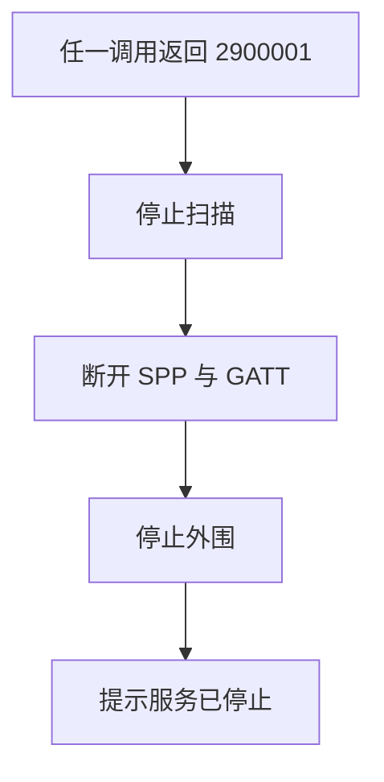
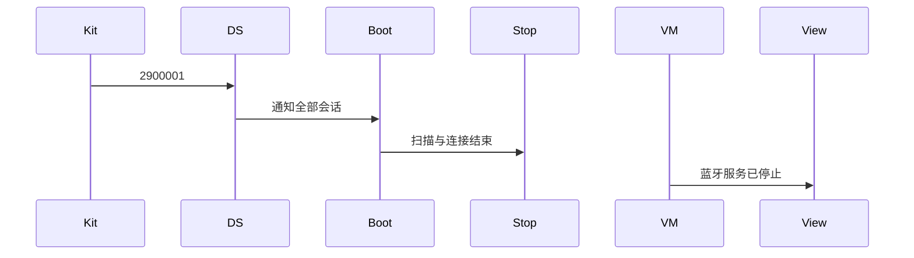
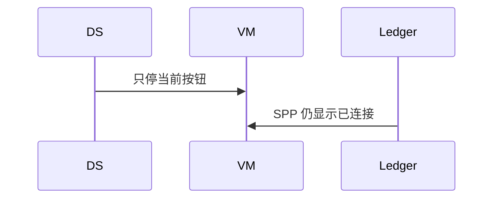

# BT-098 服务停止时全部会话结束

## 1. 条目与非目标

**判定：** 支持

**Given** 存在扫描或连接

**When** 返回 2900001

**Then** 扫描与连接都结束，提示蓝牙服务已停止

**证据：** `错误码 2900001`。行为以已接受的研究笔记和清单为准，本文件不重开行业调查。

**本条输入：** 存在扫描或连接时返回 2900001。

**本条输出：** 经典发现、BLE 扫描、SPP、GATT、广播与服务端会话都结束。提示蓝牙服务已停止。

**本条失败：** 只停一个会话，其他仍显示已连接或发现中。

**本条所有者：** 码在任一蓝牙数据源识别后，通知 `BluetoothSessionBootstrap` 或各停止用例。账本 `SppSessionLedger`、GATT 会话、扫描相位、广播与服务端相位全部收口。提示在 `BtOverviewViewModel` 与各页状态。

**非目标：**

- 不自动重启蓝牙服务。
- 不把 2900001 只当成当前按钮失败。
- 不新增 `common/yobluetooth` 以外的蓝牙栈，不增加包装层或版本兼容层。版本判断留在本条调用点。

## 2. 模块边界与分层

本组是回连、后台与诊断。依赖方向是 `product/phone` → `features/bluetooth` → `common/yobluetooth`。权限、生命周期和系统设置走 `common/platform` 与 `common/debug_core`。字节与 `Result` 走 `common/core`。日志门面走 `common/yolog`。收藏、会话记录和导出走 `common/storage`。`common/youi_kit` 只提供通用控件，不解释蓝牙状态。

**调用点：** 各数据源上报该码，收口调用已有 stop 与 disconnect，不新开监控栈。

| 包 | 类型 | 职责 |
| --- | --- | --- |
| common/yobluetooth | 数据源 | 识别 2900001 |
| common/yobluetooth | 停止扫描与断开会话用例 | 全部结束 |
| common/yobluetooth | SppSessionLedger | 不再已连接 |
| features/bluetooth | 各 ViewModel | 提示服务已停止 |
| common/platform | 长时任务 | 若在运行则取消 |

**设计前：** 一个数据源的错误只影响自己的页面，其他会话看起来还在。

**设计后：** 2900001 是全局收口。扫描、连接、外围都结束，订阅 `off`，提示同一句服务已停止。

## 3. 架构图

本组总图在 [`BT-091.md`](BT-091.md)。下图只覆盖本条。

## 4. 序列图

### 成功路径

### 错误路径

## 5. 数据模型

领域模型放在 `common/yobluetooth`，持久化模型放在 `common/storage`，平台传输对象只出现在数据源调用点，跨层用 `common/core` 的 `Result` 与 `ResultError`。错误只带类别和结构化字段，不把界面句子塞进邻层错误。

| 模型 | 所在层 | 字段 | 来源 |
| --- | --- | --- | --- |
| ResultError | 领域 | platformCode=2900001 | 服务停止 |
| 会话相位 | 领域 | 全部 idle 或 closed | 收口后 |

## 6. 层间接口

| 从 | 到 | 接口 | 成功 | 失败 |
| --- | --- | --- | --- | --- |
| 任一数据源 | 会话收口 | 2900001 | 全部停止 | 不留下发现中 |
| 收口 | LifecycleCoordinator | 取消长时任务 | 任务取消 | 不保持后台连接 |

下层不持有页面类型。结果用 `Result` 或已有观察者回传。`common/yobluetooth` 的 `Index.ets` 继续只导出用例、领域模型和必要门面，不把数据源具体类变成第二套公开栈。

## 7. 权限与生命周期

服务停止不是权限拒绝，不弹申请。

全部 `on` 被 `off`。之后的操作要等适配器再次 `STATE_ON` 且用户重新开始。

## 8. 日志

- `BtLogTag.CONN` 记录 serviceStopped=1，并记被结束的会话数。
- 领域标签加在已有 `BtLogTag`，不在 `common/yolog` 的 `YoLogTag` 里再开一套蓝牙标签。
- 日志走 `YoLog`，不在页面里直接写 hilog。

## 9. 反模式

- 收到 2900001 后立即重连。
- 只清空 UI 列表不释放套接字和 GATT 客户端。
- 用新的蓝牙 HAR、适配器或 `ApiCompat` 把本条版本差异包起来。版本判断只留在上面写明的调用点。
- 页面或 `common/youi_kit` 直接调用 `ohos.bluetooth.*`。
