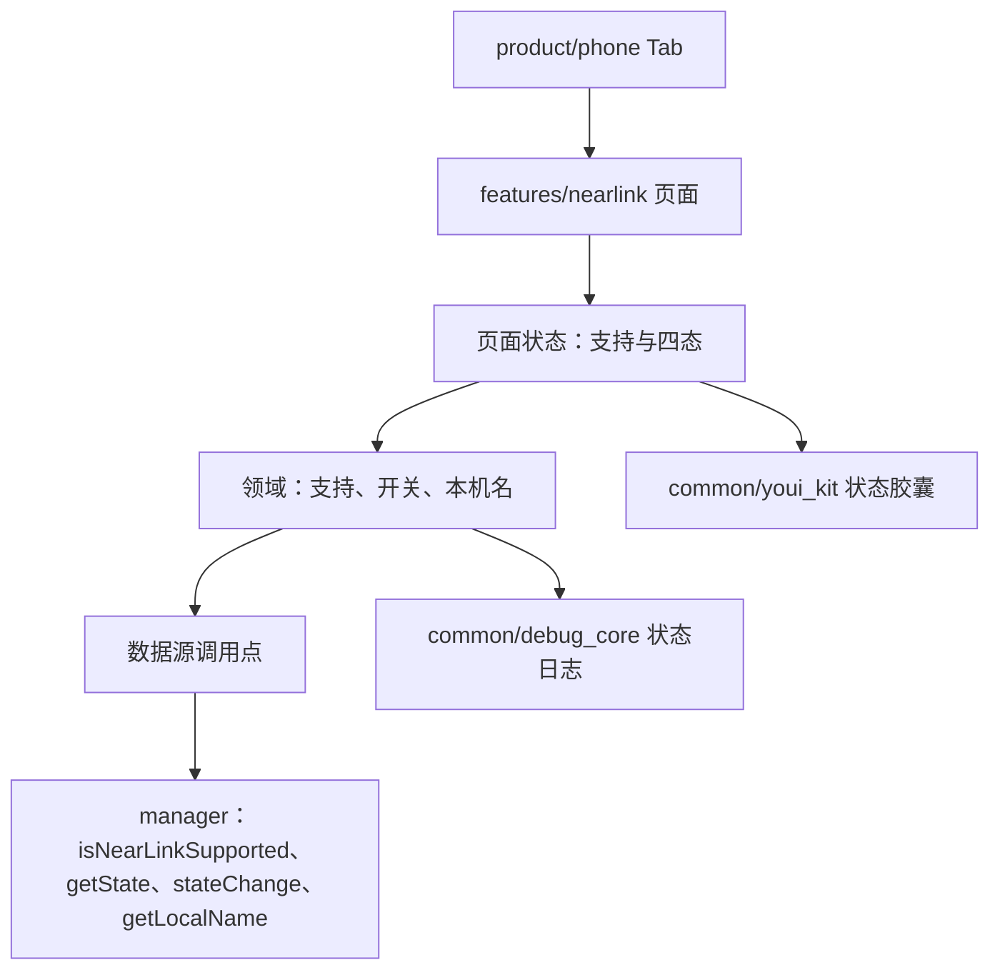
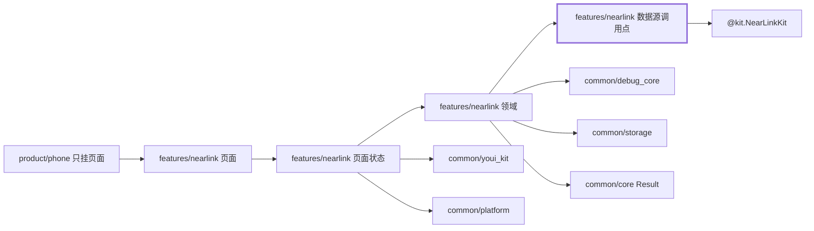
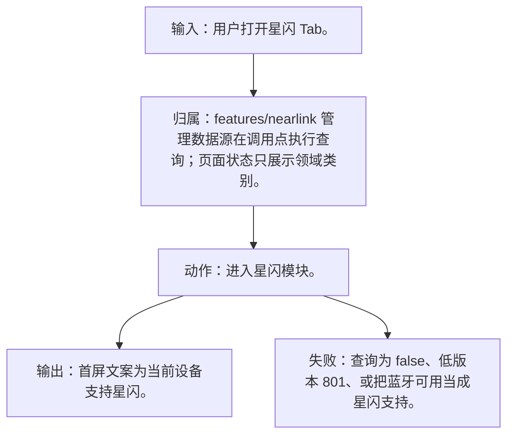
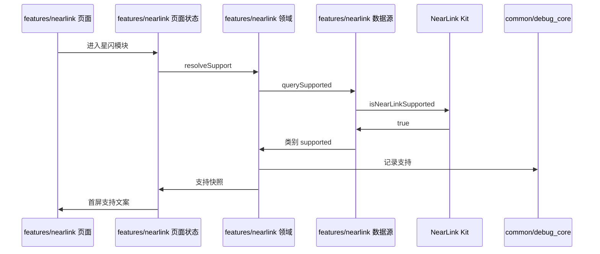
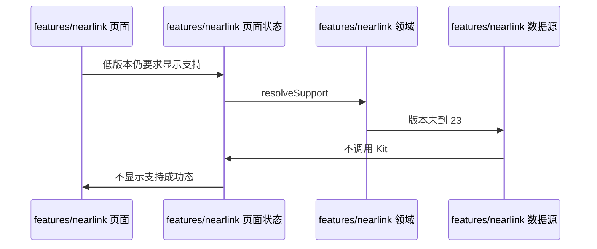

# NL-001 支持查询为真

## 1. 条目与非目标

本条属于版本门槛。达到研究笔记所记版本才在调用点调用对应接口；低于该版本时显示起始版本，并且不调用该接口，也不把未公开参数传给更低系统。

本条只判定：系统不低于 6.1.0(23) 且 `isNearLinkSupported()` 为 true 时，首屏显示当前设备支持星闪。

前置：系统不低于 6.1.0(23)，支持查询为 true。

动作：进入星闪模块。

证据：支持状态文案。

输入：用户打开星闪 Tab。

输出：首屏文案为当前设备支持星闪。

失败：查询为 false、低版本 801、或把蓝牙可用当成星闪支持。

归属：`features/nearlink` 管理数据源在调用点执行查询；页面状态只展示领域类别。

非目标：

- 不在本条打开开关，也不启动扫描。
- 不把支持结果缓存成永久能力。
- 不把星闪行为放进 `common/yobluetooth` 或 `features/bluetooth`。
- 不新增包装层、兼容层或双轨 API。版本判断若存在，只写在即将调用该接口的数据源函数里。

## 2. 模块边界与分层

设计前：`product/phone` 已把空的 `NearLinkFeaturePage` 挂到星闪 Tab。页壳不读支持查询，也不订阅 `stateChange`。`common/platform` 已有 `PlatformModuleType.NEARLINK` 与 `LifecycleCoordinator.onNearLinkSwitchChanged`，但开关事实仍未接到页面状态。

设计后：同一条用户路径按下面的包走完。下层不持有页面类型。`product/phone` 只挂载 `NearLinkFeaturePage`。`Index.ets` 不把数据源导出给壳，也不在门面里写 Kit 调用。

| 步骤 | 包与类型落点 | 本条做什么 |
| --- | --- | --- |
| 1 | product/phone | 挂载页面，不调用 manager。 |
| 2 | features/nearlink 页面状态 | 进入时请求支持快照。 |
| 3 | features/nearlink 领域 | 把布尔结果分类为已支持。 |
| 4 | features/nearlink 数据源 | 版本达到 23 才调用 `isNearLinkSupported()`。 |
| 5 | common/youi_kit | `YoStatusPill` 显示页面传入的支持文案。 |

依赖方向：页面只读页面状态；页面状态调用领域用例；领域做校验、分类和纯解析；日志进入 `common/debug_core` 的 `DebugLogRecord`；运行时痕迹进入 `common/yolog`；需要落盘的收藏、会话和导出进入 `common/storage`。`common/core` 只提供 `Result`、`AsyncSerialQueue`、`ByteUtil` 和单调时钟。需要访问 Kit 时，只在 `features/nearlink` 数据源的调用点访问 `@kit.NearLinkKit`。

替换与删除：删掉「未查询也显示支持」的页壳文案。支持只来自这一次查询。

版本门槛是研究笔记中的 6.1.0(23)。`features/nearlink` 管理数据源在调用 `isNearLinkSupported` 的同一函数内比较 `deviceInfo.sdkApiVersion`。未达到 23 时返回类别 `version_unavailable`，载荷带起始版本，不调用接口。不把该判断抽到适配类。

## 3. 架构图

本组「设备与开关」（NL-001–NL-012）的共用分层图如下。同组其他文件仍各自写本条的输入、输出、失败和归属。

本条数据链路：

## 4. 序列图

### 成功路径

### 失败路径

失败路径是本条要拦住的结果。页面用 `common/youi_kit` 的 `YoError` 或 `YoEmpty` 展示领域类别对应的文案，不把失败画成零结果的成功态。

## 5. 数据模型

领域模型 `NearLinkSupport` 只有类别 `supported` 与门槛记号 `6.1.0(23)`。Kit 布尔值在数据源边界转换，不进入页面。

领域失败只分类，放在 `features/nearlink`。类别携带结构化载荷：原生错误码、接口名、版本记号、请求 ID、字节数。用户可见句子由页面状态按类别生成，不写入 `common/core` 的 `ResultError`，也不写入 `common/youi_kit`。Kit 传输对象只活在数据源，越过边界前转成领域模型。持久化用 `common/storage` 已有记录，星闪身份放 `DeviceFavoriteRecord.attributesJson`，不新建星闪专用表。

## 6. 层间接口

- 页面状态 → 领域：`resolveSupport()` 返回 `Result`，成功载荷是 `NearLinkSupport`。
- 领域 → 数据源：`querySupported()`。
- 数据源 → Kit：`manager.isNearLinkSupported()`，仅在调用点确认 `deviceInfo.sdkApiVersion` 达到 23 之后。

数值只定义在 `features/nearlink` 的 `NearLinkConstants`。页面、日志和另一包不再抄一份。

## 7. 权限与生命周期

支持查询不使用 `ACCESS_NEARLINK`。进入模块不弹授权。

离开页面不保留「上次为 true」的完成态。下次进入重新查询。

权限编排使用 `common/platform` 的 `PermissionOrchestrator`，场景使用 `common/debug_core` 的 `PermissionScenario.NEARLINK_ACCESS`。该场景的权限列表只有 `ohos.permission.ACCESS_NEARLINK`。声明和用途字符串在 `product/phone` 的 `module.json5`（`perm_nearlink_reason`）。进入模块不调用 `ensurePermissions`。

## 8. 日志

写一条 `recordType=STATE` 的内部日志，`attributes.apiName` 为 `isNearLinkSupported`，`attributes.supported` 为 true。

统一日志是 `common/debug_core` 的 `DebugLogRecord`：`module` 为 `ModuleType.NEARLINK`，`nativeCode` 放 Kit 码，`attributes.apiName` 放接口名，`direction` 区分入、出和内部。`common/yolog` 的 `YoLog` 只记运行痕迹，标签由 `features/nearlink` 传入，星闪语义不写进 `common/yolog`。权限结果使用 `LogRecordType.PERMISSION`，不记录弹窗以外的个人信息。

## 9. 反模式

- 低于 6.1.0(23) 仍调用 `isNearLinkSupported()`。
- 用蓝牙适配器状态填星闪支持文案。
- 用 `NearLinkCompat`、版本适配器或「先调用再吞掉错误」把门槛藏起来。
- 让 `common/debug_core`、`common/platform` 或 `common/youi_kit` 直接 import `@kit.NearLinkKit`。
