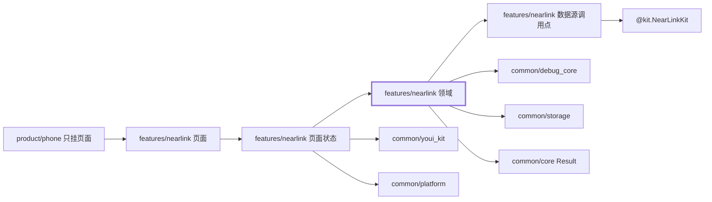
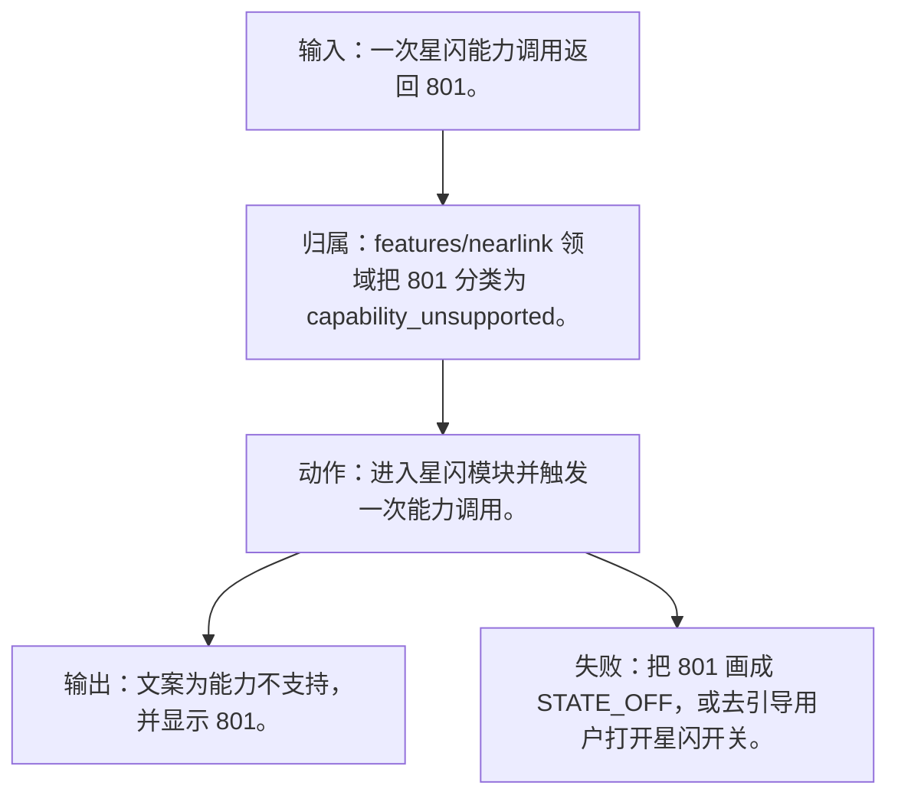
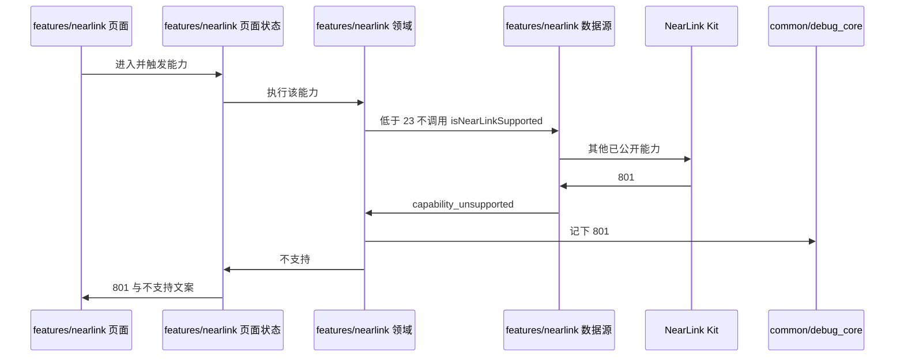
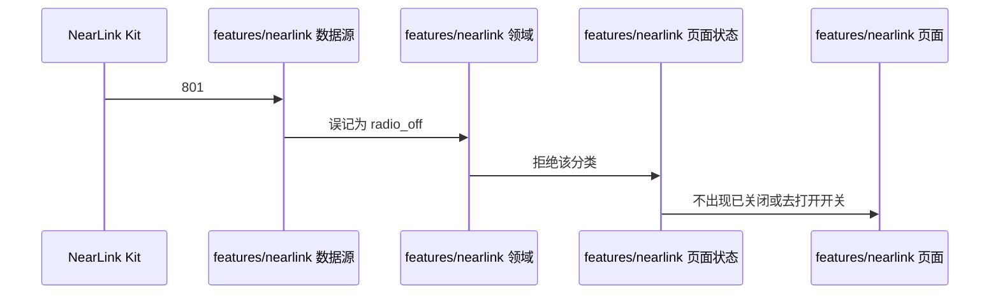

# NL-003 低版本以 801 表示不支持

## 1. 条目与非目标

本条属于版本门槛。达到研究笔记所记版本才在调用点调用对应接口；低于该版本时显示起始版本，并且不调用该接口，也不把未公开参数传给更低系统。

本条只判定：系统低于 6.1.0(23) 时，能力调用返回 801 要显示不支持，不能显示成开关关闭。

前置：系统低于 6.1.0(23)，调用星闪接口返回 801。

动作：进入星闪模块并触发一次能力调用。

证据：错误码 801 与不支持文案。

输入：一次星闪能力调用返回 801。

输出：文案为能力不支持，并显示 801。

失败：把 801 画成 `STATE_OFF`，或去引导用户打开星闪开关。

归属：`features/nearlink` 领域把 801 分类为 `capability_unsupported`。

非目标：

- 不调用只在 6.1.0(23) 才公开的 `isNearLinkSupported()`。
- 不用 801 触发设置跳转。
- 不把星闪行为放进 `common/yobluetooth` 或 `features/bluetooth`。
- 不新增包装层、兼容层或双轨 API。版本判断若存在，只写在即将调用该接口的数据源函数里。

## 2. 模块边界与分层

设计前：`product/phone` 已把空的 `NearLinkFeaturePage` 挂到星闪 Tab。页壳不读支持查询，也不订阅 `stateChange`。`common/platform` 已有 `PlatformModuleType.NEARLINK` 与 `LifecycleCoordinator.onNearLinkSwitchChanged`，但开关事实仍未接到页面状态。

设计后：同一条用户路径按下面的包走完。下层不持有页面类型。`product/phone` 只挂载 `NearLinkFeaturePage`。`Index.ets` 不把数据源导出给壳，也不在门面里写 Kit 调用。

| 步骤 | 包与类型落点 | 本条做什么 |
| --- | --- | --- |
| 1 | features/nearlink 数据源 | 低版本能力调用返回 801 时原样上交。 |
| 2 | features/nearlink 领域 | 801 与 `1009700003` 分属两个类别。 |
| 3 | features/nearlink 页面 | 展示不支持，不展示开关关闭。 |

依赖方向：页面只读页面状态；页面状态调用领域用例；领域做校验、分类和纯解析；日志进入 `common/debug_core` 的 `DebugLogRecord`；运行时痕迹进入 `common/yolog`；需要落盘的收藏、会话和导出进入 `common/storage`。`common/core` 只提供 `Result`、`AsyncSerialQueue`、`ByteUtil` 和单调时钟。需要访问 Kit 时，只在 `features/nearlink` 数据源的调用点访问 `@kit.NearLinkKit`。

替换与删除：删除「801 即关闭」的文案映射。

低于 6.1.0(23) 时，管理数据源不调用 `isNearLinkSupported()`。801 来自该版本已经存在、且本条触发的那次能力调用。调用点看到 801 就停止，不改传更高版本的参数重试。

## 3. 架构图

本组「设备与开关」的共用分层图在 [`NL-001.md`](NL-001.md)。下面两张图只画本条，链接不代替本条的输入、输出、失败和归属。

本条数据链路：

## 4. 序列图

### 成功路径

### 失败路径

失败路径是本条要拦住的结果。页面用 `common/youi_kit` 的 `YoError` 或 `YoEmpty` 展示领域类别对应的文案，不把失败画成零结果的成功态。

## 5. 数据模型

失败类别 `capability_unsupported`，载荷 `nativeCode=801`、`apiName` 为实际调用的接口。没有开关枚举。

领域失败只分类，放在 `features/nearlink`。类别携带结构化载荷：原生错误码、接口名、版本记号、请求 ID、字节数。用户可见句子由页面状态按类别生成，不写入 `common/core` 的 `ResultError`，也不写入 `common/youi_kit`。Kit 传输对象只活在数据源，越过边界前转成领域模型。持久化用 `common/storage` 已有记录，星闪身份放 `DeviceFavoriteRecord.attributesJson`，不新建星闪专用表。

## 6. 层间接口

- 数据源 → 领域：Kit 错误 801 映射为 `capability_unsupported`。
- 页面状态 → 页面：展示码 801，不用开关四态组件。

数值只定义在 `features/nearlink` 的 `NearLinkConstants`。页面、日志和另一包不再抄一份。

## 7. 权限与生命周期

这一次调用若需要权限，仍只申请星闪权限；801 本身不是 201。

收到 801 后取消本次扫描或连接订阅，避免空回调被当成正常结束。

权限编排使用 `common/platform` 的 `PermissionOrchestrator`，场景使用 `common/debug_core` 的 `PermissionScenario.NEARLINK_ACCESS`。该场景的权限列表只有 `ohos.permission.ACCESS_NEARLINK`。声明和用途字符串在 `product/phone` 的 `module.json5`（`perm_nearlink_reason`）。进入模块不调用 `ensurePermissions`。

## 8. 日志

错误日志 `nativeCode=801`，`recordType=ERROR`。不写 `STATE_OFF`。

统一日志是 `common/debug_core` 的 `DebugLogRecord`：`module` 为 `ModuleType.NEARLINK`，`nativeCode` 放 Kit 码，`attributes.apiName` 放接口名，`direction` 区分入、出和内部。`common/yolog` 的 `YoLog` 只记运行痕迹，标签由 `features/nearlink` 传入，星闪语义不写进 `common/yolog`。权限结果使用 `LogRecordType.PERMISSION`，不记录弹窗以外的个人信息。

## 9. 反模式

- 把 801 写成 `1009700003`。
- 低版本改调 `isNearLinkSupported()` 碰运气。
- 用 `NearLinkCompat`、版本适配器或「先调用再吞掉错误」把门槛藏起来。
- 让 `common/debug_core`、`common/platform` 或 `common/youi_kit` 直接 import `@kit.NearLinkKit`。
