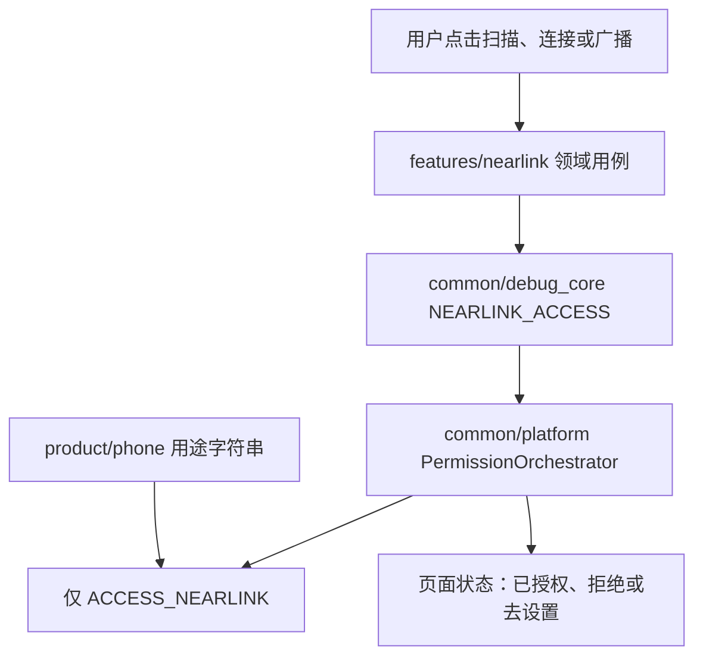
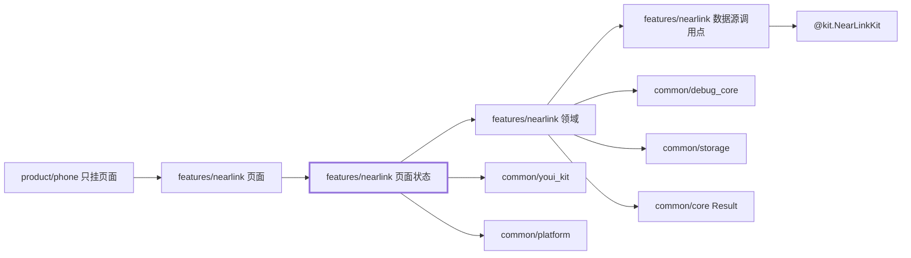
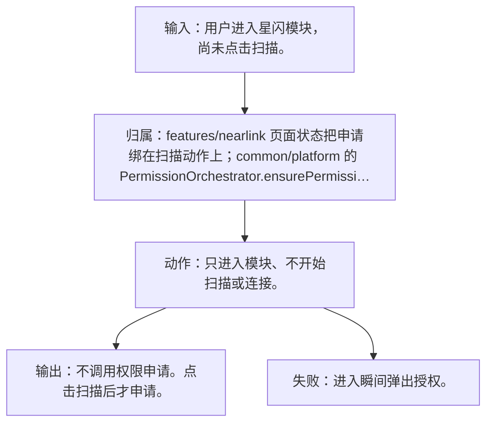
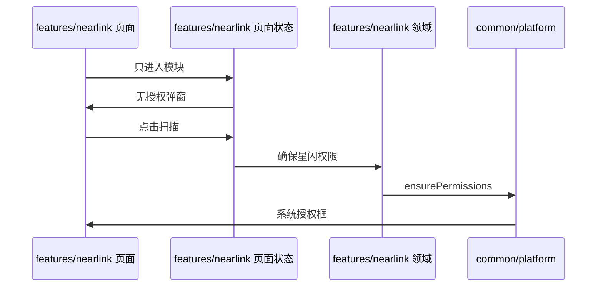
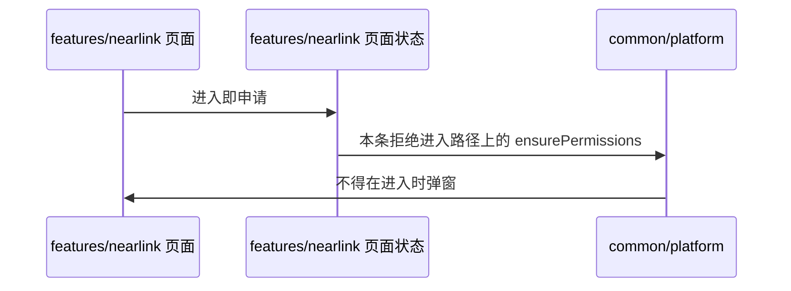

# NL-013 首次扫描才申请权限

## 1. 条目与非目标

本条属于可验收实现。通过标准是界面或日志能观察到下列结果。

本条只判定：未授权时只进入模块不弹授权；用户点击扫描后才申请。

前置：未授权 `ACCESS_NEARLINK`。

动作：只进入模块、不开始扫描或连接。

证据：进入时无授权弹窗，点击扫描后出现系统授权。

输入：用户进入星闪模块，尚未点击扫描。

输出：不调用权限申请。点击扫描后才申请。

失败：进入瞬间弹出授权。

归属：`features/nearlink` 页面状态把申请绑在扫描动作上；`common/platform` 的 `PermissionOrchestrator.ensurePermissions` 执行申请。

非目标：

- 进入、查看开关、查看说明都不申请。
- 不在 `aboutToAppear` 里申请。
- 不把星闪行为放进 `common/yobluetooth` 或 `features/bluetooth`。
- 不新增包装层、兼容层或双轨 API。版本判断若存在，只写在即将调用该接口的数据源函数里。

## 2. 模块边界与分层

设计前：`product/phone` 已在 `module.json5` 声明 `ohos.permission.ACCESS_NEARLINK`。`common/debug_core` 的 `PermissionScenario.NEARLINK_ACCESS` 只映射这一项。进入页壳时还没有按「首次扫描才申请」把申请从进入路径上拿掉。

设计后：同一条用户路径按下面的包走完。下层不持有页面类型。`product/phone` 只挂载 `NearLinkFeaturePage`。`Index.ets` 不把数据源导出给壳，也不在门面里写 Kit 调用。

| 步骤 | 包与类型落点 | 本条做什么 |
| --- | --- | --- |
| 1 | features/nearlink 页面 | 进入路径不调用用例里的申请。 |
| 2 | common/debug_core | `PermissionScenario.NEARLINK_ACCESS` 只在扫描、连接或广播动作上使用。 |
| 3 | common/platform | `ensurePermissions` 收到的列表只有星闪权限。 |

依赖方向：页面只读页面状态；页面状态调用领域用例；领域做校验、分类和纯解析；日志进入 `common/debug_core` 的 `DebugLogRecord`；运行时痕迹进入 `common/yolog`；需要落盘的收藏、会话和导出进入 `common/storage`。`common/core` 只提供 `Result`、`AsyncSerialQueue`、`ByteUtil` 和单调时钟。需要访问 Kit 时，只在 `features/nearlink` 数据源的调用点访问 `@kit.NearLinkKit`。

替换与删除：删除进入页面即 `requestPermissionsFromUser` 的路径。官方示例的进入即申请不照搬。

本条不新增版本分支。数据源只提交研究笔记已经公开的参数。

## 3. 架构图

本组「权限」（NL-013–NL-018）的共用分层图如下。同组其他文件仍各自写本条的输入、输出、失败和归属。

本条数据链路：

## 4. 序列图

### 成功路径

### 失败路径

失败路径是本条要拦住的结果。页面用 `common/youi_kit` 的 `YoError` 或 `YoEmpty` 展示领域类别对应的文案，不把失败画成零结果的成功态。

## 5. 数据模型

权限决定使用 `common/platform` 的 `PermissionDecision`。星闪领域不复制第二套授权状态机。

领域失败只分类，放在 `features/nearlink`。类别携带结构化载荷：原生错误码、接口名、版本记号、请求 ID、字节数。用户可见句子由页面状态按类别生成，不写入 `common/core` 的 `ResultError`，也不写入 `common/youi_kit`。Kit 传输对象只活在数据源，越过边界前转成领域模型。持久化用 `common/storage` 已有记录，星闪身份放 `DeviceFavoriteRecord.attributesJson`，不新建星闪专用表。

## 6. 层间接口

- 进入：页面状态不调用 `EnsurePermissionUseCase`。
- 点击扫描：领域先 `EnsurePermissionUseCase(NEARLINK_ACCESS)`，成功后才 `startScan`。

数值只定义在 `features/nearlink` 的 `NearLinkConstants`。页面、日志和另一包不再抄一份。

## 7. 权限与生命周期

申请时机就是本条。进入不申请，动作时才申请。

未点击前不订阅 `deviceFound`。

权限编排使用 `common/platform` 的 `PermissionOrchestrator`，场景使用 `common/debug_core` 的 `PermissionScenario.NEARLINK_ACCESS`。该场景的权限列表只有 `ohos.permission.ACCESS_NEARLINK`。声明和用途字符串在 `product/phone` 的 `module.json5`（`perm_nearlink_reason`）。进入模块不调用 `ensurePermissions`。

## 8. 日志

进入阶段没有 `PERMISSION` 日志。点击扫描后的结果才写入。

统一日志是 `common/debug_core` 的 `DebugLogRecord`：`module` 为 `ModuleType.NEARLINK`，`nativeCode` 放 Kit 码，`attributes.apiName` 放接口名，`direction` 区分入、出和内部。`common/yolog` 的 `YoLog` 只记运行痕迹，标签由 `features/nearlink` 传入，星闪语义不写进 `common/yolog`。权限结果使用 `LogRecordType.PERMISSION`，不记录弹窗以外的个人信息。

## 9. 反模式

- `aboutToAppear` 调用 `ensurePermissions`。
- 同时申请 `ACCESS_BLUETOOTH`。
- 用 `NearLinkCompat`、版本适配器或「先调用再吞掉错误」把门槛藏起来。
- 让 `common/debug_core`、`common/platform` 或 `common/youi_kit` 直接 import `@kit.NearLinkKit`。
