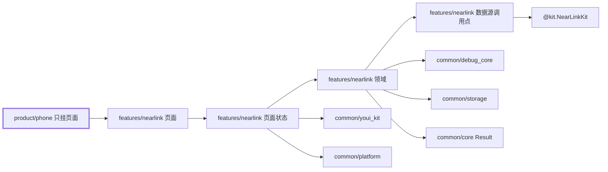
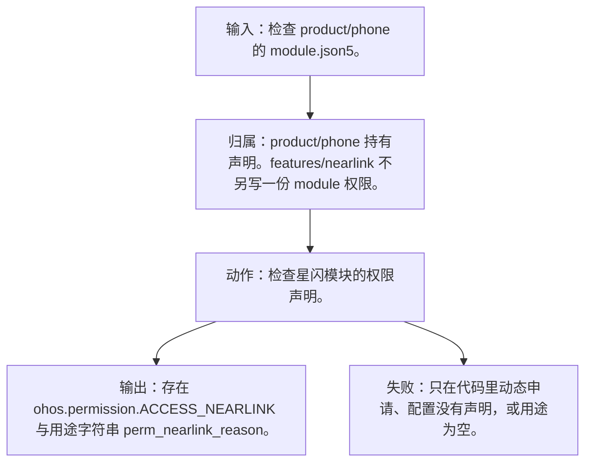
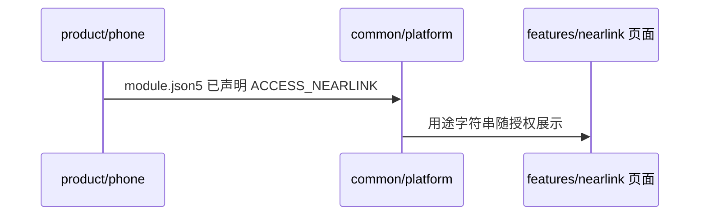
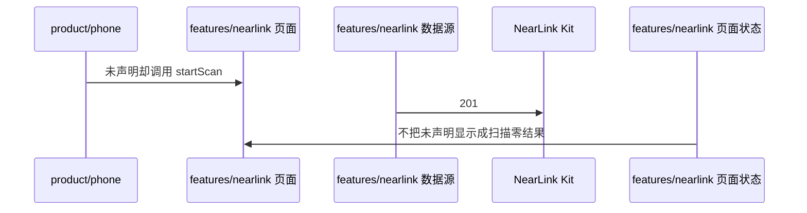

# NL-018 配置文件已声明权限

## 1. 条目与非目标

本条属于可验收实现。通过标准是界面或日志能观察到下列结果。

本条只判定：安装包声明了 `ohos.permission.ACCESS_NEARLINK`，并带有用途说明。

前置：安装包。

动作：检查星闪模块的权限声明。

证据：模块权限声明与用途字符串。

输入：检查 `product/phone` 的 `module.json5`。

输出：存在 `ohos.permission.ACCESS_NEARLINK` 与用途字符串 `perm_nearlink_reason`。

失败：只在代码里动态申请、配置没有声明，或用途为空。

归属：`product/phone` 持有声明。`features/nearlink` 不另写一份 module 权限。

非目标：

- 不把声明放到 `features/bluetooth` 的配置里。
- 不把用途字符串写进 `common/youi_kit`。
- 不把星闪行为放进 `common/yobluetooth` 或 `features/bluetooth`。
- 不新增包装层、兼容层或双轨 API。版本判断若存在，只写在即将调用该接口的数据源函数里。

## 2. 模块边界与分层

设计前：`product/phone` 已在 `module.json5` 声明 `ohos.permission.ACCESS_NEARLINK`。`common/debug_core` 的 `PermissionScenario.NEARLINK_ACCESS` 只映射这一项。进入页壳时还没有按「首次扫描才申请」把申请从进入路径上拿掉。

设计后：同一条用户路径按下面的包走完。下层不持有页面类型。`product/phone` 只挂载 `NearLinkFeaturePage`。`Index.ets` 不把数据源导出给壳，也不在门面里写 Kit 调用。

| 步骤 | 包与类型落点 | 本条做什么 |
| --- | --- | --- |
| 1 | product/phone | `module.json5` 的 requestPermissions 含星闪权限、`reason` 和 `usedScene`。 |
| 2 | common/platform | `AppPermission.ACCESS_NEARLINK` 是同一权限名的常量，不是第二份声明。 |

依赖方向：页面只读页面状态；页面状态调用领域用例；领域做校验、分类和纯解析；日志进入 `common/debug_core` 的 `DebugLogRecord`；运行时痕迹进入 `common/yolog`；需要落盘的收藏、会话和导出进入 `common/storage`。`common/core` 只提供 `Result`、`AsyncSerialQueue`、`ByteUtil` 和单调时钟。需要访问 Kit 时，只在 `features/nearlink` 数据源的调用点访问 `@kit.NearLinkKit`。

替换与删除：声明只留在手机壳的配置。HAR 不重复声明一套用户可见用途。

本条不新增版本分支。数据源只提交研究笔记已经公开的参数。

## 3. 架构图

本组「权限」的共用分层图在 [`NL-013.md`](NL-013.md)。下面两张图只画本条，链接不代替本条的输入、输出、失败和归属。

本条数据链路：

## 4. 序列图

### 成功路径

### 失败路径

失败路径是本条要拦住的结果。页面用 `common/youi_kit` 的 `YoError` 或 `YoEmpty` 展示领域类别对应的文案，不把失败画成零结果的成功态。

## 5. 数据模型

无运行时模型。常量字符串与配置里的权限名一致，定义在 `common/platform` 的 `AppPermission`。

领域失败只分类，放在 `features/nearlink`。类别携带结构化载荷：原生错误码、接口名、版本记号、请求 ID、字节数。用户可见句子由页面状态按类别生成，不写入 `common/core` 的 `ResultError`，也不写入 `common/youi_kit`。Kit 传输对象只活在数据源，越过边界前转成领域模型。持久化用 `common/storage` 已有记录，星闪身份放 `DeviceFavoriteRecord.attributesJson`，不新建星闪专用表。

## 6. 层间接口

- 壳配置中的 `name` 等于 `AppPermission.ACCESS_NEARLINK`。
- `usedScene.abilities` 使用真实的 `EntryAbility`，不照抄示例里的 `EntryFormAbility`。

数值只定义在 `features/nearlink` 的 `NearLinkConstants`。页面、日志和另一包不再抄一份。

## 7. 权限与生命周期

声明是安装期事实。运行时申请仍遵守首次动作才弹窗。

无订阅。

权限编排使用 `common/platform` 的 `PermissionOrchestrator`，场景使用 `common/debug_core` 的 `PermissionScenario.NEARLINK_ACCESS`。该场景的权限列表只有 `ohos.permission.ACCESS_NEARLINK`。声明和用途字符串在 `product/phone` 的 `module.json5`（`perm_nearlink_reason`）。进入模块不调用 `ensurePermissions`。

## 8. 日志

本条不产生会话日志。缺声明时应用无法进入授权，不伪装成扫描成功。

统一日志是 `common/debug_core` 的 `DebugLogRecord`：`module` 为 `ModuleType.NEARLINK`，`nativeCode` 放 Kit 码，`attributes.apiName` 放接口名，`direction` 区分入、出和内部。`common/yolog` 的 `YoLog` 只记运行痕迹，标签由 `features/nearlink` 传入，星闪语义不写进 `common/yolog`。权限结果使用 `LogRecordType.PERMISSION`，不记录弹窗以外的个人信息。

## 9. 反模式

- 复制官方示例的错误 Ability 名。
- 在 `common/yobluetooth` 再声明一次星闪权限。
- 用 `NearLinkCompat`、版本适配器或「先调用再吞掉错误」把门槛藏起来。
- 让 `common/debug_core`、`common/platform` 或 `common/youi_kit` 直接 import `@kit.NearLinkKit`。
