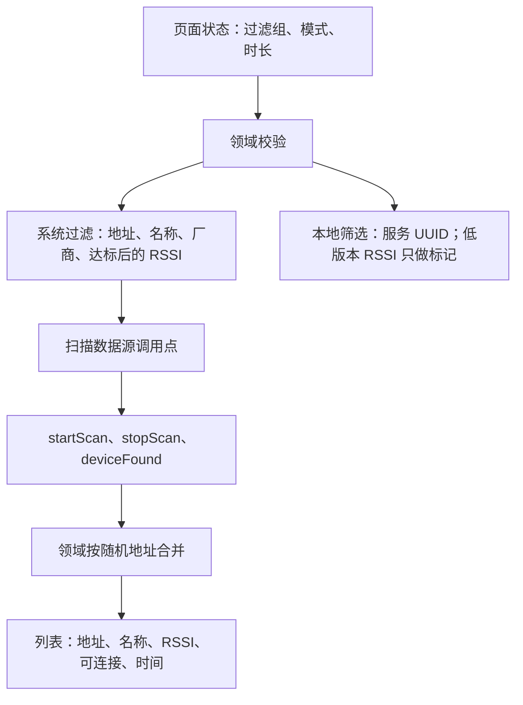
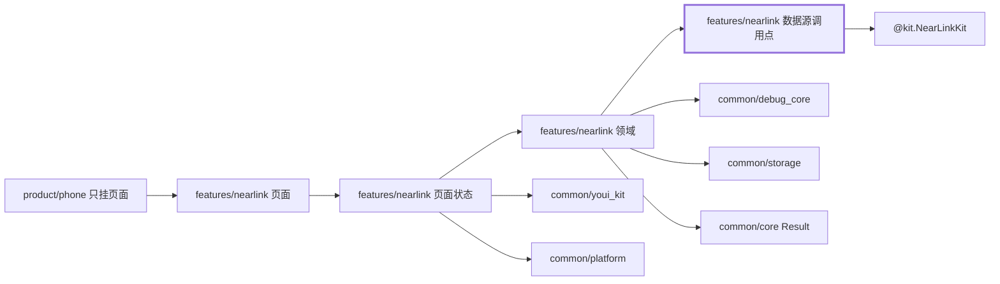
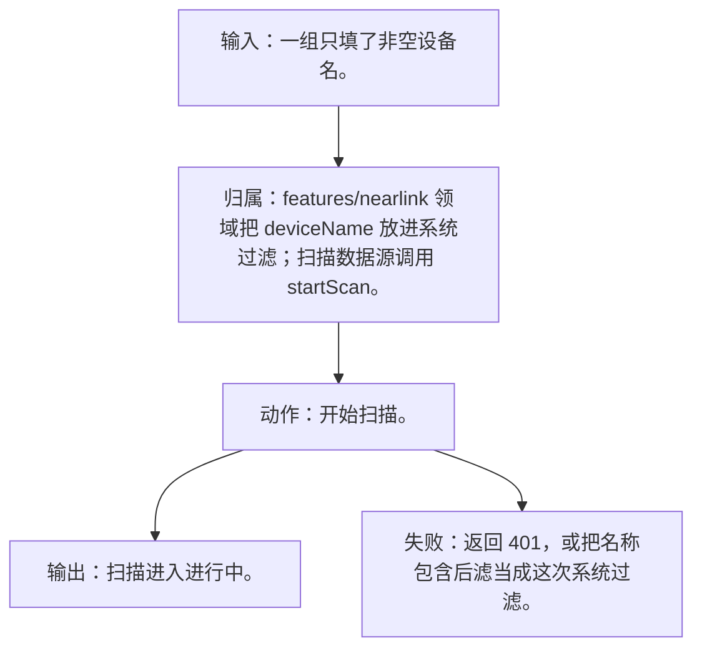
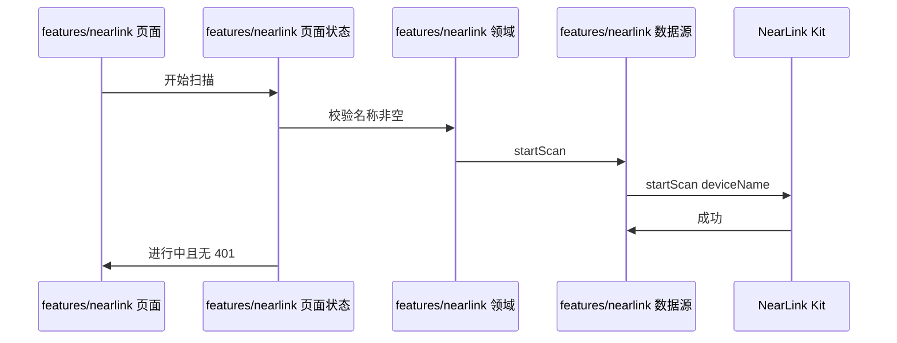
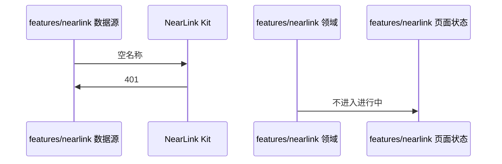

# NL-019 非空名称过滤能启动

## 1. 条目与非目标

本条属于可验收实现。通过标准是界面或日志能观察到下列结果。

本条只判定：过滤组仅含非空 `deviceName` 时，扫描能启动且不返回 401。

前置：已授权，星闪打开，过滤组仅含非空 `deviceName`。

动作：开始扫描。

证据：进行中状态，且无 401。

输入：一组只填了非空设备名。

输出：扫描进入进行中。

失败：返回 401，或把名称包含后滤当成这次系统过滤。

归属：`features/nearlink` 领域把 `deviceName` 放进系统过滤；扫描数据源调用 `startScan`。

非目标：

- 不把「名称包含」本地规则写成 Kit 的 `deviceName`。
- 名称长度上限 30，常量在 `NearLinkConstants`。
- 不把星闪行为放进 `common/yobluetooth` 或 `features/bluetooth`。
- 不新增包装层、兼容层或双轨 API。版本判断若存在，只写在即将调用该接口的数据源函数里。

## 2. 模块边界与分层

设计前：`features/nearlink` 的 `NearLinkScanMode` 仍含文档没有的 `LOW_LATENCY`，默认模式也不是低功耗。名称包含后滤与 Kit 的 `deviceName` 系统过滤写在同一个模型里。空过滤的版本判断已经在 `NearLinkScanDataSource` 调用点，这个位置保留，不抽成适配器。

设计后：同一条用户路径按下面的包走完。下层不持有页面类型。`product/phone` 只挂载 `NearLinkFeaturePage`。`Index.ets` 不把数据源导出给壳，也不在门面里写 Kit 调用。

| 步骤 | 包与类型落点 | 本条做什么 |
| --- | --- | --- |
| 1 | features/nearlink 领域 | 系统过滤字段只有地址、名称、厂商数据及掩码，外加达标版本的 RSSI。 |
| 2 | features/nearlink 数据源 | 映射为 `ScanFilters.deviceName` 后调用 `startScan`。 |

依赖方向：页面只读页面状态；页面状态调用领域用例；领域做校验、分类和纯解析；日志进入 `common/debug_core` 的 `DebugLogRecord`；运行时痕迹进入 `common/yolog`；需要落盘的收藏、会话和导出进入 `common/storage`。`common/core` 只提供 `Result`、`AsyncSerialQueue`、`ByteUtil` 和单调时钟。需要访问 Kit 时，只在 `features/nearlink` 数据源的调用点访问 `@kit.NearLinkKit`。

替换与删除：删除领域枚举里的 `LOW_LATENCY`。默认扫描模式改为低功耗。名称包含不再走系统过滤失败码。

本条不新增版本分支。数据源只提交研究笔记已经公开的参数。

## 3. 架构图

本组「扫描与过滤」（NL-019–NL-040）的共用分层图如下。同组其他文件仍各自写本条的输入、输出、失败和归属。

本条数据链路：

## 4. 序列图

### 成功路径

### 失败路径

失败路径是本条要拦住的结果。页面用 `common/youi_kit` 的 `YoError` 或 `YoEmpty` 展示领域类别对应的文案，不把失败画成零结果的成功态。

## 5. 数据模型

系统过滤模型 `NearLinkSystemFilter` 的 `deviceName` 非空。本地后滤模型分开，本条不用它。

领域失败只分类，放在 `features/nearlink`。类别携带结构化载荷：原生错误码、接口名、版本记号、请求 ID、字节数。用户可见句子由页面状态按类别生成，不写入 `common/core` 的 `ResultError`，也不写入 `common/youi_kit`。Kit 传输对象只活在数据源，越过边界前转成领域模型。持久化用 `common/storage` 已有记录，星闪身份放 `DeviceFavoriteRecord.attributesJson`，不新建星闪专用表。

## 6. 层间接口

- 页面状态 → 领域：`startScan(systemFilters)`。
- 数据源 → Kit：`scan.startScan`，过滤数组一项，仅 `deviceName`。

数值只定义在 `features/nearlink` 的 `NearLinkConstants`。页面、日志和另一包不再抄一份。

## 7. 权限与生命周期

已授权才进入本条。

先订阅 `deviceFound` 再启动。重复订阅由后续条目禁止。

权限编排使用 `common/platform` 的 `PermissionOrchestrator`，场景使用 `common/debug_core` 的 `PermissionScenario.NEARLINK_ACCESS`。该场景的权限列表只有 `ohos.permission.ACCESS_NEARLINK`。声明和用途字符串在 `product/phone` 的 `module.json5`（`perm_nearlink_reason`）。进入模块不调用 `ensurePermissions`。

## 8. 日志

开始日志含接口名 `startScan`，无 `nativeCode=401`。

统一日志是 `common/debug_core` 的 `DebugLogRecord`：`module` 为 `ModuleType.NEARLINK`，`nativeCode` 放 Kit 码，`attributes.apiName` 放接口名，`direction` 区分入、出和内部。`common/yolog` 的 `YoLog` 只记运行痕迹，标签由 `features/nearlink` 传入，星闪语义不写进 `common/yolog`。权限结果使用 `LogRecordType.PERMISSION`，不记录弹窗以外的个人信息。

## 9. 反模式

- 空名称也调用并指望成功。
- 把本地「包含」失败记成 401。
- 用 `NearLinkCompat`、版本适配器或「先调用再吞掉错误」把门槛藏起来。
- 让 `common/debug_core`、`common/platform` 或 `common/youi_kit` 直接 import `@kit.NearLinkKit`。
