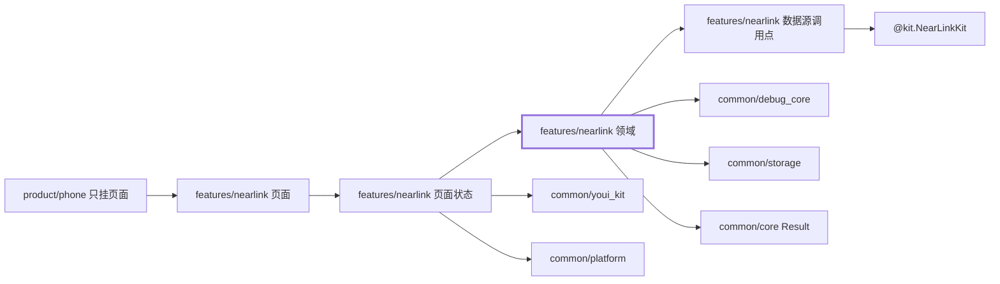
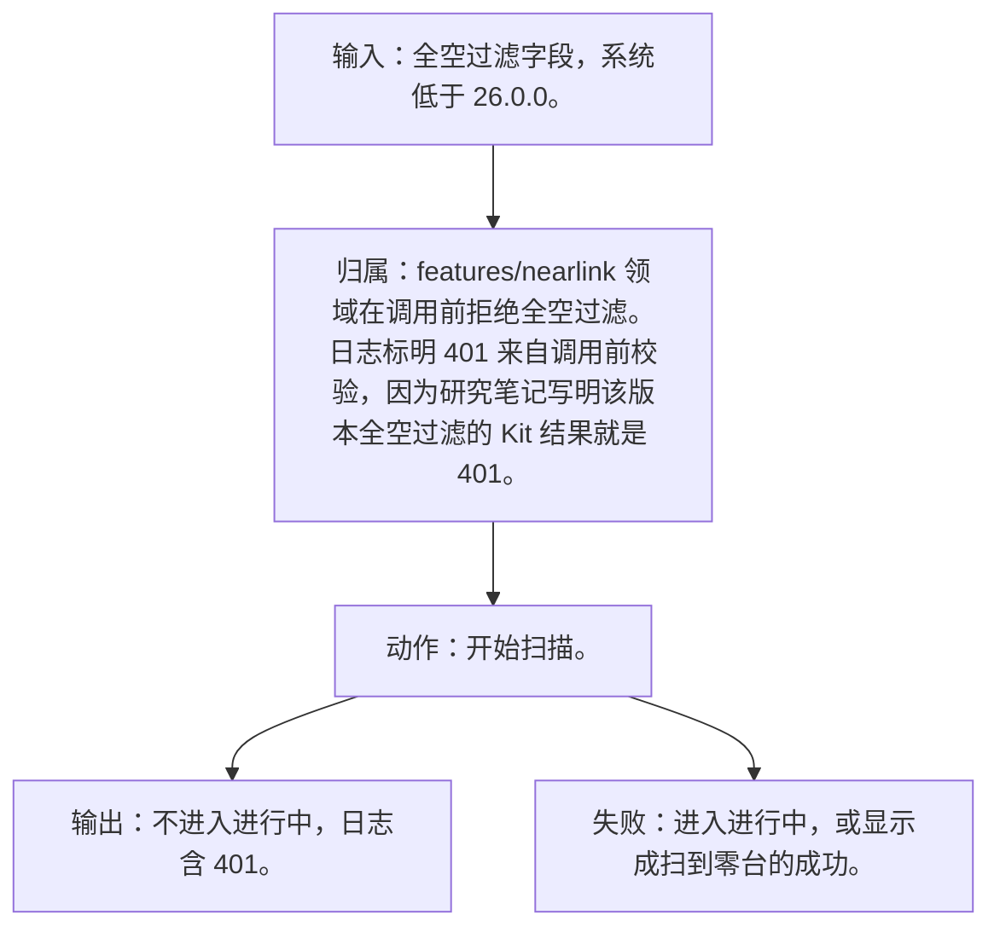
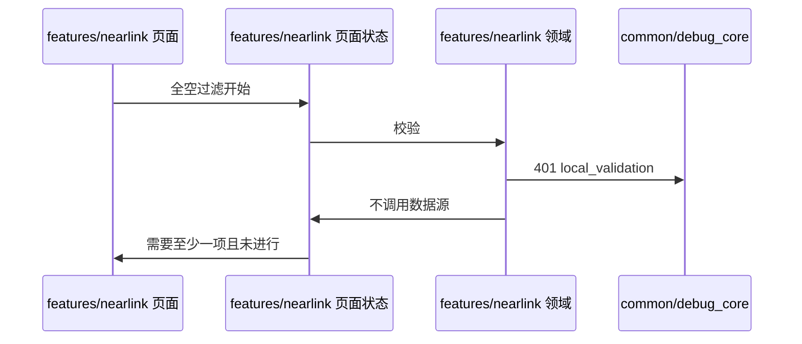
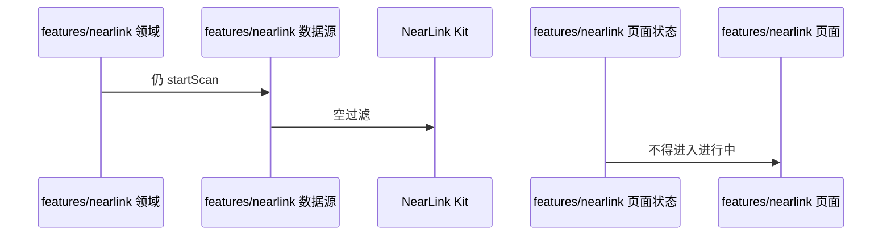

# NL-022 5.0.1 全空过滤被拒绝

## 1. 条目与非目标

本条属于可验收实现。通过标准是界面或日志能观察到下列结果。

本条只判定：目标系统低于 26.0.0 且所有过滤字段为空时，不启动扫描，提示至少一项过滤，日志含 401。

前置：系统低于 26.0.0，所有过滤字段为空。

动作：开始扫描。

证据：401 与未进入进行中。

输入：全空过滤字段，系统低于 26.0.0。

输出：不进入进行中，日志含 401。

失败：进入进行中，或显示成扫到零台的成功。

归属：`features/nearlink` 领域在调用前拒绝全空过滤。日志标明 401 来自调用前校验，因为研究笔记写明该版本全空过滤的 Kit 结果就是 401。

非目标：

- 不调用 `startScan(null)`。那是另一条版本门槛。
- 不把星闪行为放进 `common/yobluetooth` 或 `features/bluetooth`。
- 不新增包装层、兼容层或双轨 API。版本判断若存在，只写在即将调用该接口的数据源函数里。

## 2. 模块边界与分层

设计前：`features/nearlink` 的 `NearLinkScanMode` 仍含文档没有的 `LOW_LATENCY`，默认模式也不是低功耗。名称包含后滤与 Kit 的 `deviceName` 系统过滤写在同一个模型里。空过滤的版本判断已经在 `NearLinkScanDataSource` 调用点，这个位置保留，不抽成适配器。

设计后：同一条用户路径按下面的包走完。下层不持有页面类型。`product/phone` 只挂载 `NearLinkFeaturePage`。`Index.ets` 不把数据源导出给壳，也不在门面里写 Kit 调用。

| 步骤 | 包与类型落点 | 本条做什么 |
| --- | --- | --- |
| 1 | features/nearlink 领域 | 全空则类别 `invalid_parameter`，载荷 401，`attributes.source=local_validation`。 |
| 2 | features/nearlink 数据源 | 此路径不被调用。 |

依赖方向：页面只读页面状态；页面状态调用领域用例；领域做校验、分类和纯解析；日志进入 `common/debug_core` 的 `DebugLogRecord`；运行时痕迹进入 `common/yolog`；需要落盘的收藏、会话和导出进入 `common/storage`。`common/core` 只提供 `Result`、`AsyncSerialQueue`、`ByteUtil` 和单调时钟。需要访问 Kit 时，只在 `features/nearlink` 数据源的调用点访问 `@kit.NearLinkKit`。

替换与删除：删除全空仍 `startScan` 并把空列表当成功的路径。

本条不新增版本分支。数据源只提交研究笔记已经公开的参数。

## 3. 架构图

本组「扫描与过滤」的共用分层图在 [`NL-019.md`](NL-019.md)。下面两张图只画本条，链接不代替本条的输入、输出、失败和归属。

本条数据链路：

## 4. 序列图

### 成功路径

### 失败路径

失败路径是本条要拦住的结果。页面用 `common/youi_kit` 的 `YoError` 或 `YoEmpty` 展示领域类别对应的文案，不把失败画成零结果的成功态。

## 5. 数据模型

类别 `invalid_parameter`，`nativeCode=401`，`apiName=startScan`。不伪造一次已经返回的 Kit 往返对象。

领域失败只分类，放在 `features/nearlink`。类别携带结构化载荷：原生错误码、接口名、版本记号、请求 ID、字节数。用户可见句子由页面状态按类别生成，不写入 `common/core` 的 `ResultError`，也不写入 `common/youi_kit`。Kit 传输对象只活在数据源，越过边界前转成领域模型。持久化用 `common/storage` 已有记录，星闪身份放 `DeviceFavoriteRecord.attributesJson`，不新建星闪专用表。

## 6. 层间接口

- 领域 → 页面状态：拒绝，不调用数据源。
- 领域 → 日志：401 与 `source=local_validation`。

数值只定义在 `features/nearlink` 的 `NearLinkConstants`。页面、日志和另一包不再抄一份。

## 7. 权限与生命周期

已授权也不能越过全空校验。

不订阅 `deviceFound`。

权限编排使用 `common/platform` 的 `PermissionOrchestrator`，场景使用 `common/debug_core` 的 `PermissionScenario.NEARLINK_ACCESS`。该场景的权限列表只有 `ohos.permission.ACCESS_NEARLINK`。声明和用途字符串在 `product/phone` 的 `module.json5`（`perm_nearlink_reason`）。进入模块不调用 `ensurePermissions`。

## 8. 日志

错误日志含 401、接口名和来源是调用前校验。

统一日志是 `common/debug_core` 的 `DebugLogRecord`：`module` 为 `ModuleType.NEARLINK`，`nativeCode` 放 Kit 码，`attributes.apiName` 放接口名，`direction` 区分入、出和内部。`common/yolog` 的 `YoLog` 只记运行痕迹，标签由 `features/nearlink` 传入，星闪语义不写进 `common/yolog`。权限结果使用 `LogRecordType.PERMISSION`，不记录弹窗以外的个人信息。

## 9. 反模式

- 调用 `startScan(null)` 碰 26.0.0 的新语义。
- 把 401 显示成零台设备。
- 用 `NearLinkCompat`、版本适配器或「先调用再吞掉错误」把门槛藏起来。
- 让 `common/debug_core`、`common/platform` 或 `common/youi_kit` 直接 import `@kit.NearLinkKit`。
