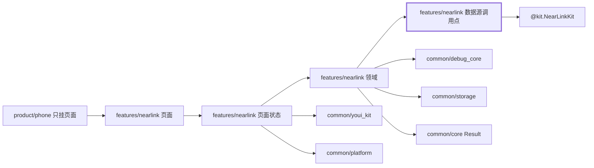
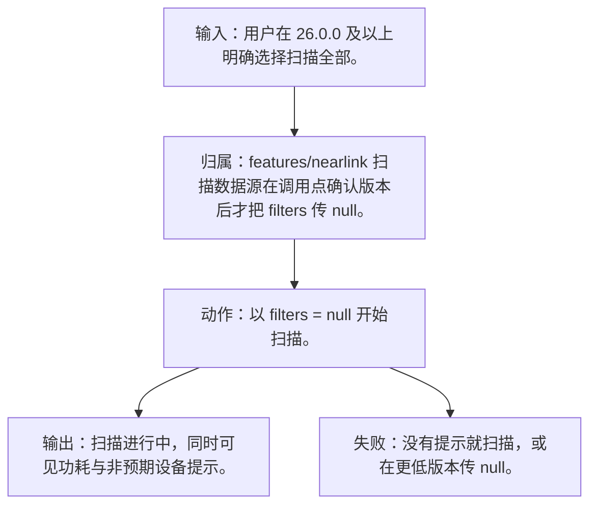
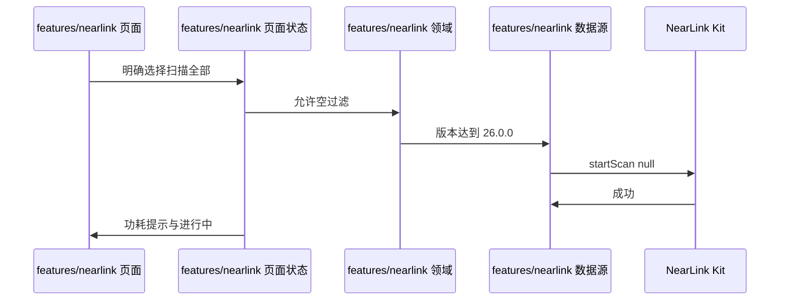
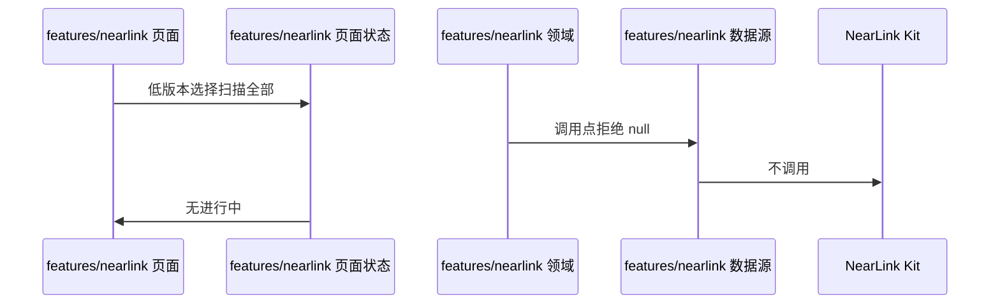

# NL-023 26.0.0 允许空过滤并提示功耗

## 1. 条目与非目标

本条属于版本门槛。达到研究笔记所记版本才在调用点调用对应接口；低于该版本时显示起始版本，并且不调用该接口，也不把未公开参数传给更低系统。

本条只判定：系统不低于 26.0.0 且用户明确选择扫描全部时，可以 `filters = null` 启动，并提示可能扫到非预期设备并增加功耗。

前置：系统不低于 26.0.0，用户明确选择扫描全部可见设备。

动作：以 `filters = null` 开始扫描。

证据：提示文案与进行中状态。

输入：用户在 26.0.0 及以上明确选择扫描全部。

输出：扫描进行中，同时可见功耗与非预期设备提示。

失败：没有提示就扫描，或在更低版本传 null。

归属：`features/nearlink` 扫描数据源在调用点确认版本后才把 `filters` 传 null。

非目标：

- 不把「扫描全部」做成默认。
- 用户未明确选择时仍要求过滤。
- 不把星闪行为放进 `common/yobluetooth` 或 `features/bluetooth`。
- 不新增包装层、兼容层或双轨 API。版本判断若存在，只写在即将调用该接口的数据源函数里。

## 2. 模块边界与分层

设计前：`features/nearlink` 的 `NearLinkScanMode` 仍含文档没有的 `LOW_LATENCY`，默认模式也不是低功耗。名称包含后滤与 Kit 的 `deviceName` 系统过滤写在同一个模型里。空过滤的版本判断已经在 `NearLinkScanDataSource` 调用点，这个位置保留，不抽成适配器。

设计后：同一条用户路径按下面的包走完。下层不持有页面类型。`product/phone` 只挂载 `NearLinkFeaturePage`。`Index.ets` 不把数据源导出给壳，也不在门面里写 Kit 调用。

| 步骤 | 包与类型落点 | 本条做什么 |
| --- | --- | --- |
| 1 | features/nearlink 页面 | 明确动作才带上扫描全部，并显示功耗提示。 |
| 2 | features/nearlink 数据源 | 版本达到后调用 `startScan(null)`。 |

依赖方向：页面只读页面状态；页面状态调用领域用例；领域做校验、分类和纯解析；日志进入 `common/debug_core` 的 `DebugLogRecord`；运行时痕迹进入 `common/yolog`；需要落盘的收藏、会话和导出进入 `common/storage`。`common/core` 只提供 `Result`、`AsyncSerialQueue`、`ByteUtil` 和单调时钟。需要访问 Kit 时，只在 `features/nearlink` 数据源的调用点访问 `@kit.NearLinkKit`。

替换与删除：删除低版本也传 null 的分支。不设兼容包装，调用点写版本判断。

调用点用 `deviceInfo.sdkApiVersion` 对照研究笔记的 26.0.0。未达到时不执行 `startScan(null)`，改走 NL-024 的版本说明。判断写在 `startScan` 同一函数内。

## 3. 架构图

本组「扫描与过滤」的共用分层图在 [`NL-019.md`](NL-019.md)。下面两张图只画本条，链接不代替本条的输入、输出、失败和归属。

本条数据链路：

## 4. 序列图

### 成功路径

### 失败路径

失败路径是本条要拦住的结果。页面用 `common/youi_kit` 的 `YoError` 或 `YoEmpty` 展示领域类别对应的文案，不把失败画成零结果的成功态。

## 5. 数据模型

领域标记 `allowEmptySystemFilter=true` 只在用户明确选择且版本达标时为真。提示文案在页面，不进错误类型。

领域失败只分类，放在 `features/nearlink`。类别携带结构化载荷：原生错误码、接口名、版本记号、请求 ID、字节数。用户可见句子由页面状态按类别生成，不写入 `common/core` 的 `ResultError`，也不写入 `common/youi_kit`。Kit 传输对象只活在数据源，越过边界前转成领域模型。持久化用 `common/storage` 已有记录，星闪身份放 `DeviceFavoriteRecord.attributesJson`，不新建星闪专用表。

## 6. 层间接口

- 数据源 → Kit：`startScan` 的 filters 为 null，仅此条件。

数值只定义在 `features/nearlink` 的 `NearLinkConstants`。页面、日志和另一包不再抄一份。

## 7. 权限与生命周期

仍需星闪权限。

订阅后启动。离开仍要停止。

权限编排使用 `common/platform` 的 `PermissionOrchestrator`，场景使用 `common/debug_core` 的 `PermissionScenario.NEARLINK_ACCESS`。该场景的权限列表只有 `ohos.permission.ACCESS_NEARLINK`。声明和用途字符串在 `product/phone` 的 `module.json5`（`perm_nearlink_reason`）。进入模块不调用 `ensurePermissions`。

## 8. 日志

开始日志 `attributes.filters=null`，并记版本记号 26.0.0。

统一日志是 `common/debug_core` 的 `DebugLogRecord`：`module` 为 `ModuleType.NEARLINK`，`nativeCode` 放 Kit 码，`attributes.apiName` 放接口名，`direction` 区分入、出和内部。`common/yolog` 的 `YoLog` 只记运行痕迹，标签由 `features/nearlink` 传入，星闪语义不写进 `common/yolog`。权限结果使用 `LogRecordType.PERMISSION`，不记录弹窗以外的个人信息。

## 9. 反模式

- 低于 26.0.0 传 null。
- 不提示功耗就显示进行中。
- 用 `NearLinkCompat`、版本适配器或「先调用再吞掉错误」把门槛藏起来。
- 让 `common/debug_core`、`common/platform` 或 `common/youi_kit` 直接 import `@kit.NearLinkKit`。
