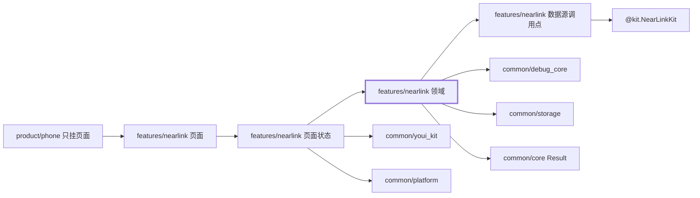
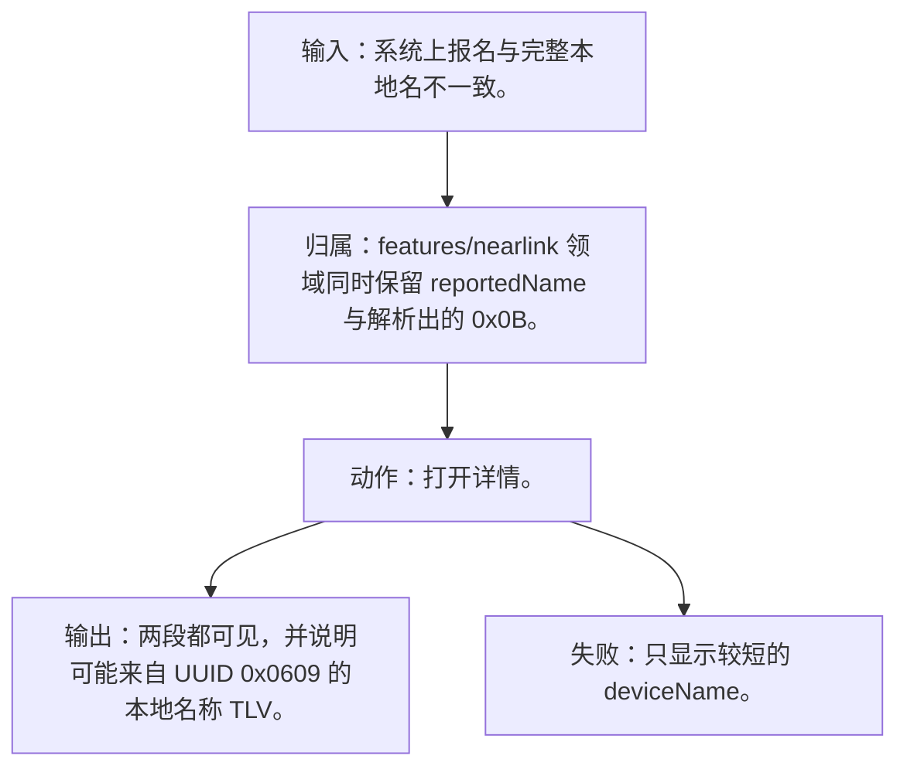
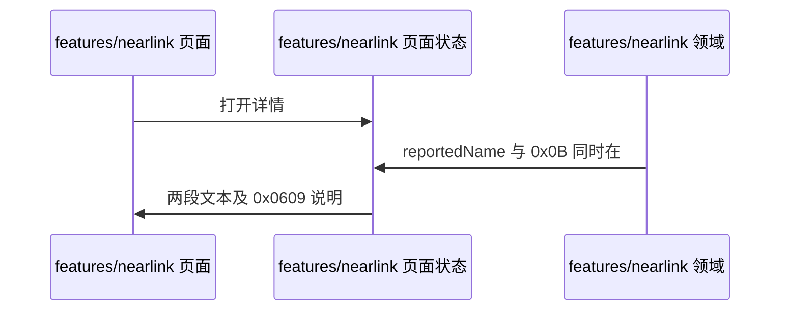
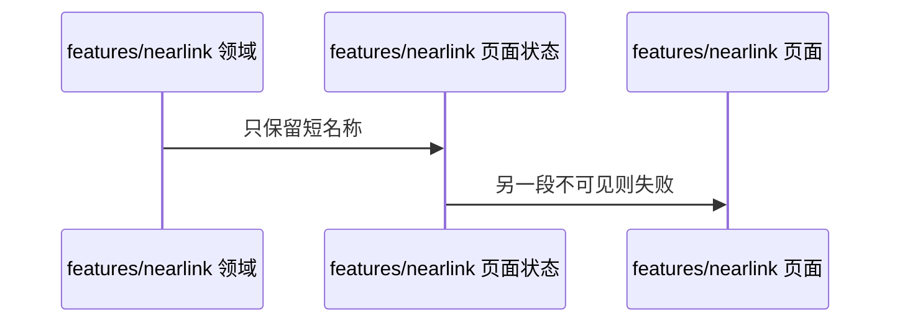

# NL-044 名称字段与 0x0B 不一致

## 1. 条目与非目标

本条属于可验收实现。通过标准是界面或日志能观察到下列结果。

本条只判定：`deviceName` 短于 `0x0B`，或服务数据 TLV 把名称截成 9 字节时，两套名称同时可见，并说明系统上报名可能来自设备信息管理服务的本地名称 TLV。

前置：`deviceName` 与 `0x0B` 不一致，或名称被截成 9 字节。

动作：打开详情。

证据：两段文本都在详情中。

输入：系统上报名与完整本地名不一致。

输出：两段都可见，并说明可能来自 UUID `0x0609` 的本地名称 TLV。

失败：只显示较短的 `deviceName`。

归属：`features/nearlink` 领域同时保留 `reportedName` 与解析出的 `0x0B`。

非目标：

- 不把 9 字节截断自动补全。
- 不把星闪行为放进 `common/yobluetooth` 或 `features/bluetooth`。
- 不新增包装层、兼容层或双轨 API。版本判断若存在，只写在即将调用该接口的数据源函数里。

## 2. 模块边界与分层

设计前：扫描结果里的 `data` 还没有稳定地变成详情字段。收藏若只存一次地址，映射清除后会认错设备。`common/storage` 已有 `DeviceFavoriteRecord`，星闪不应另造收藏表。

设计后：同一条用户路径按下面的包走完。下层不持有页面类型。`product/phone` 只挂载 `NearLinkFeaturePage`。`Index.ets` 不把数据源导出给壳，也不在门面里写 Kit 调用。

| 步骤 | 包与类型落点 | 本条做什么 |
| --- | --- | --- |
| 1 | features/nearlink 领域 | 比较两段字符串，不一致则两个字段都留下。 |
| 2 | features/nearlink 页面 | 说明服务数据可能覆盖完整名。 |

依赖方向：页面只读页面状态；页面状态调用领域用例；领域做校验、分类和纯解析；日志进入 `common/debug_core` 的 `DebugLogRecord`；运行时痕迹进入 `common/yolog`；需要落盘的收藏、会话和导出进入 `common/storage`。`common/core` 只提供 `Result`、`AsyncSerialQueue`、`ByteUtil` 和单调时钟。需要访问 Kit 时，只在 `features/nearlink` 数据源的调用点访问 `@kit.NearLinkKit`。

替换与删除：删除不一致时只留 `deviceName` 的路径。

本条不新增版本分支。数据源只提交研究笔记已经公开的参数。

## 3. 架构图

本组「广播解析与身份」的共用分层图在 [`NL-041.md`](NL-041.md)。下面两张图只画本条，链接不代替本条的输入、输出、失败和归属。

本条数据链路：

## 4. 序列图

### 成功路径

### 失败路径

失败路径是本条要拦住的结果。页面用 `common/youi_kit` 的 `YoError` 或 `YoEmpty` 展示领域类别对应的文案，不把失败画成零结果的成功态。

## 5. 数据模型

行上 `reportedName` 与 TLV `completeLocalName` 独立。说明指向服务 UUID `0x0609`，这是广播内容，不是 `getDeviceInformation`。

领域失败只分类，放在 `features/nearlink`。类别携带结构化载荷：原生错误码、接口名、版本记号、请求 ID、字节数。用户可见句子由页面状态按类别生成，不写入 `common/core` 的 `ResultError`，也不写入 `common/youi_kit`。Kit 传输对象只活在数据源，越过边界前转成领域模型。持久化用 `common/storage` 已有记录，星闪身份放 `DeviceFavoriteRecord.attributesJson`，不新建星闪专用表。

## 6. 层间接口

- 解析器输出两字段。页面不得取较短者覆盖。

数值只定义在 `features/nearlink` 的 `NearLinkConstants`。页面、日志和另一包不再抄一份。

## 7. 权限与生命周期

无权限。

无订阅。

权限编排使用 `common/platform` 的 `PermissionOrchestrator`，场景使用 `common/debug_core` 的 `PermissionScenario.NEARLINK_ACCESS`。该场景的权限列表只有 `ohos.permission.ACCESS_NEARLINK`。声明和用途字符串在 `product/phone` 的 `module.json5`（`perm_nearlink_reason`）。进入模块不调用 `ensurePermissions`。

## 8. 日志

不把两段名称写进权限日志。

统一日志是 `common/debug_core` 的 `DebugLogRecord`：`module` 为 `ModuleType.NEARLINK`，`nativeCode` 放 Kit 码，`attributes.apiName` 放接口名，`direction` 区分入、出和内部。`common/yolog` 的 `YoLog` 只记运行痕迹，标签由 `features/nearlink` 传入，星闪语义不写进 `common/yolog`。权限结果使用 `LogRecordType.PERMISSION`，不记录弹窗以外的个人信息。

## 9. 反模式

- 只显示 9 字符并标成完整名。
- 用 `NearLinkCompat`、版本适配器或「先调用再吞掉错误」把门槛藏起来。
- 让 `common/debug_core`、`common/platform` 或 `common/youi_kit` 直接 import `@kit.NearLinkKit`。
