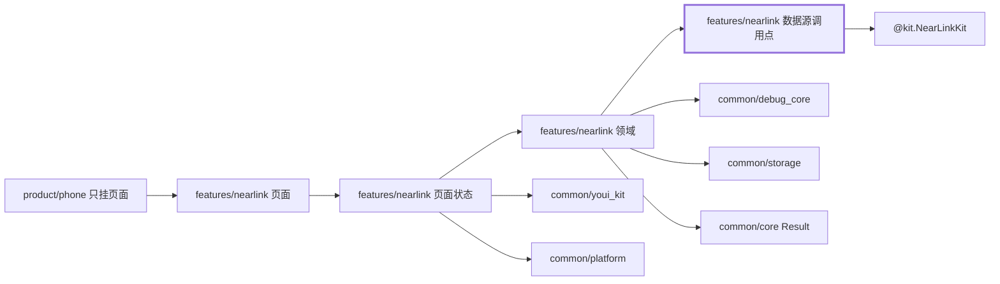
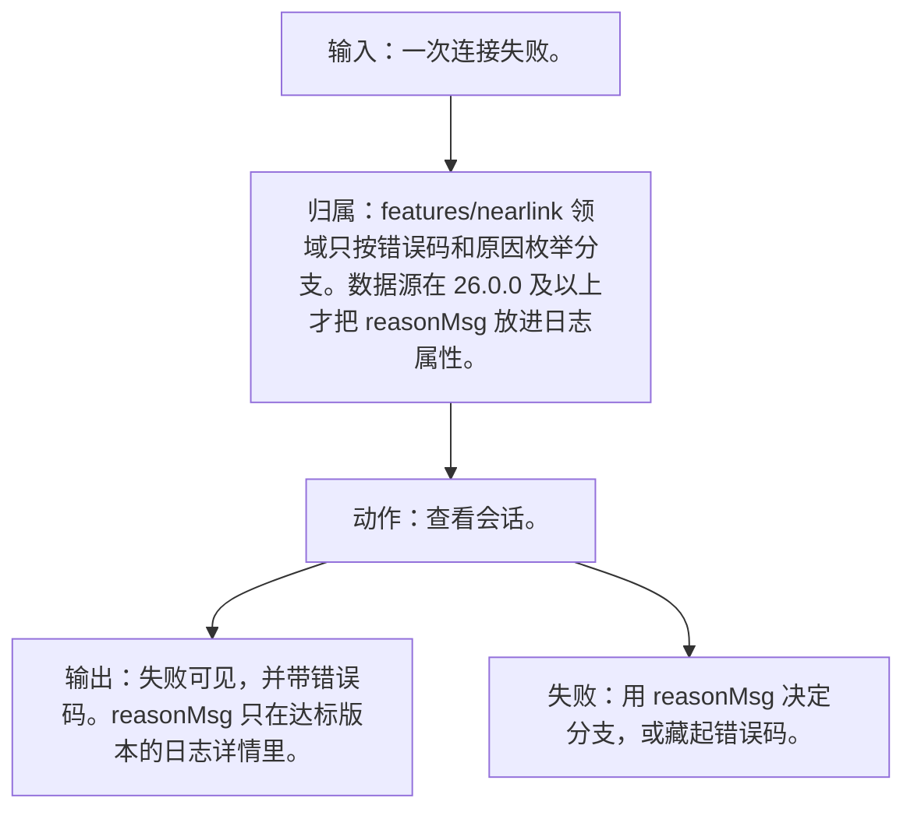
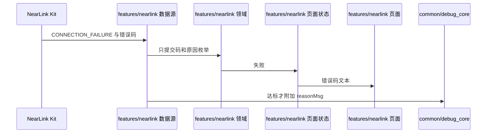
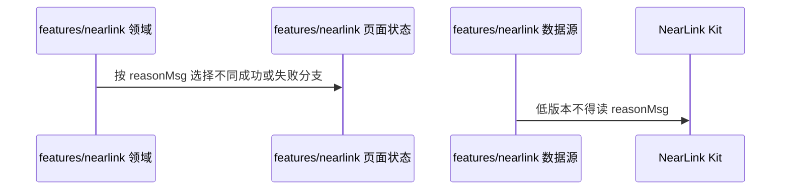

# NL-076 连接失败可见原因

## 1. 条目与非目标

本条属于版本门槛。达到研究笔记所记版本才在调用点调用对应接口；低于该版本时显示起始版本，并且不调用该接口，也不把未公开参数传给更低系统。

本条只判定：连接失败或原因为 `CONNECTION_FAILURE` 时显示失败和错误码。26.0.0 及以上的 `reasonMsg` 只出现在日志详情，不参与分支判断。

前置：`connect` 失败或原因是 `CONNECTION_FAILURE`。

动作：查看会话。

证据：错误码文本。

输入：一次连接失败。

输出：失败可见，并带错误码。`reasonMsg` 只在达标版本的日志详情里。

失败：用 `reasonMsg` 决定分支，或藏起错误码。

归属：`features/nearlink` 领域只按错误码和原因枚举分支。数据源在 26.0.0 及以上才把 `reasonMsg` 放进日志属性。

非目标：

- 不把 `reasonMsg` 显示成唯一用户文案来源。
- 不把星闪行为放进 `common/yobluetooth` 或 `features/bluetooth`。
- 不新增包装层、兼容层或双轨 API。版本判断若存在，只写在即将调用该接口的数据源函数里。

## 2. 模块边界与分层

设计前：SSAP 与端口若共用一个会话，属性失败和字节失败会混在同一条日志里。`features/nearlink` 已有客户端数据源草稿，页面状态尚未持有连接中耗时、服务树和通知是否需重新启用。

设计后：同一条用户路径按下面的包走完。下层不持有页面类型。`product/phone` 只挂载 `NearLinkFeaturePage`。`Index.ets` 不把数据源导出给壳，也不在门面里写 Kit 调用。

| 步骤 | 包与类型落点 | 本条做什么 |
| --- | --- | --- |
| 1 | features/nearlink 领域 | 分支只看码和 `CONNECTION_FAILURE`。 |
| 2 | features/nearlink 数据源 | 高版本才复制 `reasonMsg` 到日志属性。 |

依赖方向：页面只读页面状态；页面状态调用领域用例；领域做校验、分类和纯解析；日志进入 `common/debug_core` 的 `DebugLogRecord`；运行时痕迹进入 `common/yolog`；需要落盘的收藏、会话和导出进入 `common/storage`。`common/core` 只提供 `Result`、`AsyncSerialQueue`、`ByteUtil` 和单调时钟。需要访问 Kit 时，只在 `features/nearlink` 数据源的调用点访问 `@kit.NearLinkKit`。

替换与删除：删除按 `reasonMsg` 字符串分支的路径。低版本不读该字段。

`reasonMsg` 只在系统不低于 26.0.0 时由调用点写入日志属性。低于该版本不读这个参数。分支始终不看它。

## 3. 架构图

本组「SSAP 客户端」的共用分层图在 [`NL-059.md`](NL-059.md)。下面两张图只画本条，链接不代替本条的输入、输出、失败和归属。

本条数据链路：

## 4. 序列图

### 成功路径

### 失败路径

失败路径是本条要拦住的结果。页面用 `common/youi_kit` 的 `YoError` 或 `YoEmpty` 展示领域类别对应的文案，不把失败画成零结果的成功态。

## 5. 数据模型

失败类别带 `nativeCode`。`reasonMsg` 不是类别，只是日志属性，可缺省。

领域失败只分类，放在 `features/nearlink`。类别携带结构化载荷：原生错误码、接口名、版本记号、请求 ID、字节数。用户可见句子由页面状态按类别生成，不写入 `common/core` 的 `ResultError`，也不写入 `common/youi_kit`。Kit 传输对象只活在数据源，越过边界前转成领域模型。持久化用 `common/storage` 已有记录，星闪身份放 `DeviceFavoriteRecord.attributesJson`，不新建星闪专用表。

## 6. 层间接口

- 数据源 → 领域：码与原因枚举。
- 数据源 → 日志：可选 `reasonMsg`，不回传给页面做判断。

数值只定义在 `features/nearlink` 的 `NearLinkConstants`。页面、日志和另一包不再抄一份。

## 7. 权限与生命周期

无新权限。

失败后阶段是 failed，订阅按断线处理。

权限编排使用 `common/platform` 的 `PermissionOrchestrator`，场景使用 `common/debug_core` 的 `PermissionScenario.NEARLINK_ACCESS`。该场景的权限列表只有 `ohos.permission.ACCESS_NEARLINK`。声明和用途字符串在 `product/phone` 的 `module.json5`（`perm_nearlink_reason`）。进入模块不调用 `ensurePermissions`。

## 8. 日志

错误日志含错误码。若版本达到 26.0.0 且有 `reasonMsg`，只写在日志详情。

统一日志是 `common/debug_core` 的 `DebugLogRecord`：`module` 为 `ModuleType.NEARLINK`，`nativeCode` 放 Kit 码，`attributes.apiName` 放接口名，`direction` 区分入、出和内部。`common/yolog` 的 `YoLog` 只记运行痕迹，标签由 `features/nearlink` 传入，星闪语义不写进 `common/yolog`。权限结果使用 `LogRecordType.PERMISSION`，不记录弹窗以外的个人信息。

## 9. 反模式

- 低版本读取 `reasonMsg`。
- 页面 if 语句比较 `reasonMsg`。
- 用 `NearLinkCompat`、版本适配器或「先调用再吞掉错误」把门槛藏起来。
- 让 `common/debug_core`、`common/platform` 或 `common/youi_kit` 直接 import `@kit.NearLinkKit`。
