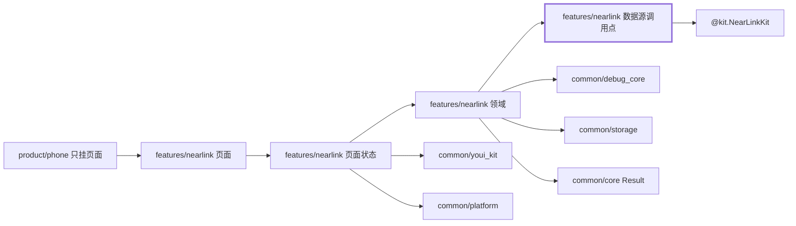
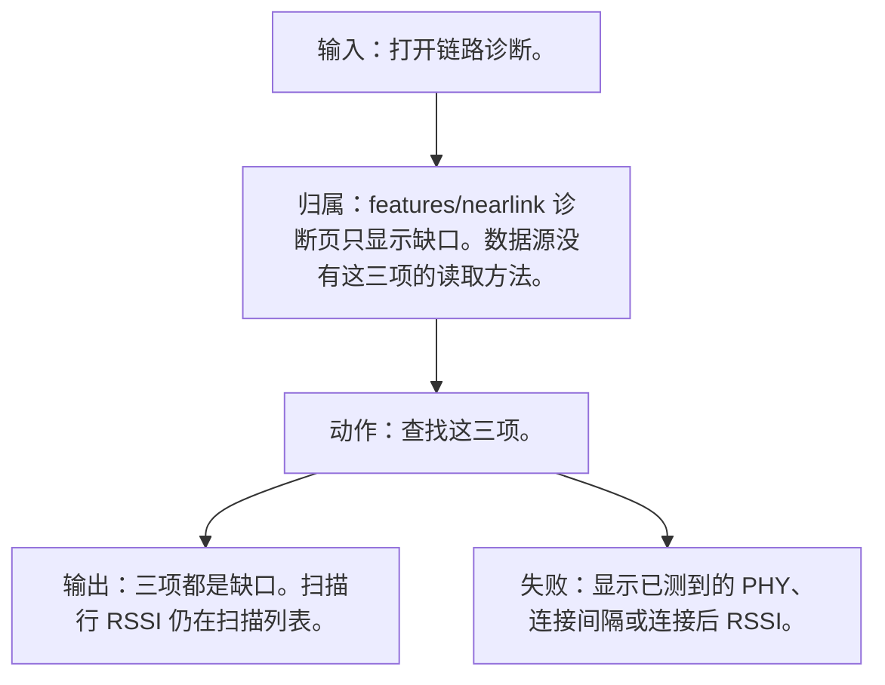
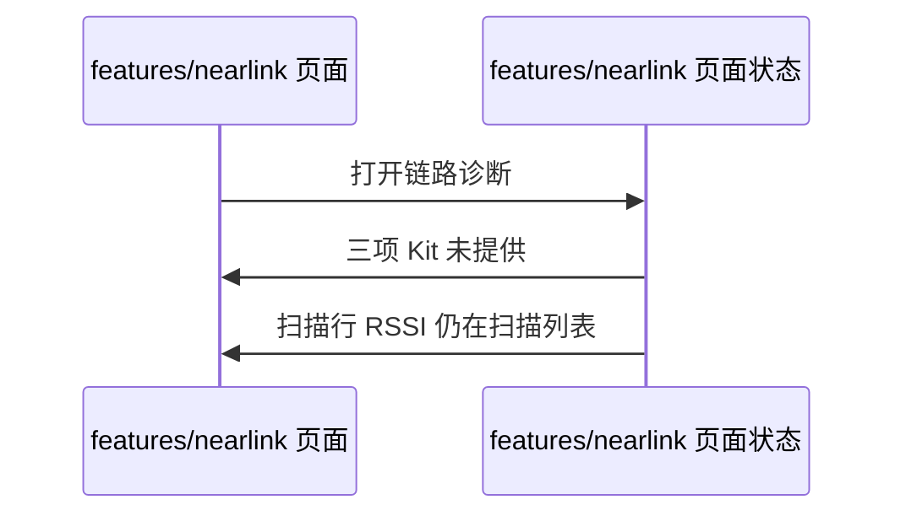
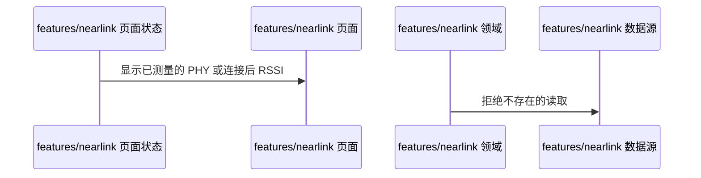

# NL-103 不提供 PHY 与连接后 RSSI

## 1. 条目与非目标

本条属于必须标明的缺口。通过标准只有可见缺口文案。没有该能力的成功态，也不设计一条假成功路径。

本条只判定：链路诊断里的 PHY、连接间隔、对端 RSSI 显示为 Kit 未提供。扫描阶段的 RSSI 仍只出现在扫描行。

前置：用户打开链路诊断。

动作：查找这三项。

证据：缺口文案，扫描行 RSSI 仍在。

输入：打开链路诊断。

输出：三项都是缺口。扫描行 RSSI 仍在扫描列表。

失败：显示已测到的 PHY、连接间隔或连接后 RSSI。

归属：`features/nearlink` 诊断页只显示缺口。数据源没有这三项的读取方法。

非目标：

- 不调用模组 AT `AT+SLEREADPEERRSSI`。
- 不把扫描 RSSI 搬到连接诊断里冒充连接后 RSSI。
- 不把星闪行为放进 `common/yobluetooth` 或 `features/bluetooth`。
- 不新增包装层、兼容层或双轨 API。版本判断若存在，只写在即将调用该接口的数据源函数里。

## 2. 模块边界与分层

设计前：Kit 没有吞吐、PHY、连接间隔和连接后 RSSI。若把本端字节数显示成空口速率，或把扫描 RSSI 127 当成强信号，都是要替换掉的展示。

设计后：同一条用户路径按下面的包走完。下层不持有页面类型。`product/phone` 只挂载 `NearLinkFeaturePage`。`Index.ets` 不把数据源导出给壳，也不在门面里写 Kit 调用。

| 步骤 | 包与类型落点 | 本条做什么 |
| --- | --- | --- |
| 1 | features/nearlink 页面 | 三项缺口文案。 |
| 2 | features/nearlink 扫描行 | RSSI 只留在扫描模型。 |

依赖方向：页面只读页面状态；页面状态调用领域用例；领域做校验、分类和纯解析；日志进入 `common/debug_core` 的 `DebugLogRecord`；运行时痕迹进入 `common/yolog`；需要落盘的收藏、会话和导出进入 `common/storage`。`common/core` 只提供 `Result`、`AsyncSerialQueue`、`ByteUtil` 和单调时钟。本条不调用缺失能力的 Kit 接口，数据源也不为它补一条成功返回。

替换与删除：不设计测量成功路径。

本条不新增版本分支。数据源只提交研究笔记已经公开的参数。

## 3. 架构图

本组「吞吐、重连、日志与诊断」的共用分层图在 [`NL-102.md`](NL-102.md)。下面两张图只画本条，链接不代替本条的输入、输出、失败和归属。

本条数据链路：

## 4. 序列图

### 成功路径

### 失败路径

失败路径是本条要拦住的结果。页面用 `common/youi_kit` 的 `YoError` 或 `YoEmpty` 展示领域类别对应的文案，不把失败画成零结果的成功态。

## 5. 数据模型

诊断模型没有 phy、interval、peerRssi 的成功值。扫描行的 rssi 属于另一模型。

领域失败只分类，放在 `features/nearlink`。类别携带结构化载荷：原生错误码、接口名、版本记号、请求 ID、字节数。用户可见句子由页面状态按类别生成，不写入 `common/core` 的 `ResultError`，也不写入 `common/youi_kit`。Kit 传输对象只活在数据源，越过边界前转成领域模型。持久化用 `common/storage` 已有记录，星闪身份放 `DeviceFavoriteRecord.attributesJson`，不新建星闪专用表。

## 6. 层间接口

- 诊断页不调用 Kit。扫描列表继续读扫描行。

数值只定义在 `features/nearlink` 的 `NearLinkConstants`。页面、日志和另一包不再抄一份。

## 7. 权限与生命周期

无新权限。

不新增订阅。

权限编排使用 `common/platform` 的 `PermissionOrchestrator`，场景使用 `common/debug_core` 的 `PermissionScenario.NEARLINK_ACCESS`。该场景的权限列表只有 `ohos.permission.ACCESS_NEARLINK`。声明和用途字符串在 `product/phone` 的 `module.json5`（`perm_nearlink_reason`）。进入模块不调用 `ensurePermissions`。

## 8. 日志

日志 `gap=phy_interval_peer_rssi`。

统一日志是 `common/debug_core` 的 `DebugLogRecord`：`module` 为 `ModuleType.NEARLINK`，`nativeCode` 放 Kit 码，`attributes.apiName` 放接口名，`direction` 区分入、出和内部。`common/yolog` 的 `YoLog` 只记运行痕迹，标签由 `features/nearlink` 传入，星闪语义不写进 `common/yolog`。权限结果使用 `LogRecordType.PERMISSION`，不记录弹窗以外的个人信息。

## 9. 反模式

- 显示测量成功。
- 用扫描 RSSI 填充对端 RSSI。
- 用 `NearLinkCompat`、版本适配器或「先调用再吞掉错误」把门槛藏起来。
- 让 `common/debug_core`、`common/platform` 或 `common/youi_kit` 直接 import `@kit.NearLinkKit`。
