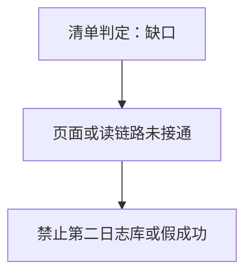
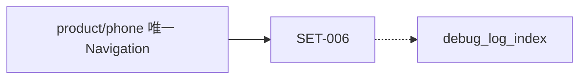
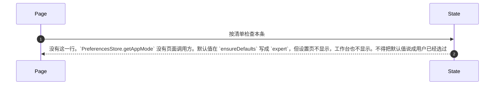
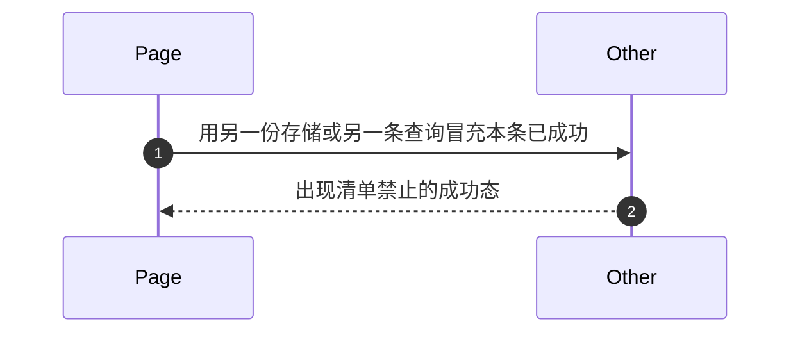

# SET-006 设置页展示专家或轻量

## 1. 条目与非目标

清单 `SET-006`，判定「支持」。屏幕是设置（`screen.settings.hub`）。行为对照 Wi-Fi 分支 `cursor/wifi-network-phase-d-4072` 的 `7295d1771288a0fb957021bd0e948073f435d96c` 上的现有代码，不重开行业调查，也不改 ets。

- Given：`PreferenceKeys.APP_MODE` 为 `app.mode`，`AppMode` 有 `expert` 与 `light`
- When：在设置页查找模式开关
- Then：没有这一行。`PreferencesStore.getAppMode` 没有页面调用方。默认值在 `ensureDefaults` 写成 `expert`，但设置页不显示，工作台也不显示。不得把默认值说成用户已经选过

本条输入是 键 `app.mode`。输出是 设置页与工作台都看不见。失败是 工作台自存一份模式，或把空壳显示成轻量已开启。归属是 模式键归设置库。工作台只读页面状态转发的结果，不自己存。

非目标：不在每个模块再做全局开关。不把模式写进 `app_setting` 再留一份在 preferences。

## 2. 模块边界与分层

UI 是 ArkUI 页面（`@ComponentV2`）。ViewModel/State 是本仓库 `viewmodel` 目录里的页面状态，对应《MVVM模式（V2）》的 ViewModel，也是鸿蒙类型包里的页面状态层，不是 Android 的 ViewModel 类。UseCase 在 domain。RepositoryContract 是仓库契约。DataSource 是数据源。下层不引用页面。

唯一读路径写成：UI → ViewModel/State → UseCase → RepositoryContract → DataSource → 表 `debug_log_index`。跨模块会话日志只有一条读路径：UI → ViewModel/State → UseCase → RepositoryContract → DataSource → 表 `debug_log_index`。终点是已有日志库 `LogRepository` 的表 `debug_log_index`，不是 Kit，也不是 hilog。蓝牙、星闪、Wi-Fi 共用这一条。`DebugLogRecord` 只是领域模型，经 `LogMapper.toIndexRecord` 写入 `LogIndexRecord`，不另开库。

导航见 `开发/指南/开发/应用框架/ArkUI（方舟UI框架）/UI开发 (ArkTS声明式开发范式)/设置组件导航和页面路由/组件导航(Navigation) (推荐)/Navigation基础架构介绍.md`：一个 Navigation 绑定一个 NavPathStack，显示模式含 Stack、Split、Auto。状态见 `开发/指南/开发/应用框架/ArkUI（方舟UI框架）/UI开发 (ArkTS声明式开发范式)/学习UI范式状态管理/MVVM模式（V2）.md`。关系型库见 `开发/指南/开发/应用框架/ArkData（方舟数据管理）/应用数据持久化/通过关系型数据库实现数据持久化 (ArkTS).md`。用户首选项见 `开发/指南/开发/应用框架/ArkData（方舟数据管理）/应用数据持久化/通过用户首选项实现数据持久化 (ArkTS).md`。进程日志见 `开发/API参考/系统/调测调优/Performance Analysis Kit（性能分析服务）/ArkTS API/ohos.hilog HiLog日志打印.md`。hilog 不是会话读模型。

设计前：默认值在首选项初始化时写入。没有读展示链路。

设计后：显示组有模式行，在专家与轻量之间切换，经 `UpdateSettingUseCase.saveAppMode` 写入。

| 步骤 | 归属 |
| --- | --- |
| 展示 UI | 设置页面。首页看板是 `HomeFeaturePage`，应用设置是底栏里的 `SettingsHubPage`，模块设置在各自功能栈，日志中心和日志详情是压栈页，命令由蓝牙、星闪、WiFi 各自扩展 `CommandPanelTemplate` |
| 页面状态 ViewModel/State | 工程目录 `viewmodel`。本条若是缺口，则这个目录还没有接上 |
| 用例 UseCase | 设置用例读取 `app.mode`。不另起 `LoadAppModeUseCase` 与设置用例并列 |
| 仓库契约 RepositoryContract | SET-004 的同一个契约 |
| 数据源 DataSource | 同一个首选项数据源 |
| 终点 | `PreferencesStore` 里的 `app.mode` |
| 根导航 | `product/phone` 的 `Index.ets`：一棵 `Navigation`、一个 `NavPathStack`、`NavigationMode.Stack` |
| 会话日志库 | `common/storage` 的 `LogRepository`，表 `debug_log_index` |
| 进程日志 | `common/yolog` 的 `YoLog`，不是会话读模型 |
| 壳组件 | `common/youi_kit` 的 `YoPageShell`，不读库、不调 Kit |

依赖只向下。页面不调用 Kit，数据源不引用页面。

上表的用例、契约和数据源只说明不许再另起一套；它们不是本条已经接通的调用。本条结果仍以清单的判定为准。

## 3. 架构图

本条不把缺的界面画成已经走完 UI → ViewModel/State → UseCase → RepositoryContract → DataSource。那条路径只允许终点是 `debug_log_index`，而且本条还没有接上。

虚线表示只有设计后的日志读取才进入 `debug_log_index`。本条若不是日志读取，页面不得改走这张表，也不得改走 `YoLog`。

## 4. 序列图

### 成功路径

本条判定是缺口。成功路径就是清单里的结果，不是把缺的屏幕画成已经可用。

### 失败路径

失败是把缺口写成已经实现，或为了补上屏幕再开第二条读路径、第二张表。

## 5. 数据模型

领域模型、存储行、页面投影分开。页面不持有 Kit 结构体，也不持有 `relationalStore.ResultSet`。

| 字段 | 含义 | 所在层 |
| --- | --- | --- |
| `键` | app.mode | PreferenceKeys |
| `枚举` | expert / light | AppMode |
| `页面` | 不展示 | 缺口 |
| `默认` | ensureDefaults 写 expert | 不是用户操作 |

错误只带类别和已有错误码，例如 `StoreErrorCodes.RDB_OPEN_FAILED`。用户能读的句子只在页面状态生成，不写进 `common/core` 的错误类型。

## 6. 层间接口

- 工作台不 import `PreferencesStore`。
- 页面把用户动作交给页面状态。页面状态不接收 Kit 对象。
- 页面状态只调用本条写明的用例，返回 `common/core` 的 `Result` 或本条投影。
- 用例只依赖仓库契约，不 import `@kit.ConnectivityKit`、`@kit.NetworkKit`、蓝牙 Kit 或星闪 Kit，除非本条终点明确写了某个模块已经在数据源里调用的 Kit。
- 契约的实现就是现有仓库，不另开一张表。
- `features/bluetooth`、`features/nearlink`、`features/wifi_network` 不因为本条再各写一个日志列表。

## 7. 权限与生命周期

切换模式不申请权限。

根页面 `aboutToAppear` 只绑定 `UIContextRegistry`。工作台和设置作为 Tab 内容，离开槽位不销毁根 `NavPathStack`。订阅若在设计后才加上，必须在离开时成对取消。本 PR 不添加订阅。

## 8. 日志

模式不是会话行。

跨模块会话日志只有一条读路径：UI → ViewModel/State → UseCase → RepositoryContract → DataSource → 表 `debug_log_index`。终点是已有日志库 `LogRepository` 的表 `debug_log_index`，不是 Kit，也不是 hilog。蓝牙、星闪、Wi-Fi 共用这一条。`DebugLogRecord` 只是领域模型，经 `LogMapper.toIndexRecord` 写入 `LogIndexRecord`，不另开库。

第二日志库是违规，出现在下列任一处：日志中心、日志详情或工作台最近会话改读 `YoLog` 的 `FileAppender`、`MemoryRingAppender`，或把 hilog 输出当成会话行；蓝牙、星闪或 Wi-Fi 各自再保存一份会话日志（另一张表、另一份文件、页面里的第二份数组）并与 `debug_log_index` 并列查询；把 `DebugLogRecord` 再持久化到另一张表；把会话行写进 `PreferencesStore` 或 `app_setting`；落地时保留 `LoadSessionLogPreviewUseCase` 对 `LogRepository.getInstance().list` 的直连，同时又加一条查询函数或另一个用例；页面或页面状态自己 import `@kit.ArkData` 或 `yolog` 来列出会话。旧直连必须在接上契约的同一改动里删除。本 PR 不新增 logger，也不改 ets。

三模块写入侧已经共用 `LogCaptureService`：`BluetoothScanLogger`、`SppReconnectEventLogger`、`NearLinkEventLogger`、`WifiScanLogger`、`WifiMessageLogger`、`HttpNetworkLogger`、`TransportLogBinder`、`SessionManager`、`SendCommandUseCase`、`AppendLogUseCase` 都调用 `LogCaptureService.captureEvent` 或 `captureBytes`，再由 `LogRepository.append` 写入 `debug_log_index`。

## 9. 反模式

- 不在 `HomeFeaturePage` 用 `@Local` 再存一份全局模式。
- 不把 `AppThemeMode` 的 system/light/dark 和专家/轻量混成一个字段。
- 不在页面或 `common/youi_kit` 里直接调用 Kit 或 `relationalStore`。
- 不新增包装层、兼容层或第二套同名仓库。
- 不把缺口写成支持。命令面板、日志中心、日志详情和设置八组在 `7295d1771288a0fb957021bd0e948073f435d96c` 上都还没有可成功演示的页面。
- 本阶段不写产品代码，也不改界面。
