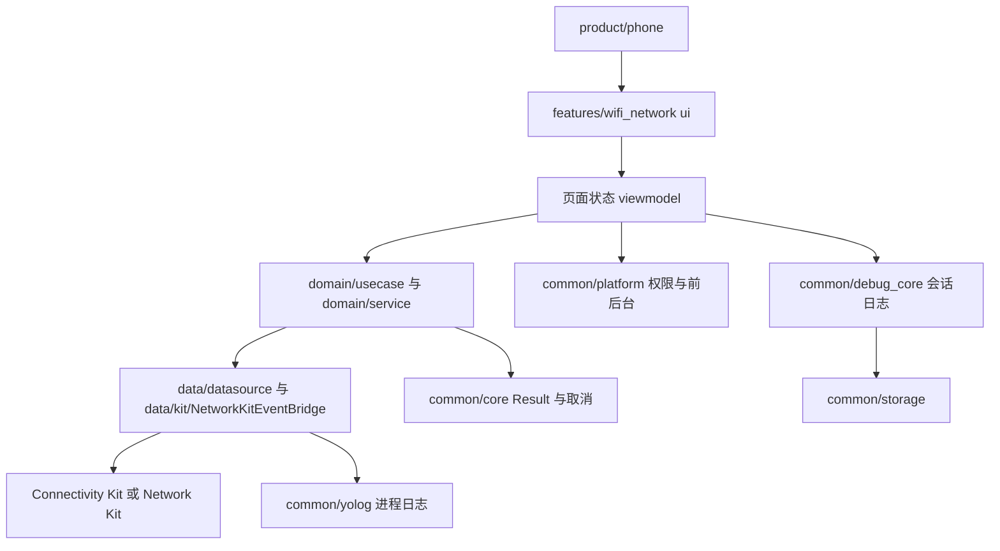
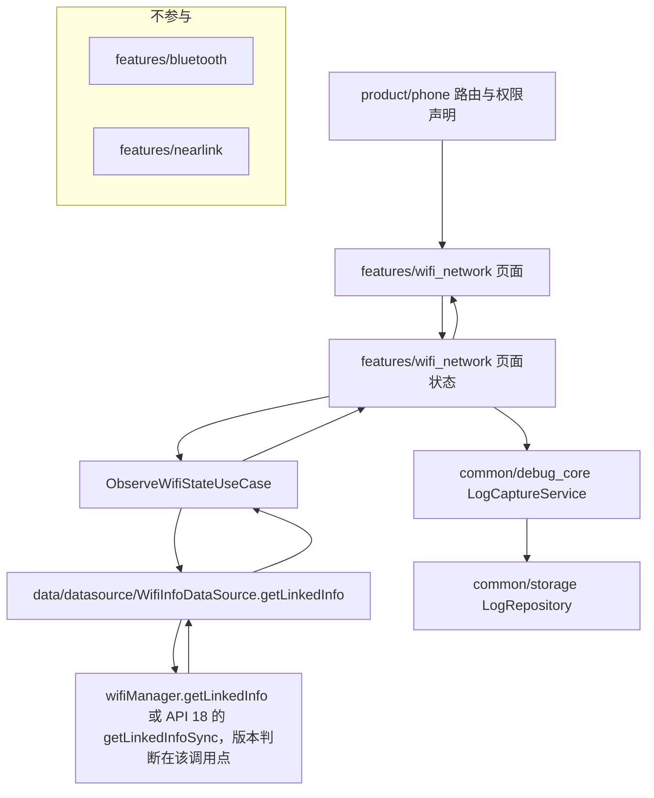
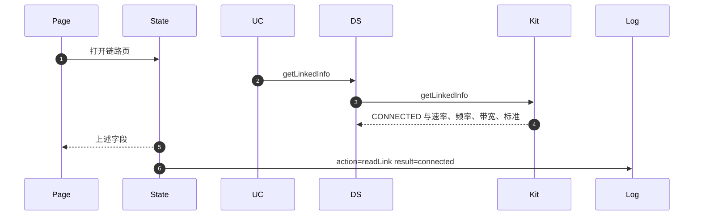
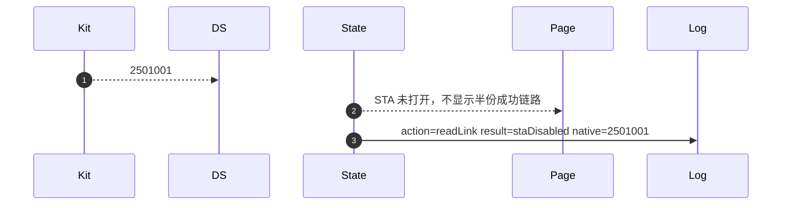

# WN-040 已连接链路显示协商与状态

## 1. 条目与非目标

清单 `WN-040`，主标记「普通应用」。行为只取 `docs/goal/research/wifi-network.md` 与 `docs/goal/checklist/wifi-network.md`，不重开行业调查。

- Given：已连接到 AP
- When：打开链路页
- Then：显示 SSID、RSSI dBm、频率、上行速率 Mbps、下行速率 Mbps、信道带宽、Wi-Fi 标准、ConnState 为 CONNECTED

本条输入是 getLinkedInfo 的已连接结果。输出是 SSID、RSSI dBm、频率、上行与下行 Mbps、信道带宽、Wi-Fi 标准、ConnState CONNECTED。失败是 缺任一字段却显示成功，或 ConnState 不是 CONNECTED。归属是 WifiInfoDataSource.getLinkedInfo 映射为链路快照，ObserveWifiStateUseCase 交给页面状态。

本组「已连接链路」的共用图放在本文件。同组其他条目仍各自写输入、输出、失败和归属。

本组共用图在本文件。

非目标：不在本条显示噪声或 SNR。那是 WN-049 的缺口。不把 WLAN 或网络行为放进 `features/bluetooth` 或 `features/nearlink`。不新增包装层、兼容层或版本适配包。本阶段不写产品代码，也不做界面实现。

## 2. 模块边界与分层

设计前：`product/phone` 还没有本条的独立路由。`features/wifi_network` 的 `ui/page/WifiFeaturePage` 是空壳，只组合 `common/youi_kit` 的 `YoPageShell`。Kit 调用已经落在既有数据源，订阅落在 `data/kit/NetworkKitEventBridge`。`WifiNetworkRepository` 直接 import `@kit.NetworkKit`，这条 import 是越层，设计后删除，而不是再包一层门面。页面状态目录尚未接上本条。

设计后：`product/phone` 只做进入与 `module.json5` 声明。页面只订阅页面状态。页面状态只调用 `ObserveWifiStateUseCase`。用例只依赖 `WifiNetworkRepositoryContract` 与领域纯函数。副作用停在 `data/datasource/WifiInfoDataSource.getLinkedInfo`。系统接口是 `wifiManager.getLinkedInfo 或 API 18 的 getLinkedInfoSync，版本判断在该调用点`。会话行只进 `common/debug_core` 的 `LogCaptureService`，再由 `common/storage` 的 `LogRepository` 落库。进程诊断用 `common/yolog`。取消、时钟与 `Result` 用 `common/core`。权限场景与前后台用 `common/platform`。`common/youi_kit` 不解释 WLAN。

| 步骤 | 归属 |
| --- | --- |
| 进入与权限声明 | product/phone |
| 展示 | features/wifi_network 的 ui/page |
| 页面状态 | features/wifi_network 页面状态（工程目录 viewmodel，对照鸿蒙类型包即页面状态层） |
| 用例与纯规则 | features/wifi_network domain：链路快照与扫描行不是同一个类型 |
| 调用点 | features/wifi_network data/datasource/WifiInfoDataSource.getLinkedInfo |
| 事件订阅 | features/wifi_network data/kit/NetworkKitEventBridge，不再外包一层 |
| 权限场景与前后台 | common/platform PermissionOrchestrator、LifecycleCoordinator |
| 会话日志 | common/debug_core LogCaptureService、DebugLogRecord |
| 落库与导出 | common/storage LogRepository、ExportFileWriter |
| 进程日志 | common/yolog YoLog |
| 结果、取消、时钟 | common/core Result、CancellationToken、TimeUtil |
| 通用页面壳 | common/youi_kit 的 YoPageShell，不承载本条规则 |

依赖方向：`product/phone` → `features/wifi_network` 页面 → 页面状态 → `domain` → `data` → 系统 Kit。`data` 不引用页面。`common/debug_core` 不反向依赖 `features/wifi_network` 的页面。

## 3. 架构图

上图是「已连接链路」这一组的共用边界，详细图放在本组第一条 `WN-040`。依赖只向下：页面不调用 Kit，数据源不引用页面，`common/youi_kit` 只提供壳组件。

本条路径：

## 4. 序列图

### 成功路径

### 失败路径

## 5. 数据模型

领域模型与传输字段分开。页面不直接持有 Kit 结构体。持久化用 `common/storage` 已有的会话与日志记录，不把领域快照原样写进另一层。

| 字段 | 含义 | 所在层 |
| --- | --- | --- |
| `本条输入` | getLinkedInfo 的已连接结果 | 页面状态收到的事实，不是 Kit 对象 |
| `本条输出` | SSID、RSSI dBm、频率、上行与下行 Mbps、信道带宽、Wi-Fi 标准、ConnState CONNECTED | features/wifi_network 页面状态 |
| `失败` | 缺任一字段却显示成功，或 ConnState 不是 CONNECTED | 不得当作成功的结果 |
| `动作` | readLink | 交给 common/debug_core 的动作名 |
| `终态` | connected | common/debug_core DebugLogRecord |
| `系统接口` | wifiManager.getLinkedInfo 或 API 18 的 getLinkedInfoSync，版本判断在该调用点 | 只在调用点 data/datasource/WifiInfoDataSource.getLinkedInfo 可见 |
| `领域归属` | 链路快照与扫描行不是同一个类型 | features/wifi_network domain |

错误只带类别与系统码。`ResultError.nativeCode` 保存 201、801、2501000 这类数字。类别放在 `features/wifi_network` 已有的 `WifiNetworkErrorCodes`。用户可见的一句说明只在页面状态生成，不写进 `common/core` 的错误类型。

## 6. 层间接口

- 页面把用户动作交给页面状态，页面状态不接收 `wifiManager.getLinkedInfo 或 API 18 的 getLinkedInfoSync，版本判断在该调用点` 的 Kit 对象。
- 页面状态调用 `ObserveWifiStateUseCase`，返回 `common/core` 的 `Result` 或本条领域快照。
- `ObserveWifiStateUseCase` 只依赖 `WifiNetworkRepositoryContract` 与领域纯函数，不 import `@kit.ConnectivityKit` 或 `@kit.NetworkKit`。
- `data/datasource/WifiInfoDataSource.getLinkedInfo` 是系统调用点。版本判断与 `BusinessError.code` 分类写在这个调用旁边。
- 会话终态由页面状态交给 `common/debug_core` 的 `LogCaptureService.captureEvent`，`ModuleType` 为 `WIFI`。
- `features/bluetooth` 与 `features/nearlink` 没有本条接口。
- 上行与下行分字段，不合成一个速率。

契约落在已有边界：页面状态对用例、用例对 `WifiNetworkRepositoryContract`、数据源对 Kit。`Index.ets` 继续只导出用例、模型与仓库，不在入口文件里写扫描、过滤或套接字算法。

## 7. 权限与生命周期

GET_WIFI_INFO。真实 BSSID 另见 WN-008。

打开链路页时读取。RSSI 订阅见 WN-042，本条不强制订阅。

需要订阅的事件在进入时登记，离开时经 `NetworkKitEventBridge` 成对取消。套接字由 `common/debug_core` 的 `SessionManager` 与已有 transport coordinator 释放，页面销毁不直接 `close` Kit 对象。前后台由 `common/platform` 的 `LifecycleCoordinator` 通知用例。

## 8. 日志

成功或失败都写一行会话日志：时间、动作 `readLink`、终态 `connected`。格式化可走已有的 `WifiScanLogger`、`WifiMessageLogger` 或 `HttpNetworkLogger`，它们只负责组 `DebugEvent` 并调用 `LogCaptureService`，不另建日志库。`common/yolog` 记调用点与系统码，不记密钥、证书私钥或预共享密钥明文。导出走 `common/storage` 的 `LogExportService` / `ExportFileWriter` 时沿用同一掩码。

## 9. 反模式

- 不把缓存刷新写成一次新的主动扫描，除非本条的 When 确实调用了 `startScan` 且回调为成功。
- 不在页面或 `common/youi_kit` 里直接调用 `wifiManager`、`connection`、`http` 或 `socket`。
- 不把 linkSpeed 同时填进上行和下行。
- 不在 `WifiNetworkRepository` 上再包一个兼容仓库，也不把版本判断挪到新的适配类。
- 不用空列表、无限加载或占位 MAC 表示本条的失败。
- 不让 `features/bluetooth` 或 `features/nearlink` 订阅 WLAN、默认网络或本应用套接字。
