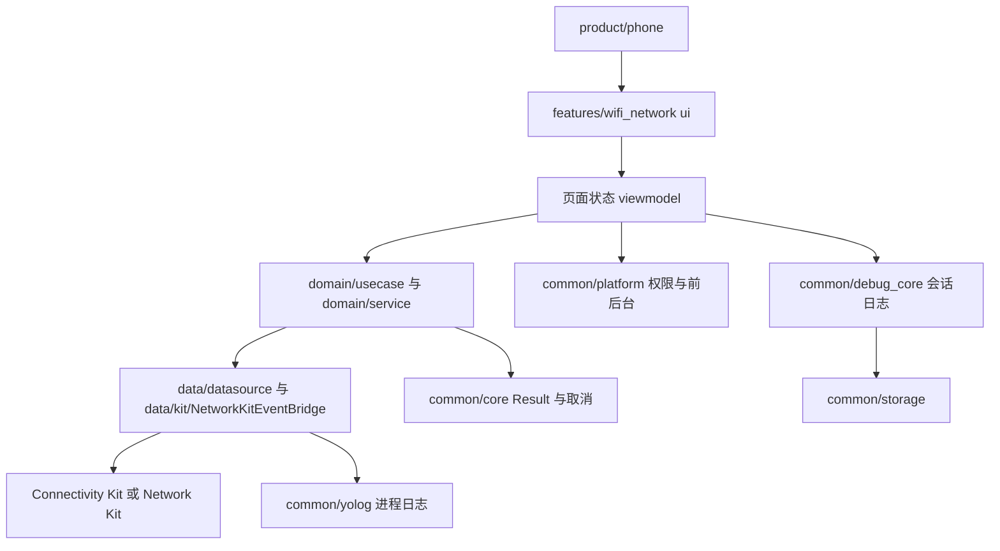
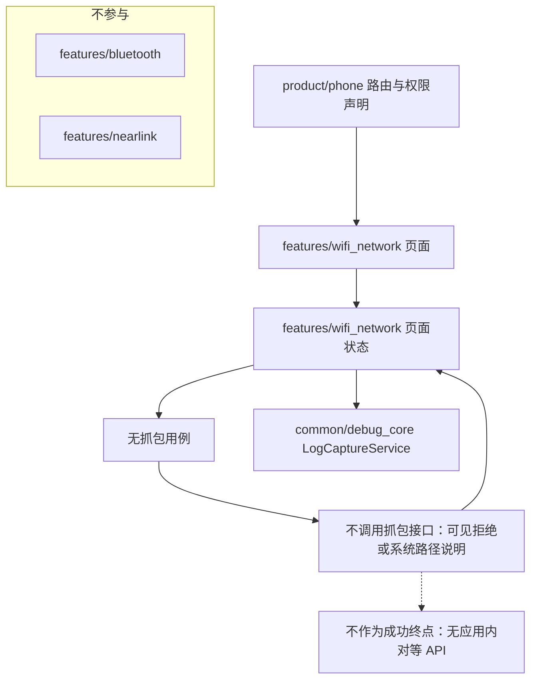
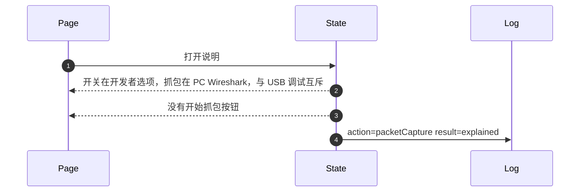
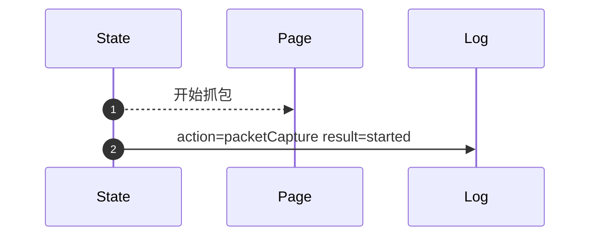

# WN-118 报文分析只说明系统与 PC 路径

## 1. 条目与非目标

清单 `WN-118`，主标记「开发者选项」。行为只取 `docs/goal/research/wifi-network.md` 与 `docs/goal/checklist/wifi-network.md`，不重开行业调查。

- Given：Phone 或 Tablet 已开开发者模式且 USB 连接到 Windows
- When：用户按指南打开网络报文分析
- Then：应用内只提供说明：开关在开发者选项，抓包在 PC 的 Wireshark，且与 USB 调试互斥。应用内没有开始抓包按钮

本条输入是 用户查看报文分析说明。输出是 三段说明：开发者选项、PC Wireshark、与 USB 调试互斥。没有开始按钮。失败是 出现开始抓包按钮或应用内 pcap。归属是 页面状态只持有说明文本。没有任何抓包用例。

本组「抓包、加速与权限墙」的共用图放在本文件。同组其他条目仍各自写输入、输出、失败和归属。

本条是开发者选项。应用内只说明系统设置或 PC 工具里的路径，没有开始抓包、弱网滑杆或同等成功按钮。

本组共用图在本文件。报文分析只覆盖 Phone 与 Tablet，API 26.0.0 起的系统功能，不是本应用接口。

非目标：不实现 VPN 抓其他应用。不导出整机 pcap。不把 WLAN 或网络行为放进 `features/bluetooth` 或 `features/nearlink`。不新增包装层、兼容层或版本适配包。本阶段不写产品代码，也不做界面实现。

## 2. 模块边界与分层

设计前：`product/phone` 还没有本条的独立路由。`features/wifi_network` 的 `ui/page/WifiFeaturePage` 是空壳，只组合 `common/youi_kit` 的 `YoPageShell`。Kit 调用已经落在既有数据源，订阅落在 `data/kit/NetworkKitEventBridge`。`WifiNetworkRepository` 直接 import `@kit.NetworkKit`，这条 import 是越层，设计后删除，而不是再包一层门面。页面状态目录尚未接上本条。

设计后：`product/phone` 只做进入与 `module.json5` 声明。页面只订阅页面状态。页面状态只调用 `无抓包用例`。用例只依赖 `WifiNetworkRepositoryContract` 与领域纯函数。副作用停在 `不调用抓包接口`。系统接口是 `无应用内对等 API`。会话行只进 `common/debug_core` 的 `LogCaptureService`，再由 `common/storage` 的 `LogRepository` 落库。进程诊断用 `common/yolog`。取消、时钟与 `Result` 用 `common/core`。权限场景与前后台用 `common/platform`。`common/youi_kit` 不解释 WLAN。

| 步骤 | 归属 |
| --- | --- |
| 进入与权限声明 | product/phone |
| 展示 | features/wifi_network 的 ui/page |
| 页面状态 | features/wifi_network 页面状态（工程目录 viewmodel，对照鸿蒙类型包即页面状态层） |
| 用例与纯规则 | features/wifi_network domain：说明模型：developerOption、wireshark、usbDebugExclusive |
| 调用点 | features/wifi_network 不调用抓包接口 |
| 事件订阅 | features/wifi_network data/kit/NetworkKitEventBridge，不再外包一层 |
| 权限场景与前后台 | common/platform PermissionOrchestrator、LifecycleCoordinator |
| 会话日志 | common/debug_core LogCaptureService、DebugLogRecord |
| 落库与导出 | common/storage LogRepository、ExportFileWriter |
| 进程日志 | common/yolog YoLog |
| 结果、取消、时钟 | common/core Result、CancellationToken、TimeUtil |
| 通用页面壳 | common/youi_kit 的 YoPageShell，不承载本条规则 |

依赖方向：`product/phone` → `features/wifi_network` 页面 → 页面状态 → `domain` → `data` → 系统 Kit。`data` 不引用页面。`common/debug_core` 不反向依赖 `features/wifi_network` 的页面。

## 3. 架构图

上图是「抓包、加速与权限墙」这一组的共用边界，详细图放在本组第一条 `WN-118`。依赖只向下：页面不调用 Kit，数据源不引用页面，`common/youi_kit` 只提供壳组件。

本条路径：

## 4. 序列图

### 成功路径

### 失败路径

## 5. 数据模型

领域模型与传输字段分开。页面不直接持有 Kit 结构体。持久化用 `common/storage` 已有的会话与日志记录，不把领域快照原样写进另一层。

| 字段 | 含义 | 所在层 |
| --- | --- | --- |
| `本条输入` | 用户查看报文分析说明 | 页面状态收到的事实，不是 Kit 对象 |
| `本条输出` | 三段说明：开发者选项、PC Wireshark、与 USB 调试互斥。没有开始按钮 | features/wifi_network 页面状态 |
| `失败` | 出现开始抓包按钮或应用内 pcap | 不得当作成功的结果 |
| `动作` | packetCapture | 交给 common/debug_core 的动作名 |
| `终态` | explained | common/debug_core DebugLogRecord |
| `系统接口` | 无应用内对等 API | 只在调用点 不调用抓包接口 可见 |
| `说明` | 系统设置或 PC 工具路径 | 页面状态，无成功按钮 |

错误只带类别与系统码。`ResultError.nativeCode` 保存 201、801、2501000 这类数字。类别放在 `features/wifi_network` 已有的 `WifiNetworkErrorCodes`。用户可见的一句说明只在页面状态生成，不写进 `common/core` 的错误类型。

## 6. 层间接口

- 页面把用户动作交给页面状态，页面状态不接收 `无应用内对等 API` 的 Kit 对象。
- 页面状态调用 `无抓包用例`，返回 `common/core` 的 `Result` 或本条领域快照。
- `无抓包用例` 只依赖 `WifiNetworkRepositoryContract` 与领域纯函数，不 import `@kit.ConnectivityKit` 或 `@kit.NetworkKit`。
- `不调用抓包接口` 是系统调用点。版本判断与 `BusinessError.code` 分类写在这个调用旁边。
- 会话终态由页面状态交给 `common/debug_core` 的 `LogCaptureService.captureEvent`，`ModuleType` 为 `WIFI`。
- `features/bluetooth` 与 `features/nearlink` 没有本条接口。
- 说明不跳转到一个会开始镜像的能力。

契约落在已有边界：页面状态对用例、用例对 `WifiNetworkRepositoryContract`、数据源对 Kit。`Index.ets` 继续只导出用例、模型与仓库，不在入口文件里写扫描、过滤或套接字算法。

## 7. 权限与生命周期

普通应用没有抓包权限可成功。

无抓包会话。

本条不建立成功方向的 Kit 订阅，也没有要释放的成功会话。同一页上其他能力若已订阅，仍由 `NetworkKitEventBridge` 成对取消。`WifiSettingsNavigator` 只打开系统设置，不把跳转记成本条成功。

## 8. 日志

成功或失败都写一行会话日志：时间、动作 `packetCapture`、终态 `explained`。格式化可走已有的 `WifiScanLogger`、`WifiMessageLogger` 或 `HttpNetworkLogger`，它们只负责组 `DebugEvent` 并调用 `LogCaptureService`，不另建日志库。`common/yolog` 记调用点与系统码，不记密钥、证书私钥或预共享密钥明文。导出走 `common/storage` 的 `LogExportService` / `ExportFileWriter` 时沿用同一掩码。

## 9. 反模式

- 不在应用内放开始抓包、带宽滑杆或与系统工具等价的成功按钮。
- 不把开发者选项的开关状态伪装成应用已经抓到报文。
- 不把应用 VPN 写成抓包入口。
- 不在 `WifiNetworkRepository` 上再包一个兼容仓库，也不把版本判断挪到新的适配类。
- 不用空列表、无限加载或占位 MAC 表示本条的失败。
- 不让 `features/bluetooth` 或 `features/nearlink` 订阅 WLAN、默认网络或本应用套接字。
