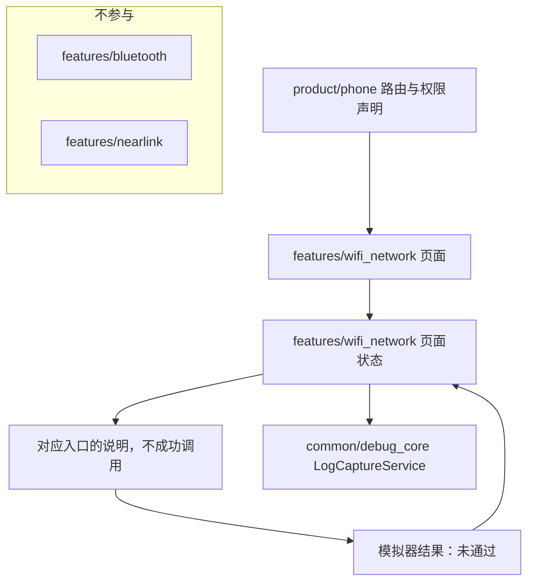
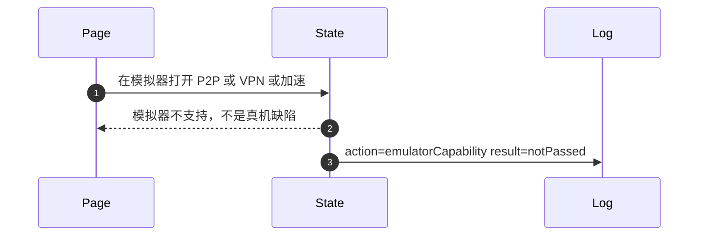
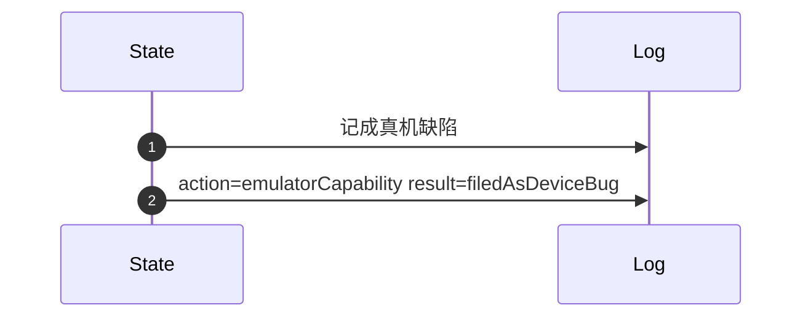

# WN-124 模拟器上的 P2P、VPN、加速保持未通过

## 1. 条目与非目标

清单 `WN-124`，主标记「真机」。行为只取 `docs/goal/research/wifi-network.md` 与 `docs/goal/checklist/wifi-network.md`，不重开行业调查。

- Given：模拟器
- When：打开 P2P 或 VPN 或网络加速
- Then：界面写明模拟器不支持对应项，不把失败记成真机缺陷

本条输入是 模拟器上的这三项入口。输出是 写明模拟器不支持。记录不是真机缺陷。本条未通过。失败是 记成真机缺陷或记成通过。归属是 页面状态根据运行环境写明不支持。不把失败送进真机缺陷列表。

本组「抓包、加速与权限墙」的共用架构图在 [WN-118](WN-118.md)。该链接不代替本条的输入、输出、失败和归属。

本条是真机项。模拟器上的结果保持未通过，不能记成功能通过，也不能记成真机缺陷。

本条在模拟器上保持未通过。

非目标：不在模拟器上实现假的 P2P 组或 VPN。不把 WLAN 或网络行为放进 `features/bluetooth` 或 `features/nearlink`。不新增包装层、兼容层或版本适配包。本阶段不写产品代码，也不做界面实现。

## 2. 模块边界与分层

设计前：`product/phone` 还没有本条的独立路由。`features/wifi_network` 的 `ui/page/WifiFeaturePage` 是空壳，只组合 `common/youi_kit` 的 `YoPageShell`。Kit 调用已经落在既有数据源，订阅落在 `data/kit/NetworkKitEventBridge`。`WifiNetworkRepository` 直接 import `@kit.NetworkKit`，这条 import 是越层，设计后删除，而不是再包一层门面。页面状态目录尚未接上本条。

设计后：`product/phone` 只做进入与 `module.json5` 声明。页面只订阅页面状态。页面状态只调用 `对应入口的说明，不成功调用`。用例只依赖 `WifiNetworkRepositoryContract` 与领域纯函数。副作用停在 `不把模拟器失败当成数据源缺陷`。系统接口是 `P2P 不支持模拟器。Network Kit 不支持 VPN。Network Boost 不支持模拟器`。会话行只进 `common/debug_core` 的 `LogCaptureService`，再由 `common/storage` 的 `LogRepository` 落库。进程诊断用 `common/yolog`。取消、时钟与 `Result` 用 `common/core`。权限场景与前后台用 `common/platform`。`common/youi_kit` 不解释 WLAN。

| 步骤 | 归属 |
| --- | --- |
| 进入与权限声明 | product/phone |
| 展示 | features/wifi_network 的 ui/page |
| 页面状态 | features/wifi_network 页面状态（工程目录 viewmodel，对照鸿蒙类型包即页面状态层） |
| 用例与纯规则 | features/wifi_network domain：notPassed，reason=emulator，notDeviceDefect=true |
| 调用点 | features/wifi_network 不把模拟器失败当成数据源缺陷 |
| 事件订阅 | features/wifi_network data/kit/NetworkKitEventBridge，不再外包一层 |
| 权限场景与前后台 | common/platform PermissionOrchestrator、LifecycleCoordinator |
| 会话日志 | common/debug_core LogCaptureService、DebugLogRecord |
| 落库与导出 | common/storage LogRepository、ExportFileWriter |
| 进程日志 | common/yolog YoLog |
| 结果、取消、时钟 | common/core Result、CancellationToken、TimeUtil |
| 通用页面壳 | common/youi_kit 的 YoPageShell，不承载本条规则 |

依赖方向：`product/phone` → `features/wifi_network` 页面 → 页面状态 → `domain` → `data` → 系统 Kit。`data` 不引用页面。`common/debug_core` 不反向依赖 `features/wifi_network` 的页面。

## 3. 架构图

本条路径：

## 4. 序列图

### 成功路径

### 失败路径

## 5. 数据模型

领域模型与传输字段分开。页面不直接持有 Kit 结构体。持久化用 `common/storage` 已有的会话与日志记录，不把领域快照原样写进另一层。

| 字段 | 含义 | 所在层 |
| --- | --- | --- |
| `本条输入` | 模拟器上的这三项入口 | 页面状态收到的事实，不是 Kit 对象 |
| `本条输出` | 写明模拟器不支持。记录不是真机缺陷。本条未通过 | features/wifi_network 页面状态 |
| `失败` | 记成真机缺陷或记成通过 | 不得当作成功的结果 |
| `动作` | emulatorCapability | 交给 common/debug_core 的动作名 |
| `终态` | notPassed | common/debug_core DebugLogRecord |
| `系统接口` | P2P 不支持模拟器。Network Kit 不支持 VPN。Network Boost 不支持模拟器 | 只在调用点 不把模拟器失败当成数据源缺陷 可见 |
| `验收` | 模拟器上保持未通过 | 页面状态，不写入真机缺陷 |

错误只带类别与系统码。`ResultError.nativeCode` 保存 201、801、2501000 这类数字。类别放在 `features/wifi_network` 已有的 `WifiNetworkErrorCodes`。用户可见的一句说明只在页面状态生成，不写进 `common/core` 的错误类型。

## 6. 层间接口

- 页面把用户动作交给页面状态，页面状态不接收 `P2P 不支持模拟器。Network Kit 不支持 VPN。Network Boost 不支持模拟器` 的 Kit 对象。
- 页面状态调用 `对应入口的说明，不成功调用`，返回 `common/core` 的 `Result` 或本条领域快照。
- `对应入口的说明，不成功调用` 只依赖 `WifiNetworkRepositoryContract` 与领域纯函数，不 import `@kit.ConnectivityKit` 或 `@kit.NetworkKit`。
- `不把模拟器失败当成数据源缺陷` 是系统调用点。版本判断与 `BusinessError.code` 分类写在这个调用旁边。
- 会话终态由页面状态交给 `common/debug_core` 的 `LogCaptureService.captureEvent`，`ModuleType` 为 `WIFI`。
- `features/bluetooth` 与 `features/nearlink` 没有本条接口。
- WLAN 扫描的模拟器证据是 WN-039，不在本条改成通过。

契约落在已有边界：页面状态对用例、用例对 `WifiNetworkRepositoryContract`、数据源对 Kit。`Index.ets` 继续只导出用例、模型与仓库，不在入口文件里写扫描、过滤或套接字算法。

## 7. 权限与生命周期

权限齐全也不在模拟器上通过。

无。

需要订阅的事件在进入时登记，离开时经 `NetworkKitEventBridge` 成对取消。套接字由 `common/debug_core` 的 `SessionManager` 与已有 transport coordinator 释放，页面销毁不直接 `close` Kit 对象。前后台由 `common/platform` 的 `LifecycleCoordinator` 通知用例。

## 8. 日志

成功或失败都写一行会话日志：时间、动作 `emulatorCapability`、终态 `notPassed`。格式化可走已有的 `WifiScanLogger`、`WifiMessageLogger` 或 `HttpNetworkLogger`，它们只负责组 `DebugEvent` 并调用 `LogCaptureService`，不另建日志库。`common/yolog` 记调用点与系统码，不记密钥、证书私钥或预共享密钥明文。导出走 `common/storage` 的 `LogExportService` / `ExportFileWriter` 时沿用同一掩码。

## 9. 反模式

- 不把模拟器失败记成通过，也不把它记成真机缺陷。
- 不为了让模拟器变绿而换一套假数据。
- 不因为 Network Kit 支持模拟器，就把 VPN 也写成支持。
- 不在 `WifiNetworkRepository` 上再包一个兼容仓库，也不把版本判断挪到新的适配类。
- 不用空列表、无限加载或占位 MAC 表示本条的失败。
- 不让 `features/bluetooth` 或 `features/nearlink` 订阅 WLAN、默认网络或本应用套接字。
