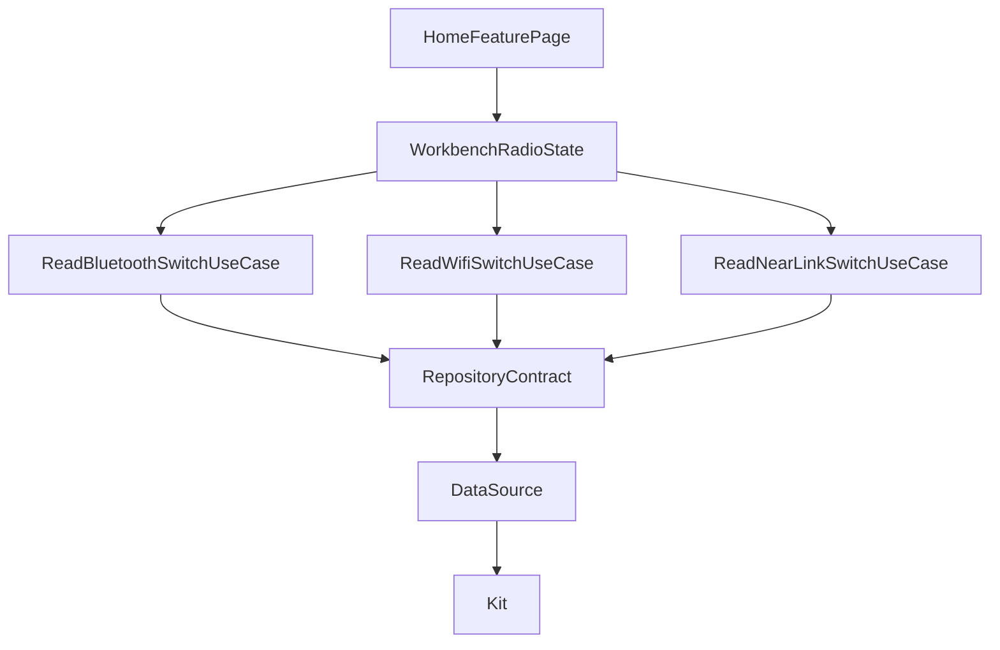
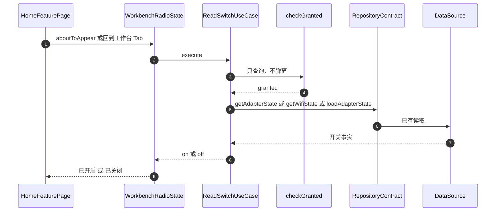

# WB-003 工作台显示蓝牙、WLAN、星闪状态胶囊

## 1. 条目与非目标

清单 `WB-003`，判定「支持」。屏幕是工作台（`screen.workbench.home`）。

- Given：工作台已显示
- When：查看状态条
- Then：有三枚 `YoStatusPill`：蓝牙、WLAN、星闪。读到开关才显示「已开启」或「已关闭」。未授权显示「未授权」。星闪不支持显示「不支持」。读取失败或尚未返回显示「未读取」。入口卡不设 `statusLabel`

本条输入是各模块仓库已经给出的开关事实。输出是工作台上的三句状态。失败是用「已关闭」冒充未读取、未授权或不支持，或在工作台弹出授权。

非目标：不在工作台调用 `@kit.ConnectivityKit`、蓝牙 Kit 或星闪 Kit。不把三个模块的扫描搬进工作台。不新建第三份状态缓存。不订阅 Kit。不改入口卡布局。视觉待新 UI 规范 PR。射频仍是待真机。

## 2. 模块边界与分层

依赖方向不变：`features/home` 不依赖三个射频 HAR。`product/phone` 调用已有仓库上的开关读取用例，把阅读码交给 `HomeFeaturePage`。页面把阅读码变成句子。

| 步骤 | 归属 |
| --- | --- |
| 展示 UI | `HomeFeaturePage` 的三枚 `YoStatusPill`。入口卡仍不设 `statusLabel` |
| 页面状态 | `product/phone` 的 `WorkbenchRadioState` 保存阅读码。`WorkbenchStatusText` 生成句子 |
| 用例 | `ReadBluetoothSwitchUseCase`、`ReadWifiSwitchUseCase`、`ReadNearLinkSwitchUseCase`。只调用仓库契约的 `getAdapterState`、`getWifiState`、`loadAdapterState` |
| 权限 | `PermissionScenarioCoordinator.checkGranted`。不调用 `requestPermissionsFromUser` |
| 仓库契约 | `BluetoothRepositoryContract`、`WifiNetworkRepositoryContract`、`NearLinkRepositoryContract` |
| 数据源 | 各模块已有 DataSource |
| 终点 | 各模块 Kit。页面与页面状态不到达 Kit |
| 最近会话 | 仍走 `LoadWorkbenchOverviewUseCase`，与胶囊不是同一条读路径 |

## 3. 架构图

没有从页面到 DataSource 或 Kit 的边。`features/home` 不指向三个射频 HAR。

## 4. 序列图

### 成功路径

### 失败路径

未授权返回 `denied`，胶囊显示「未授权」。仓库失败或抛错返回 `unread`，胶囊显示「未读取」。星闪 `supported === false` 返回 `unsupported`，显示「不支持」。这三种都不显示「已关闭」。

## 5. 数据模型

| 字段 | 含义 | 所在层 |
| --- | --- | --- |
| `RadioSwitchReading` | unread、denied、unsupported、off、on | `common/debug_core` |
| `bluetooth` / `wlan` / `nearlink` | 当前阅读码 | `WorkbenchRadioState` |
| 胶囊句子 | 模块名加「已开启」「已关闭」「未授权」「不支持」「未读取」 | `WorkbenchStatusText` |

页面不持有 Kit 结构体。用户句子不写进错误类型。

## 6. 层间接口

- `ReadBluetoothSwitchUseCase.execute(): Promise<Result<string>>`，契约方法 `getAdapterState`。
- `ReadWifiSwitchUseCase.execute(): Promise<Result<string>>`，契约方法 `getWifiState`。
- `ReadNearLinkSwitchUseCase.execute(): Promise<Result<string>>`，契约方法 `loadAdapterState`。
- `PermissionScenarioCoordinator.checkGranted(scenario): Promise<boolean>`。
- `HomeFeaturePage` 的 `@Param bluetoothReading`、`wlanReading`、`nearlinkReading`。

`feature_wifi_network` 只额外导出 `ReadWifiSwitchUseCase`。`feature_nearlink` 只额外导出 `ReadNearLinkSwitchUseCase`。蓝牙读取在 `yobluetooth`，不从 `feature_bluetooth` 再导出。

## 7. 权限与生命周期

工作台不弹授权。未授权只显示在胶囊上，授权墙留在模块页。进入工作台和回到工作台 Tab 各读一次。不订阅 Kit，因此没有成对取消。

## 8. 日志

读开关失败不新造日志库，也不把胶囊状态写入 `debug_log_index`。会话行仍只走 LOG-003。最近会话仍不读那张表。

## 9. 反模式

- 不在 `HomeFeaturePage` 里调用 Kit、DataSource 或 `requestPermissionsFromUser`。
- 不把入口卡的 `statusLabel` 当成这三枚胶囊。
- 不把未读取、未授权或不支持显示成「已关闭」。
- 不让 `features/home` 依赖三个射频 HAR。
- 不把射频待真机写成已经在设备上通过。
