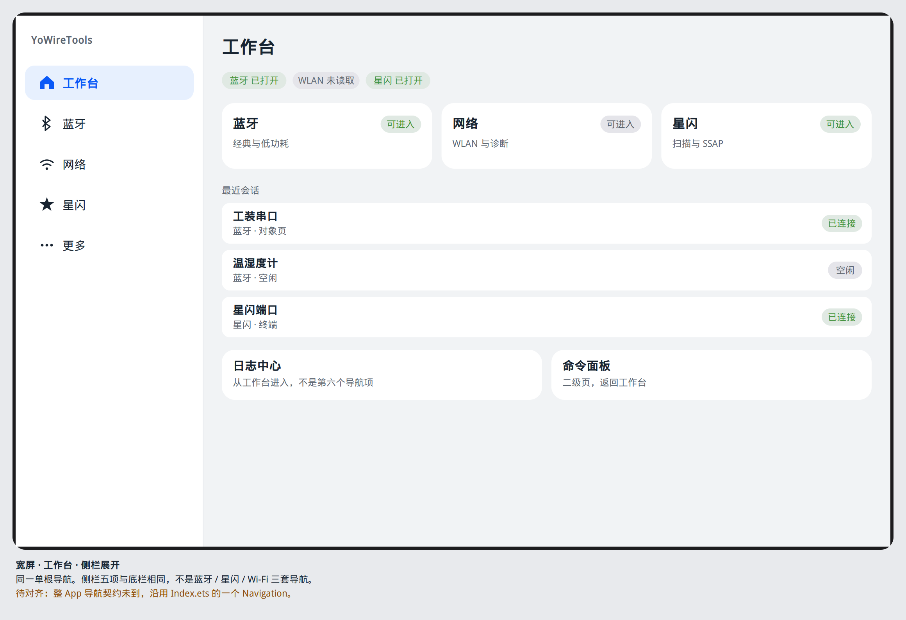

# 导航

## 一条根栈

`product/phone` 的 `Index.ets` 已经是一个 `Navigation` 加一个 `NavPathStack`，子页面是 `NavDestination`，标题栏隐藏，由 `YoPageShell` 里的 `HdsNavigation` 绘制。本设计沿用这一条栈。

不改成每个 Tab 一根 `NavPathStack`。Phase-C 的 Wi-Fi 壳写过「网络栈与蓝牙栈分开」。那句话与 `main` 上的 `Index.ets`、以及蓝牙 Phase-C「根节点是一个 Navigation」冲突。合并结论见 [PHASE-C-DISPOSITION.md](../PHASE-C-DISPOSITION.md)：分开栈作废。

也不把根容器改成 `NavigationMode.Split` 或 `Auto`。`Index.ets` 当前是 `NavigationMode.Stack`。列表和详情的分栏用页内 `YoSplitScaffold`，应用导航留给底栏或侧栏。平台分栏语义见 `开发/指南/…/组件导航(Navigation) (推荐)/Navigation分栏开发.md`。本工程把「导航栏」留给 `YoSideNavRail`，把「列表 / 详情」留给页内分栏。这与蓝牙 Phase-C 一致。

`@ohos.router` 不作为页内跳转。依据：`开发/指南/…/设置组件导航和页面路由/组件导航和页面路由概述.md`。

## 待对齐的导航契约

壳只有一条导航，不把蓝牙栈、星闪栈、Wi-Fi 栈拼成三套再叠在底栏上。上面沿用的是 `main` 上 `Index.ets` 已经存在的一个 `Navigation`、一个 `NavPathStack`。这不是功能侧的整 App 导航 API。

整 App 的分层与 API 还没有文档。`origin/main` 没有 `docs/`。已打开的 PR 里，PR #6、#7、#8 是三个模块各自的架构，PR #20 的 `docs/goal/citation.md` 只索引编号。都不是这份契约。等待功能 Goal，不猜文件名。

到达之前，本文件只标位置，不写契约：

| 位置 | 现在能说的 | 还不写 |
| --- | --- | --- |
| 谁持有根栈 | 页面上只有 `Index.ets` 的那一个 `NavPathStack` | 新的栈类型、跨模块注册函数 |
| Tab 与目的地如何登记 | 五个槽位用现有 `AppRoutes` | 把三个模块的路由表接成第四套 |
| 子页如何进入 | `NavDestination`，层级用已有的 `YoNavDestinationKind` | 各模块自己再长一根导航 |

功能侧整 App 架构文档给出导航 API 之后，再把上表改成对该文档的引用。在那之前，不把三模块的跳转说明升成应用契约。

切换底栏或侧栏时，若栈非空，先 `pop` 到根，再改 `activeTabIndex`。否则蓝牙终端会盖住网络 Tab。按下底栏只改变按下色，松手后才 pop 并切换。按下不 push。

路由名无法匹配时停在当前页，`YoToast` 说明打不开。不落到另一个模块。

## 目的地层级

`YoNavDestinationKind`：

| 种类 | 底栏 | 用途 |
| --- | --- | --- |
| `ROOT_TAB` | 窄屏显示 | 五个根页 |
| `MODULE` | 隐藏，显示返回 | 扫描、发现、配置、日志列表 |
| `OBJECT` | 隐藏，显示返回 | 单台设备、单条 AP、单条日志 |
| `TERMINAL` | 隐藏，输入区贴底 | SPP、端口、连接检查 |
| `MODAL` | 无壳装饰 | `bindSheet` 或 `AlertDialog` |

系统返回只 `pop`。栈空时停在当前根 Tab，不退出应用，也不切到相邻模块。

## 断点

断点类是 `common/platform` 的 `WindowWidthBreakpoint`：小于 600vp 为 COMPACT，600–839 为 MEDIUM，840–1439 为 EXPANDED，大于等于 1440 为 XL。

| 宽度 | 壳 | 内容 |
| --- | --- | --- |
| `<600vp` | 底部 `HdsTabs` | 子页单列。进入子页后整页替换 |
| `600–839vp` | 仍是底栏 | 列表加详情用 `YoSplitScaffold`，默认 4:6，每栏至少 280vp |
| `≥840vp` | `YoSideNavRail` 宽 240vp，底栏隐藏 | 侧栏项与底栏同一组五项 |
| `≥1440vp` | 侧栏 | 内容最大宽度 2220vp，两侧留白 |

页边距用 `YoResponsive.pageHorizontal`。终端页分栏用 `YoNavigationToken` 的 6:4（`SPLIT_LIST_HEAVY_*`），让收发区更宽。

折叠与分屏时主按钮不压在折痕上。窗口窄于 600vp 时回到单列。过滤草稿和终端输入留在页面状态里，不因旋转被清掉。依据：`设计/设计指南/通用设计基础/布局/布局基础.md`、`响应式布局方法.md`、`响应式应用架构.md`。

安全区由 `YoPageShell` 的 `HdsNavigation` 处理。窄屏内容底部预留 `YoNavigationToken.FLOATING_TAB_BOTTOM_PADDING`（88vp）。

## 从样例里采用的导航模式

[HarmonyOSComponentUXExamples](https://gitcode.com/HarmonyOS_Samples/HarmonyOSComponentUXExamples) 的 `products/phone/src/main/ets/components/navigation/bottomtabbar/` 用 `Tabs` 与 `HdsTabs` 做底部页签，并提供宽屏左右结构。本工程已有 `YoAppShell` 在小于 840vp 用 `HdsTabs`、大于等于 840vp 用侧栏，采用的是同一组页签换位置，不再做第二套底栏。

同仓 `products/phone/src/main/ets/components/navigation/titlebar/` 的二级页标题对应 `HdsNavDestination` / 标题栏。本工程标题由 `YoPageShell` 内的 `HdsNavigation` 绘制，系统 `Navigation` 标题栏保持隐藏，避免双标题。

[guide-snippets 的 LayoutSample](https://gitcode.com/HarmonyOS_Samples/guide-snippets/tree/master/ArkUISample/LayoutSample) 展示 `Column`、`Row`、`Flex`、`Stack` 和安全区。调试页优先线性布局。超过一层对齐关系时才用 `RelativeContainer`。绝对定位不用于适配宽度。

[ArktsMvvmSample](https://gitcode.com/HarmonyOS_Samples/guide-snippets/tree/master/ArkUISample/ArktsMvvmSample) 把 Model、View、ViewModel 分开。该样例 README 标题是 MVVM（V1）。本工程新界面用状态管理 V2：页面 `@Local` 持有页面状态，子组件 `@Param` 接输入，`@Event` 交出点击。`@Param` 不在子组件里改领域事实。依据：`开发/指南/…/学习UI范式状态管理/状态管理概述.md` 与 `MVVM模式（V2）.md`。不把样例里的 `@State` 页面抄进新屏幕。

## 壳的七态

| 态 | 壳 |
| --- | --- |
| 默认 | 五项都在。选中项用 `YoColor.SURFACE_SELECTED`。内容是该槽根页 |
| 按下 | 底栏或侧栏用 `YoColor.INTERACTIVE_PRESSED`。松手才切换 |
| 禁用 | 五项都可进入。模拟器上蓝牙、星闪、网络仍可打开，用来阅读不可用说明。不把 Tab 做成一点就扫描成功 |
| 空 | 壳不出现「没有模块」。空列表在子页 |
| 错误 | 未知路由停在当前页，`YoToast`。壳不切到别的模块 |
| 加载 | 壳立即出现。查询加载发生在当前根页内容区 |
| 无权限 | 壳不弹授权。权限墙在用户点击扫描、连接或读取之后，由该子页用统一权限墙表示 |

## 可视化原型

静态图，不是另一套导航。窄屏底栏与宽屏侧栏是同一组五项。

宽屏默认：侧栏展开，内容仍是工作台。底栏隐藏。

宽屏二级页：从工作台进入日志中心，侧栏仍高亮工作台，左列表右详情。

窄屏各态见 [原型索引](../prototypes/README.md)。
# 导航

## 现在代码里有的

`product/phone/src/main/ets/pages/Index.ets`：一个 `Navigation`，一个 `NavPathStack`，`NavigationMode.Stack`，`hideTitleBar(true)`。根上是五个槽位。`navDestination` 只注册了蓝牙 SPP、SPP 终端、BLE。工作台、网络、星闪、更多是槽位内容，不是栈页面。

这是现状，不是整机契约。契约文件在 PR #21，未进 `main`。下面视觉规则可以先写死；路由名是否改成第 7.2 节那一套，等 `docs/goal/architecture/app/` 进 `main` 再对齐。对齐前不新开第二棵 Navigation，也不把三个射频模块各做一个 product。

## 五个目的地

与 `string.json` 一致：

| 槽位 | 文案 | 现路由或页面 |
| --- | --- | --- |
| 0 | 工作台 | `HomeFeaturePage` |
| 1 | 蓝牙 | `/bluetooth/overview` |
| 2 | 网络 | `/wifi/overview` |
| 3 | 星闪 | `/nearlink/overview` |
| 4 | 更多 | `/more/hub`，标题资源是「更多」 |

窄屏：`Tabs`，`barPosition` End，悬浮式，高 bar.56，图标 24vp，文字 Caption_L。当前项品牌色，其余二级色。须 `expandSafeArea` 避开系统导航条，页签热区与导航条热区分开（`底部页签.md`）。

≥840vp：底栏不渲染。左侧栏宽 96vp 只显示图标，或 200vp 图标+文字（窗口够 12 列时用 200vp）。当前项表面用 brand 的浅容器，不是一条 4vp 色条。

切换槽位只改当前索引，不 `pushPath`，不清栈。从蓝牙概览 push 出去的终端还在栈上；切到工作台再切回蓝牙，栈仍在。这一句是现有 `Index.ets` 的行为，契约对齐前不改成「一切槽清空栈」。

## 从属页

push 用同一个 `NavPathStack`。`NavDestination` `hideTitleBar(false)` 时用系统标题栏：返回、标题 Title 由系统样式承担，内容区不再重复大标题。菜单用 `bindMenu`，不多于四项。

官方 `Navigation基础架构介绍.md`：容器宽度 &lt;600vp 建议单栏，≥600vp 建议分栏（Stack / Split / Auto）。本仓库现为 Stack。list+detail 的左右分栏做在目的地内部的 `Row` 里，避免在契约未定时把 `mode` 改成 Auto。是否改为 Split，写在对齐位，不在本文件决定。

## 对齐位

| 待对齐 | 只指向 |
| --- | --- |
| 目的地是否仍是这五个、命令面板和日志中心算不算一级 | PR #21 `docs/goal/checklist/app.md`；屏行为索引 PR #20 `docs/goal/citation.md` |
| 跨模块会话列表的读模型 | 同两处。读路径终点若契约写的是表 `debug_log_index`，界面只消费 ViewModel 给出的行，不读 hilog |
| 状态装饰器 | 新界面用状态管理 V2（`@ComponentV2`）。不在规范里指定仓库还没有的状态类名 |

页面文件不 `import` Kit。壳的 `product/phone` 可以引用 feature 导出的页面组件，这是现有装配方式；导出面收口属于 APP-003，未进 `main` 前不在这里改 `Index.ets`。
