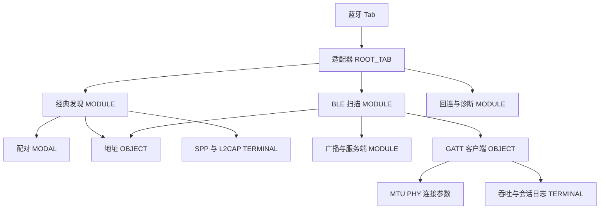

# 蓝牙目的地

壳的断点、底栏、深浅色和权限墙已合并到 [应用壳导航](../app-shell/navigation.md)。本文件只保留蓝牙目的地。Phase-C 在这里写过的宽度表不再作为第二份规范。

## 布局

蓝牙根页是底栏或侧栏的第二槽，`YoNavDestinationKind.ROOT_TAB`。子页进入 `product/phone` 那一条 `NavPathStack`。窄屏单列。列表加详情在不小于 600vp 时用 `YoSplitScaffold`，不另开 `NavigationMode.Split`。

## ArkUI 组件树

```text
Navigation
└── NavDestination                      // 仅子页；根页是 Navigation 的子节点
    └── YoPageShell                     // HdsNavigation
        └── 见各屏组件树
YoAppShell
└── HdsTabs 或 YoSideNavRail            // 五项，蓝牙是下标 1
```

## 状态矩阵

壳的七态见 [导航](../app-shell/navigation.md)。蓝牙根页内容的七态见 [适配器与权限](adapter-permissions.md)。

| 态 | 本模块导航 |
| --- | --- |
| 默认 | 选中蓝牙时内容是适配器页 |
| 按下 | 底栏松手后若栈非空先 pop，再停留在蓝牙根页 |
| 禁用 | 模拟器仍可进入，用来阅读 BT-008，不在 Tab 上直接扫描成功 |
| 空 | 没有设备的空态在发现或扫描页 |
| 错误 | 未知蓝牙路由停在当前页 |
| 加载 | 适配器查询发生在根页内容区 |
| 无权限 | 壳不弹窗。BT-001、BT-002 的权限墙在发现或扫描页 |

## 编号追溯

| 项 | 值 |
| --- | --- |
| 设计屏 | `bluetooth/shell-navigation` |
| 架构编号 | 不单占一条。各目的地的编号见下表 |
| 架构 PR | https://github.com/yohurm/HarmonyOS-YoWireTools/pull/8 |
| 工作台入口 | 槽 0 的蓝牙卡片进入 `/bluetooth/overview`。无 WB 编号 |

## 目的地



| 目的地 | 文档 | 编号 |
| --- | --- | --- |
| 适配器与权限 | [adapter-permissions.md](adapter-permissions.md) | BT-001–BT-008 |
| 经典发现 | [classic-discovery.md](classic-discovery.md) | BT-009–BT-018 |
| 配对 | [pairing.md](pairing.md) | BT-019–BT-026 |
| 地址与身份 | [address-identity.md](address-identity.md) | BT-027–BT-036 |
| SPP 终端 | [spp-terminal.md](spp-terminal.md) | BT-037–BT-046 |
| L2CAP | [l2cap.md](l2cap.md) | BT-047–BT-049 |
| BLE 扫描 | [ble-scan.md](ble-scan.md) | BT-050–BT-061 |
| 广播与 GATT 服务端 | [advertising-gatt-server.md](advertising-gatt-server.md) | BT-062–BT-068 |
| GATT 客户端 | [gatt-client.md](gatt-client.md) | BT-069–BT-079 |
| MTU、PHY 与连接参数 | [mtu-phy-connection.md](mtu-phy-connection.md) | BT-080–BT-085 |
| 吞吐与会话日志 | [throughput-packets-log.md](throughput-packets-log.md) | BT-086–BT-090 |
| 回连、后台与诊断 | [reconnect-background-diagnostics.md](reconnect-background-diagnostics.md) | BT-091–BT-098 |

离开扫描页或持续广播页时，停止请求交给该页的页面状态。壳不停止扫描，也不调用 `ohos.bluetooth.*`。

现有代码里已经有 `/bluetooth/overview`、`/bluetooth/spp`、`/bluetooth/spp/terminal`、`/bluetooth/ble`。其余子路由名仍是设计名，实现前不在本文件发明新的 Kit 接口。
