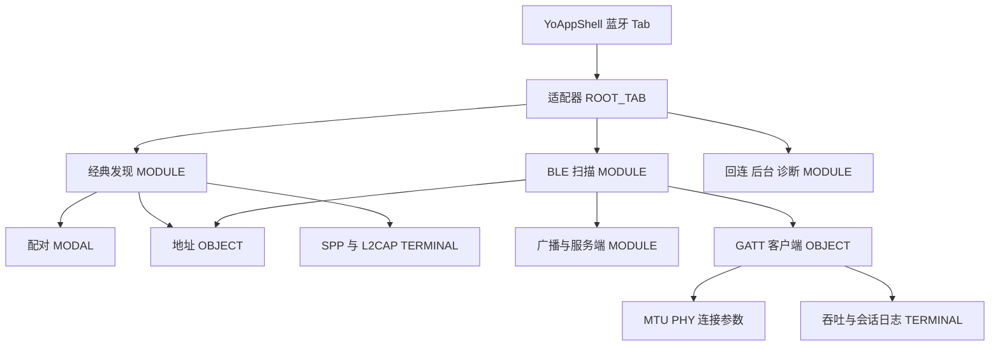

# 壳与导航

蓝牙是应用壳里的一个 Tab，不是星闪或 Wi‑Fi 里的入口。壳不解释适配器状态。子页面自己呈现权限、扫描和连接。

## 结构

`product/phone` 的根节点是一个 `Navigation`，内容是 `YoAppShell`。这符合组件导航把标题栏、内容区和子页面放在同一容器里的做法（`开发/指南/开发/应用框架/ArkUI（方舟UI框架）/UI开发 (ArkTS声明式开发范式)/设置组件导航和页面路由/组件导航和页面路由概述.md`）。蓝牙内部跳转使用 `NavPathStack.pushPath`，不使用 `@ohos.router`。

底栏五项由 Entry 注入，Kit 不写产品文案：

| 序 | 标签 | 路由根 | 本设计 |
| --- | --- | --- | --- |
| 0 | 工作台 | `/home/workbench` | 不承载蓝牙屏 |
| 1 | 蓝牙 | `/bluetooth/overview` | 唯一蓝牙根 |
| 2 | 网络 | `/wifi/overview` | 不放蓝牙屏 |
| 3 | 星闪 | `/nearlink/overview` | 不放蓝牙屏 |
| 4 | 更多 | `/more/hub` | 不放蓝牙屏 |

宽度来自 `WindowWidthBreakpoint`，单位 vp（`开发/API参考/应用框架/ArkUI（方舟UI框架）/ArkTS组件/公共定义/像素单位.md`）：

| 宽度 | 壳 | 蓝牙内容 |
| --- | --- | --- |
| `<600` | 底部浮动 `HdsTabs` | 子页面单列堆叠 |
| `600–839` | 仍是底栏 | `YoSplitScaffold` 列表 4、详情 6，列宽 ≥280vp |
| `≥840` | `YoSideNavRail`，宽 240vp | 底栏隐藏；蓝牙子页面仍可再分栏 |
| `≥1440` | 侧栏，内容区最大 2220vp 居中 | 同上 |

`YoPageShell` 包住每个蓝牙目的地。根 Tab 用 `YoNavDestinationKind.ROOT_TAB`，显示底栏、不显示返回。发现和扫描用 `MODULE`，隐藏底栏、显示返回。设备身份和 GATT 客户端用 `OBJECT`。终端和日志用 `TERMINAL`。配对说明用 `MODAL`。系统标题栏隐藏，标题由 `YoPageShell` 的 `HdsNavigation` 绘制，避免双标题。

宽屏的列表加详情用 `YoSplitScaffold`，不另开 `NavigationMode.Split`。平台分栏的语义见 `…/组件导航(Navigation) (推荐)/Navigation分栏开发.md`：导航栏固定、子页面切换。本工程把「导航栏」留给应用侧栏，把「列表 / 详情」留给蓝牙页内分栏。

离开扫描页或持续广播页时，页面 `aboutToDisappear` 把停止请求交给对应 ViewModel。壳自己不停止扫描。

## 信息密度

底栏和侧栏只显示五个模块名和图标，不显示 RSSI、地址或错误码。蓝牙 Tab 的角标不用来计数附近设备。当前适配器状态留在概览页的 `YoStatusPill`。

子页面标题一行，副标题最多两行，超出省略。返回只回到蓝牙栈的上一页。从终端返回发现页时，不跳到星闪或网络。

## 控件

| 区域 | 符号 |
| --- | --- |
| 应用壳 | `YoAppShell`、`YoSideNavItem` |
| 宽屏侧栏 | `YoSideNavRail` |
| 页框 | `YoPageShell`、`YoNavDestinationKind` |
| 页内分栏 | `YoSplitScaffold` |
| 半模态操作行 | `YoTitleBarActionRow` |
| 短反馈 | `YoToast` |

页面用 `@Local` 保存当前 Tab 和 `NavPathStack`。壳把目的地内容用 `@Param` / `@BuilderParam` 注入。这是状态管理 V2 的输入输出划分（`…/学习UI范式状态管理/状态管理概述.md`）。

## 状态

| 状态 | 本屏 |
| --- | --- |
| 默认 | 五项都在。蓝牙被选中时内容是适配器页。侧栏选中项背景 `YoColor.SURFACE_SELECTED` |
| 按下 | 底栏项或侧栏项按下用 `YoColor.INTERACTIVE_PRESSED`。松手后才切换 Tab。按下不 push 路由 |
| 禁用 | 五项都可进入。模拟器上蓝牙仍可打开，用来阅读不可用说明。不把蓝牙 Tab 做成可点且立刻成功的扫描 |
| 空 | 壳不出现「没有模块」。蓝牙没有设备时，空态在发现或扫描页，壳保持五项 |
| 错误 | 路由名无法匹配时停在当前页，`YoToast` 说明页面打不开。不落到网络或星闪页 |
| 加载 | 壳立即出现。适配器查询的加载发生在概览内容区，不用整应用加载挡住其他 Tab |

## 非目标

- 不把 SPP、GATT、广播注册进星闪或 Wi‑Fi 的页面。
- 不在 Kit 里写「蓝牙」文案或蓝牙枚举。
- 不新增导航组件。
