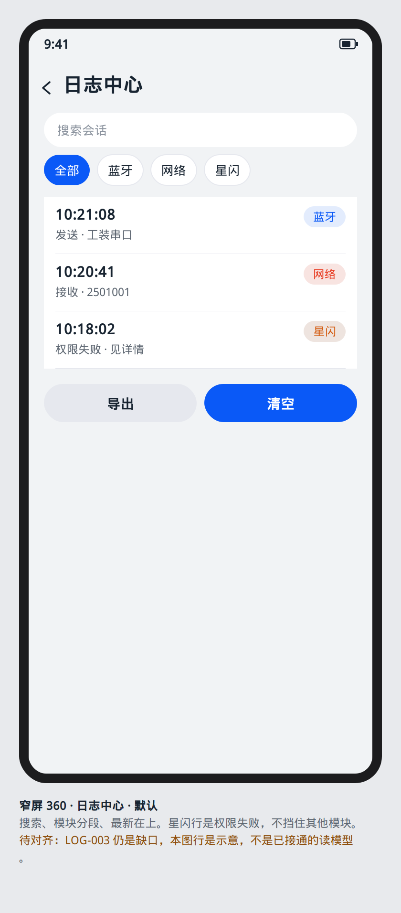
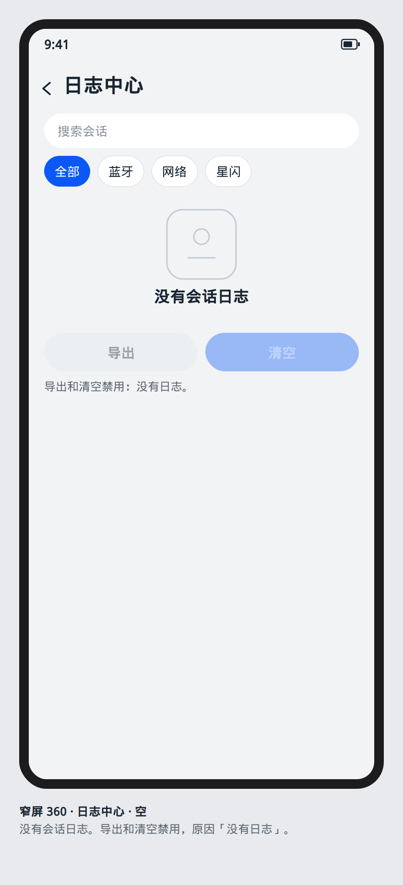
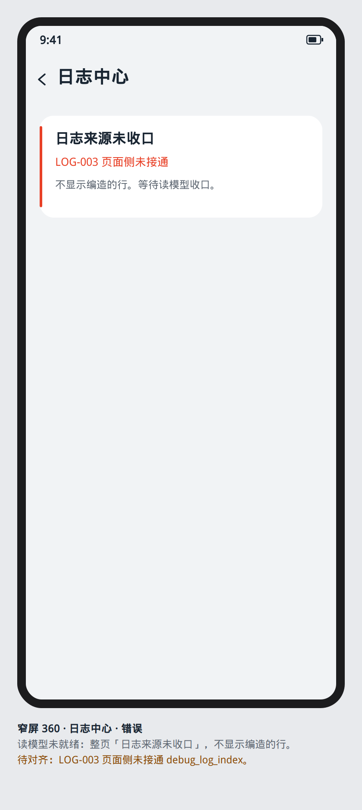
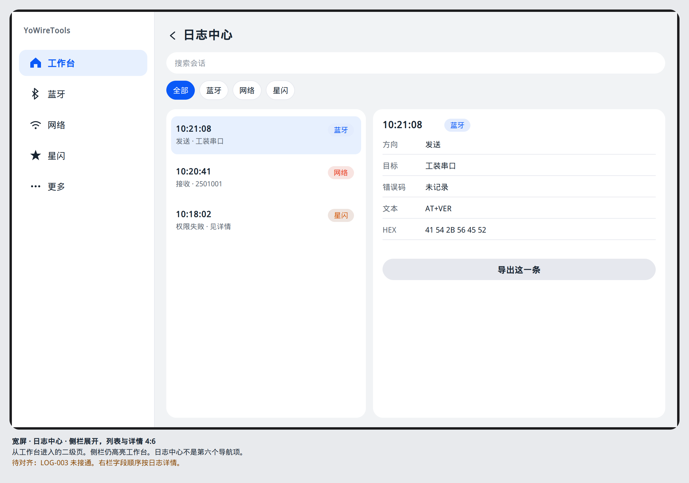

# 日志中心

设计屏号 `screen.log.center`。从工作台进入，层级 `MODULE`。各模块标题菜单里的「会话日志」仍进入该模块自己的日志屏，不强制改道到这里。

## 读模型

唯一允许的读路径在未合并的 [PR #20](https://github.com/yohurm/HarmonyOS-YoWireTools/pull/20) head `139ddc61`，索引是 `docs/goal/citation.md`，正文是 `docs/goal/architecture/log/LOG-003.md`：UI → ViewModel/State → UseCase → RepositoryContract → DataSource → 表 `debug_log_index`。LOG-003 判定仍是「缺口」：现有 `LoadSessionLogPreviewUseCase` 直连 `LogRepository`，页面侧还没接上。这不是读模型已经接通。`docs/goal/architecture/log/LOG-008.md` 禁止第二日志库，会话列表不读 `YoLog` 或 hilog。清单是 `docs/goal/checklist/log.md`（LOG-001–LOG-008）。这些文件不在 `main` 上。

本屏不新命名查询函数，也不把直连用例当成已接通。页面只渲染页面状态给出的行。模块会话页仍各看各的 BT / NL / WN 编号，不把本屏说成那些编号的替身。

## 布局

顶：`Search` 做关键字。旁边 `YoSegmentButton` 切模块：全部、蓝牙、网络、星闪。宽度写在外层 `Scroll`，不写在 `SegmentButton` 上。
列表：主行时间加模块胶囊，次行方向、目标摘要、错误码。文本或 HEX 不在主行铺开。
底：导出、清空。清空先 `AlertDialog`。

窄屏单列。不小于 600vp 时左列表右详情，详情即 [detail.md](detail.md)，4:6。

行字段对齐 PRD 02 里用户要看见的那些：时间、模块、方向、协议、目标、错误码、文本或 HEX。缺字段留空。

## ArkUI 组件树

```text
NavDestination
└── YoPageShell
    └── Column
        ├── Search
        ├── Scroll
        │   └── YoSegmentButton
        ├── List
        │   └── ListItem
        │       └── Column
        │           ├── Row
        │           │   ├── Text
        │           │   └── YoStatusPill
        │           └── Text
        └── Row
            ├── YoActionButton
            └── YoActionButton
YoSplitScaffold                         // ≥600vp
```

`Search` 的专页在 `开发/API参考/…/ArkTS组件/文本与输入/Search.md`。样例搜索框在 HarmonyOSComponentUXExamples 的 `components/input`。模块内过滤仍用 Phase-C 的 `TextInput`，因为那些屏是表单而不是搜索页。

## 状态矩阵

| 态 | 本屏 |
| --- | --- |
| 默认 | 有行。最新在上。选中行在宽屏右栏重复时间、方向、错误码 |
| 按下 | 行按下后松手打开详情或更新右栏。导出与清空走按钮按下态 |
| 禁用 | 当前过滤结果为空时导出和清空禁用，原因「没有日志」 |
| 空 | 没有任何行，或过滤后为零：`YoEmpty`「没有会话日志」。这与写入失败不同 |
| 错误 | 导出失败 `YoError`，列表保留。读模型尚未就绪时，整页 `YoError`「日志来源未收口」，不显示编造的行 |
| 加载 | 打开时 `YoLoading`「正在读取会话日志」。新行到达不整页加载 |
| 无权限 | 本屏不申请射频或网络权限。某一行记录的是权限失败时，胶囊 `warning`，点进详情看错误码。不用权限墙挡住其他模块的行 |

## 编号追溯

| 项 | 值 |
| --- | --- |
| 设计屏 | `screen.log.center` |
| 架构编号 | 无 LOG 切片。行内容可追溯到 BT-086–BT-090、NL-103、NL-107–NL-109、NL-113、WN-128–WN-132 |
| 工作台 | `screen.workbench.home` 的日志卡片。槽 0 |

## 可视化原型

静态图，不是页面实现。窄屏从工作台进入；宽屏仍是同一条侧栏。



默认：搜索、模块分段、最新在上。星闪行是权限失败，不挡住其他模块。



空：没有会话日志，导出和清空禁用。



错误：读模型未就绪时整页「日志来源未收口」，不编造行。



宽屏：侧栏仍高亮工作台，左列表右详情。日志中心不是第六个导航项。
# 日志中心

从工作台「日志」push。不是底栏第六项。目标路由架构写的是 `/log/list`。`main` 没有这页。模式：控制台的页签 + 48vp 行。

页签四项：「全部」「蓝牙」「网络」「星闪」。这是场景 Tab，用来过滤已经在列表里的来源，不是四个应用。

## 布局

`Tabs` Fixed。每个页签同一 `List` 数据的过滤视图，行 48vp：色点、时间 Caption_L、摘要 Body_S 省略。点行 push 详情。

标题栏 `Search` 宽 layoutWeight，提示「关键字」。关键字空时不显示清除图标；有字时尾部 40vp 图标按钮清除。

无行：当前页签下 Body_M「没有日志」。不借用蓝牙扫描的「搜索成功」。

读路径未接线时不是空态冒充：列表区 Body_M「日志还不能跨模块读取」，无行、无假时间。这句只在 ViewModel 明确给出未接线时出现。门禁第 9 项未过之前，实现不得把空 `Column` 说成这一句已经接上。

宽屏 ≥600vp：左列表 360vp，右详情。未选时右栏「选择一条」。窄屏 push。

## 组件树

```text
NavDestination 「日志」
  Column
    Search
    Tabs 「全部」「蓝牙」「网络」「星闪」
      List
        ListItem 48
          色点
          Text Caption_L 时间
          Text Body_S 摘要
```

## 状态

| 态 | 界面 |
| --- | --- |
| 默认 | 当前页签有行 |
| 按下 | 行按压后进入详情或宽屏选中 |
| 禁用 | 无禁用行。清除按钮在关键字空时不渲染 |
| 空 | 「没有日志」 |
| 错 | 页签下 Body_M status.error，例如读取失败。搜索框仍在 |
| 加载 | 列表顶部 16vp LoadingProgress，已有行保留 |
| 无权限 | 日志中心不申请射频权限，无权限墙 |

## 对照

采用 IKConsole 的顶栏分栏和 NetworkQuery 的等宽页签（四项正好）。行密度用日志 48vp 而不是 WLAN 64vp。不采用扫描图示、连接 sheet、家居、FastBle、体温卡。
# 日志中心

目标名 `/log/list`。从工作台「日志」进入，不是底栏第六项。来源：G12 `SystemLogsPage` 的级别 D/I/W/E/F、暂停/继续、清空、关键字、无设备空态；H6 的分类页签。

顶栏 `Tabs` Fixed：「全部」「蓝牙」「网络」「星闪」。每个页签过滤同一列表。行 48vp：4vp 圆点（E 用 `warning`，W 用 `alert`，其余 `font_tertiary`）、时间 12、摘要 12 省略。点行 `push` 详情。

关键字：`Search` layoutWeight 1，提示「关键字」。空关键字不显示清除；有字时尾部 40vp 热区清除。

级别：`Select`，选项为全部与 D/I/W/E/F，对应 hadice 的 Harmony 级别，不加入 Android 的 VERBOSE。暂停、继续、清空放标题栏菜单。无设备不是本页的条件；没有日志源时用空态，不搬 hadice 的 `NoDeviceState` 桌面插画。

## 状态

| 态 | 表现 |
| --- | --- |
| 默认 | 行按时间倒序，新行在上 |
| 按下 | 行按下 |
| 禁用 | 暂停时不再追加，已有行保留，菜单项变为「继续」 |
| 空 | 「没有日志」 |
| 错误 | 顶栏下 `warning`，筛选保留 |
| 加载 | 列表顶 16vp `LoadingProgress`，已有行保留 |
| 无权限 | 若读取被拒绝，内容换权限墙，页签保留 |
