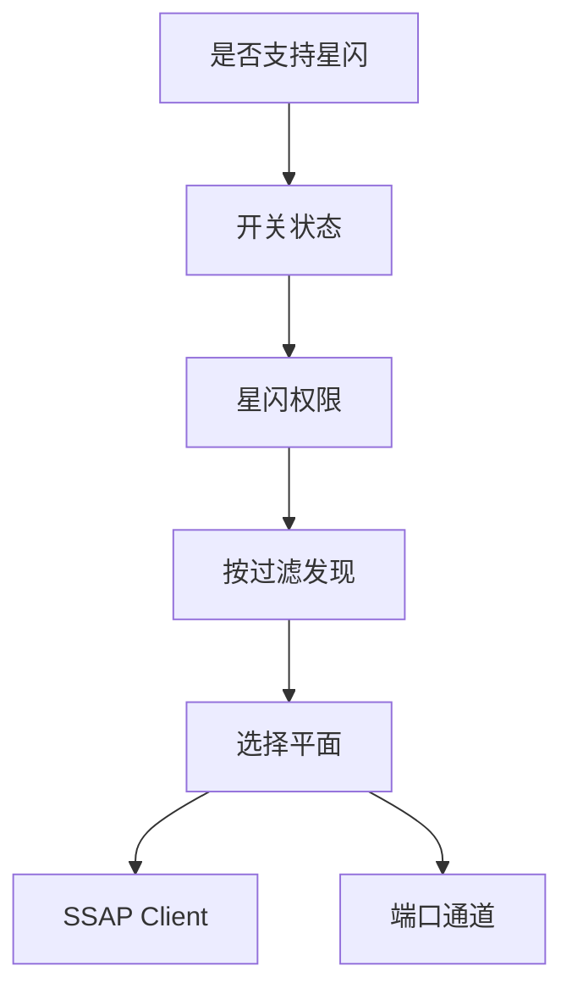

# 来源与能力边界

## 总则

星闪界面以本仓已经核对过的 HarmonyOS NearLink Kit 契约为准。官方示例和开源框架用来核对能力顺序，不用来套页面壳。来源之间冲突时，下表的「界面取舍」生效，并在对应页面里写明。

## 来源

### 本仓契约

这些文件决定字段、错误码和按钮是否可用。它们不是待换皮的旧界面。

| 来源 | 取用的事实 |
| --- | --- |
| `.projectark/2-需求文档/无线调试工具/PRD/05-星闪模块PRD.md` | 能力检测、扫描、SSAP、dataTransfer、加密提示；Server 与广播预留 |
| `.projectark/5-架构设计/无线调试工具/nearlink/01-能力探测扫描与广播解析设计.md` | API 13 空过滤返回 401；API 26 才允许 null；过滤字段；RSSI 127 无效；随机地址去重键 |
| `.projectark/5-架构设计/无线调试工具/nearlink/02-SSAP客户端服务属性与MTU设计.md` | 一个远端一个 Client；MTU [22, 512]，默认 256；操作串行；close 后不可复用 |
| `.projectark/5-架构设计/无线调试工具/nearlink/03-dataTransfer端口数传配对加密与拥塞设计.md` | 端口生命周期；1009700020/0021/0022/0023；只有 ACB `ENCRYPTED` 算已加密 |
| `features/nearlink` 的能力探测、过滤校验、常量、安全状态 | 与上面契约一致的运行时枚举，用来命名界面状态 |

`features/nearlink` 当前页面是空壳，不作为布局参照。

### 星闪官方与开源

| 来源 | 地址 | 取用的事实 |
| --- | --- | --- |
| OpenHarmony 星闪服务说明 | https://github.com/openharmony/communication_nearlink_service/blob/master/README_zh.md | 调用任何接口前先 `isNearLinkSupported()`；开关四态；扫描模式三档；多组过滤为或关系；SSAP 与通用数据传输是两套接口；框架里还有广播、合作集、基础/可靠传输模式 |
| HarmonyOS NearLink Codelab | https://gitee.com/harmonyos_codelabs/nearlink-kit_-codelab | 真机路径是「设置 › 多设备协同 › 星闪」；扫描前要填设备名；扫描结果之后才进 SSAP 客户端和属性通知 |
| manager 参考 | https://developer.huawei.com/consumer/cn/doc/harmonyos-references-V13/nearlink-manager-V13 | 支持查询与开关状态入口 |
| scan 参考 | https://developer.huawei.com/consumer/en/doc/harmonyos-references/nearlink-scan | `startScan` / `stopScan` / `deviceFound` |
| ssap 参考 | https://developer.huawei.com/consumer/cn/doc/harmonyos-references/nearlink-ssap | Client、服务、属性、MTU |
| dataTransfer 参考 | https://developer.huawei.com/consumer/en/doc/harmonyos-references/nearlink-data-transfer-api | `createPort`、`connect`、`writeData`、`readData` |
| SSAP 服务端能力说明 | https://developer.huawei.com/consumer/cn/doc/doccenter-capabilities/nearlink-ssap-server-connect | Server 是后续能力，首期只保留说明 |

华为开发者文档页面本次打开后没有返回可引用的接口正文。接口细节以本仓架构设计里已经核对的 WSL 官方边界，以及上面的开源说明为准。没有在这两处同时出现的字段，不画成可操作控件。

### ArkUI 与视觉

| 来源 | 取用的约束 |
| --- | --- |
| Navigation | https://developer.huawei.com/consumer/cn/doc/harmonyos-guides/arkts-navigation-navigation | 模块内一条导航栈。工作台是根目的地，其余页面可返回 |
| List | https://developer.huawei.com/consumer/cn/doc/harmonyos-references/ts-container-list | 过滤组用分组列表；服务树用可展开分组，不自造另一套滚动容器 |
| bindSheet | https://developer.huawei.com/consumer/cn/doc/harmonyos-references/ts-universal-attributes-sheet-transition 与本仓 `bindSheet半模态弹窗开发经验.md` | 属性检视用半模态；一个宿主只绑一个 sheet；`@ComponentV2` 用双向绑定 |
| 色彩 | https://developer.huawei.com/consumer/cn/doc/doccenter-ux-design/color-0000001776857164 与 `common/youi_kit` 的 `youi_primary` | 品牌色 `#0A59F7`，背景 `#F1F3F5`，错误 `#E84026`，警告 `#ED6F21`，成功 `#64BB5C` |
| 多设备断点 | HarmonyOS UIUX 设计师规范 | 小于 600vp 单栏；600–840vp 仍单栏加宽；大于等于 840vp 才分栏 |

### 明确不照搬的参照

研究材料里的蓝牙扫描列表、BLE 中心设备卡片，只说明「发现过程要有反馈」。星闪不使用那套「雷达扫描 + 设备行 + 连接」结构。Codelab 是线性演示：填名称、看结果、进 SSAP。本模块保留这个顺序，但加上端口平面、原始广播、随机地址和加密状态，因为调试工具要同时看见这三套能力。

## 冲突与取舍

| 议题 | 开源说明中的写法 | 本仓 HarmonyOS 契约 | 界面取舍 |
| --- | --- | --- | --- |
| 空过滤 | ArkTS 示例用 `startScan([])` 表示全量扫描 | API 13 过滤器全空返回 401；API 26 可传 null，官方不建议 | 默认必须有有效过滤。只有探测到 API 不低于 26 且用户确认功耗后，才允许无过滤 |
| 过滤字段 | Native 过滤还有服务 UUID 和 RSSI 阈值 | ArkTS `ScanFilters` 为地址、设备名、厂商 ID、厂商数据、掩码 | 平台过滤只画这五项。服务 UUID 和 RSSI 下限只作为结果后筛 |
| 过滤组合 | 多个 `SleScanFilter` 之间是或 | 架构要求组间或、组内与 | 发现台把一组过滤画成一张卡，组与组是「满足任一」 |
| 扫描结果 | 开源 ArkTS 字段只列出地址、名称、RSSI | `ScanResults.data` 是原始广播；RSSI 127 无效 | 卡片给出原始字节入口；127 显示「无效」，不换算距离 |
| 开关 | 示例直接 `enableNearlink()` | 产品要求引导系统设置；Codelab 路径是系统星闪页 | 按钮文案是「打开系统星闪设置」，应用内不静默打开 |
| 传输模式 | 框架描述基础模式和可靠模式 | 首期连接参数只有地址、UUID、MTU | 首期不画传输模式开关 |
| 加密 | 数据通道不保证加密；配对后查 ACB | 未确认不得显示已加密 | 安全条只有未要求、未确认、配对中、已配对未加密、已加密、失败 |
| 预留能力 | 广播、Server、合作集都有接口 | PRD 定为架构预留 | 工作台只显示锁定说明 |

## 能力顺序

界面上的每一步都对应一次可以失败的能力调用。

支持判断用 `manager.isNearLinkSupported()`。不支持时不再调用扫描、SSAP 和 dataTransfer。开关用 `manager.getState()`，状态为 `STATE_ON`、`STATE_OFF`、`STATE_TURNING_ON`、`STATE_TURNING_OFF`。权限是 `ohos.permission.ACCESS_NEARLINK`。

发现用 `scan.startScan(filters, options)`，结果来自 `deviceFound`。服务平面用 `ssap.createClient(address)`，一个远端只创建一次，然后 `connect`、`getServices`、属性读写、`requestMtuSize`。端口平面用 `dataTransfer.createPort(uuid)`，再 `connect({ address, uuid, mtu })`。两条平面的失败码不同，所以不能合成一次连接。

## 禁止事项

- 禁止把开源示例里的空数组全量扫描画成 API 13 的默认操作。
- 禁止把 Native 才有的服务 UUID 过滤画成平台过滤器。
- 禁止把基础/可靠传输模式画进首期端口页。
