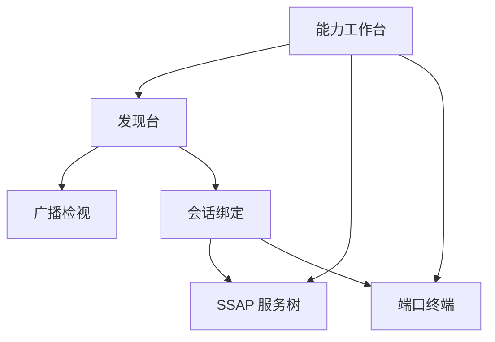

# 信息架构与任务流

## 总则

星闪模块内部是一条 Navigation 栈，根页面是能力工作台。发现、服务、端口是三条能力平面，不是同一份设备列表上的三个页签。页签会让人以为选中一台设备之后，「连接」对三条能力含义相同。实际上过滤、Client 和端口 UUID 的前置条件、身份键和失败码都不一样。

## 模块边界

入口来自应用主导航里的「星闪」根页。本设计不改主导航本身。进入模块后：

- 根目的地：能力工作台。没有返回，离开模块用主导航。
- 子目的地都有返回。返回不静默销毁还活着的 Client 或端口；离开前提示会话仍在。
- 半模态不进导航栈：过滤组编辑、属性检视、配对说明各绑在自己的宿主上。

## 页面

| 页面 | 用户要完成的事 | 身份键 |
| --- | --- | --- |
| 能力工作台 | 看本机是否可用，进入一条平面 | 本机 |
| 发现台 | 用过滤契约收集广播 | 过滤组 |
| 广播检视 | 核对原始字节和解析字段 | 一条广播 |
| 会话绑定 | 决定这条广播走服务还是端口 | 随机地址 + 广播指纹 |
| SSAP 服务树 | 发现服务并操作属性 | 一个 Client |
| 端口终端 | 用 UUID 收发 | 端口 UUID + 对端地址 |

收藏保存在工作台，不单独占一级页面。收藏项同时记录别名、最近随机地址、广播指纹、默认平面和默认端口 UUID。只存地址的收藏不可作为主识别。

## 导航

工作台进入已有会话时，直接打开对应的服务树或端口终端，不再强迫用户重走发现。新的对端仍然必须从发现进入会话绑定。

## 主路径

### 第一次使用

1. 工作台读取支持、开关、权限、是否真机。
2. 任一项不满足时，停在工作台，并给出对应恢复动作。
3. 三项都满足后，进入发现台。发现台先展示过滤契约，不先展示空列表。
4. 用户给出至少一项有效过滤，选择扫描模式和时长，开始发现。
5. 点一条广播，进入会话绑定，选择服务平面或端口平面。
6. 服务平面创建 Client 并发现服务。端口平面先注册 UUID，再连接。

### 再次调试

1. 工作台的最近会话标明平面：SSAP 或端口。
2. Client 未 close、端口未 destroy 时，「继续」回到原页面。
3. 地址已经变化时，最近会话标成「地址可能已失效」，主按钮改成「按指纹重新发现」，不直接 connect 旧地址。

## 为什么不用蓝牙列表壳

蓝牙调试常见结构是：扫描开关、设备行、一行上的连接。星闪有三件对不上的事：

| 蓝牙列表假设 | 星闪事实 | 界面后果 |
| --- | --- | --- |
| 先扫到所有附近设备 | API 13 拒绝空过滤 | 过滤契约在结果之前 |
| 地址稳定 | 扫描地址是随机地址 | 卡片标明「本轮地址」，收藏另存指纹 |
| 连接只有一种 | SSAP 与 dataTransfer 是两套 API | 绑定页分成两张平面卡 |
| 连上就能收发 | 端口不保证加密，写会拥塞 | 终端单独显示安全条和拥塞 |

发现台的结果单元是广播卡片：名称来源、随机地址、RSSI 是否有效、服务与厂商摘要、原始长度，以及两枚分开的动作「绑定服务」「绑定端口」。

## 宽屏

手机单栏按上面的栈推进。宽度达到 840vp 时，发现台左栏是过滤组、右栏是广播卡片；SSAP 左栏是服务树、右栏是属性检视，半模态改为常驻栏。端口终端仍是单任务，只把日志区拉高。分栏不把三个平面同时摊成三列设备列表。

## 禁止事项

- 禁止用 Tabs 把发现、SSAP、端口做成三个对等页签。
- 禁止从工作台直接对一个只剩旧地址的收藏发起连接。
