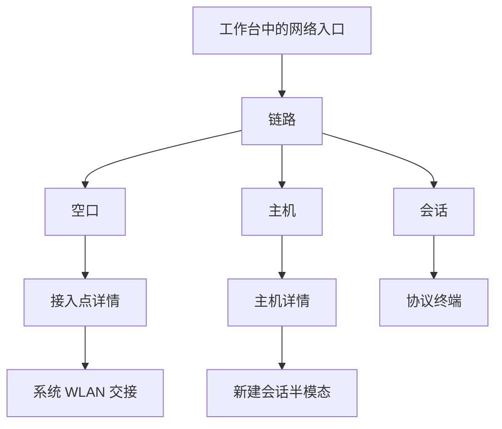

# 信息架构

## 总则

用户进入网络模块时，手里已经有一个对象：当前这条链路、某一个接入点、某一台局域网主机，或一次协议会话。页面按对象切换，诊断图和连接流是对象的证据与动作。

模块从现有工作台的网络入口进入。入口本身不在本文重做。

## 四类对象

| 对象 | 用户要判断的事 | 主证据 | 主动作 |
| --- | --- | --- | --- |
| 链路 | 从射频到出口哪一跳断了 | 路径节点，展开后是有顺序的检查步骤 | 检查这条路径；WLAN 异常时去系统设置 |
| 接入点 | 它在哪个信道、信号如何、能否交给系统去连 | 列表、信道图、时间图，三者共用一个选中项 | 看详情；交给系统连接 |
| 主机 | 私网里谁有响应、哪个端口可开协议 | 主机列表，详情里的端口 | 用该端口新建会话；受控的端口扫描 |
| 会话 | 报文是否按预期收发 | 终端报文流 | 连接、发送、断开、前台恢复后重建 |

手机上这四类是模块内子页签，不是应用底部页签。应用底部页签仍由工作台拥有。

## 层级

| 层级 | 承载 | 返回 |
| --- | --- | --- |
| 模块根 | 子页签：链路、空口、主机、会话。标题「网络」 | 回到工作台，沿用应用已有返回或页签切换，本文不改该壳 |
| 推入页 | 接入点详情、主机详情、协议终端 | 标题栏返回。系统返回键同样回到来源对象 |
| 半模态 | 系统 WLAN 交接、新建会话、修改网段 | 取消、下滑或点遮罩关闭，底下的列表保持 |
| 对话框 | 大范围端口扫描确认 | 取消关闭；确认后才开始 |

空口里的「列表 / 信道 / 时间」是同一页的视图切换，不是三次推入。切换视图不改变选中的接入点。

协议终端是同一个目的页。TCP、UDP、HTTP、WebSocket、MQTT 改变的是报文区和发送区的字段，不各做一个首页。

## 相对旧稿的功能逻辑变化

| 旧稿 | 新逻辑 | 原因 |
| --- | --- | --- |
| 首页是摘要加「环境分析 / 网络调试」入口 | 打开模块即当前链路。没有工具宫格 | 入口页要回答「现在通不通」，而不是再选一次工具 |
| 环境分析右栏四个子页：评分、信道、时间、Connection | 列表、信道、时间是同一选中项的三种证据。评分不做并列主视图 | 三个视图要同步选中；评分没有对应的领域结果 |
| Connection 是环境子页，隐含应用内连接 | 关联是能力交接：能打开系统 WLAN 就交接；不能就说明权限并允许复制 SSID | 普通应用没有连接指定 WLAN 的默认能力 |
| 网络调试顶栏是 Socket、HTTP、WS、MQTT、LAN、诊断 | 诊断并入链路的步骤；局域网独立为主机；协议按会话存在 | 用户要延续同一个目标，而不是在协议名之间跳转 |
| 诊断是四个并列工具 | 一次检查是 `NetworkDiagnosticPlan`：网络状态、解析、TCP、HTTP，前一步失败则后面跳过 | 与现有 `DiagnosticStepKind` 一致，失败原因可定位 |
| 840vp 右栏贴四个子页 | 宽屏列是透镜、对象列表、证据画布、检查器。详见宽屏文档 | 分栏要让图和详情同时可见，而不是把手机子页放大 |
| 设置页承载 13 项环境开关和四组协议设置 | 冷却、私网限制、大范围确认留在对应流程里。不另做模块设置信息架构 | 那些约束是操作的前置条件，不是偏好列表 |
| BSSID、信道宽度缺失时留白或省略 | 详情固定展示「掩蔽原因」和「系统未返回」 | `BssidMaskReason` 与扫描字段本来就可能为空 |

## 页面清单

| 页面 | 原型 | 层级 |
| --- | --- | --- |
| 链路 | `01`–`06`、`26` | 模块根 |
| 空口列表 | `07`–`10` | 模块根的一种视图 |
| 空口信道 | `11` | 同一页的视图 |
| 空口时间 | `12` | 同一页的视图 |
| 接入点详情 | `13` | 推入 |
| 系统 WLAN 交接 | `14`、`15` | 半模态 |
| 主机列表 | `16`–`18` | 模块根 |
| 主机详情 | `19` | 推入 |
| 端口扫描确认 | `27` | 对话框 |
| 会话列表 | `20` | 模块根 |
| 协议终端 | `21`、`23`、`24`、`25` | 推入 |
| 新建会话 | `22`；宽屏见 `30` 右栏 | 手机半模态，宽屏检查器 |
| 宽屏空口 / 链路 / 主机 / 会话 | `28`–`31` | 840vp 及以上 |
| 中屏空口 | `32` | 600–839vp |

修改网段使用与新建会话相同的半模态结构，不单独占一幅主原型。字段只有 CIDR，提交前做私网校验。
