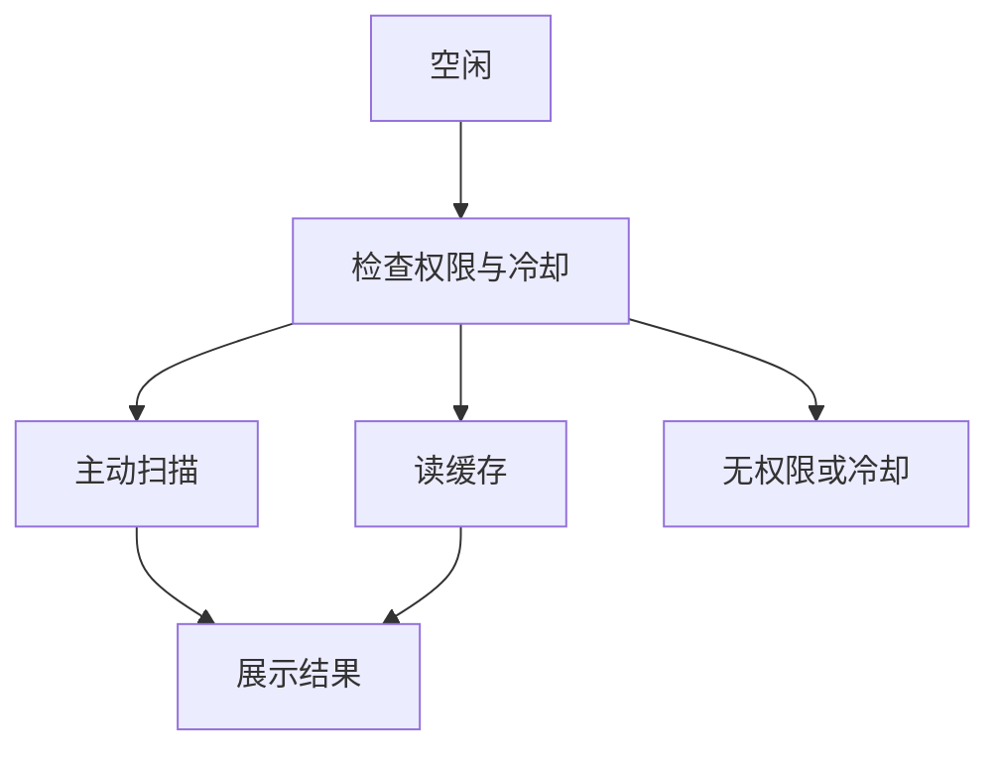
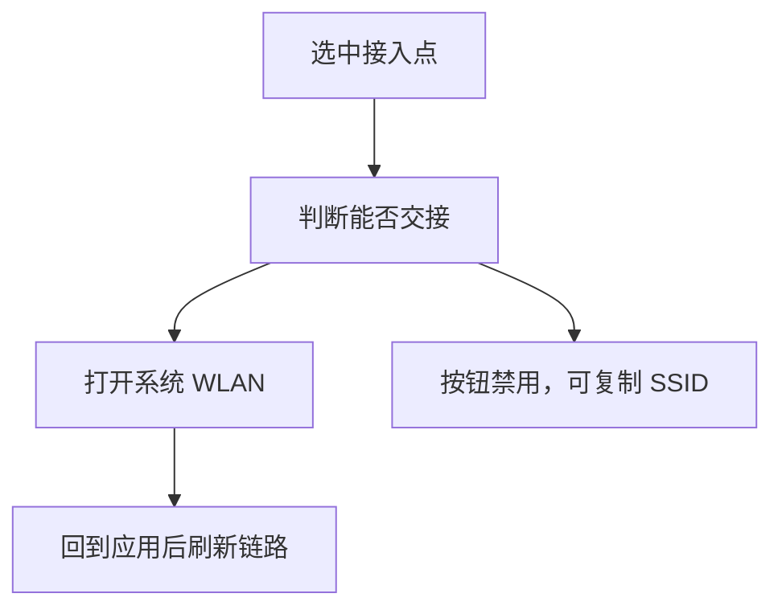

# 交互、连接与诊断

## 总则

扫描、路径检查、局域网探测和协议连接都是长任务：有进行中、可停止、失败可定位。关联 WLAN 与建立协议会话是两条流，不共用一张表单。

## 扫描空口

用户目标：得到一份可阅读的接入点，并知道它是新扫描还是缓存。  
入口：空口标题栏。  
控件：标题栏文字按钮；进行中改为「停止」。  
前置：WLAN 已开，且有 `GET_WIFI_INFO`。主动扫描还要能力允许。

反馈：扫描中顶部进度条，旧列表保持。结束用列表自身更新，不用 Toast 报「扫描成功」。冷却用页内横幅和 `YW-WIFI-1002`。  
暂停：信道图和时间图的「暂停」只冻结绘图，不代表射频停止。  
后台：离开前台不再发起主动扫描。回到前台只刷新缓存时间。  
热区：标题栏动作不小于 40vp × 40vp。筛选芯片高度 28vp，点按热区扩到 40vp。

## 路径检查

用户目标：知道目标从当前网络出发断在哪一跳。  
入口：链路的「检查」或「测这条路径」。目标默认是用户上次使用的主机；没有历史时用一个明确的公网名，并允许改。  
步骤顺序：网络状态、域名解析、TCP、HTTP。与 `NetworkDiagnosticPlan` 一致。  
前一步失败，后面标记跳过，不继续发请求。  
进行中可停止，停止对应 `YW-NET-2202` 的取消语义。  
Trace 若平台只能做近似探测，步骤名写「近似路由」并说明限制，不把结果伪装成 ICMP traceroute。  
Whois 不在默认四步里。只有目标是公网名或公网地址时，检查器里提供附加说明，并写明需要互联网。

## 交给系统连接

用户目标：让系统去关联选中的 SSID。  
入口：详情底栏，或宽屏检查器。列表上的「当前」不是连接按钮。

半模态不收集密码。系统设置是系统界面，返回后模块只重新读取链路和扫描缓存。  
若读到的仍不是目标 SSID，链路保持原关联，并用页内说明「系统没有切到 YoLab-5G」，不显示失败动画假装应用连接失败。

键鼠：宽屏检查器里的主按钮可聚焦。Esc 关闭半模态。不抢系统返回快捷键。

## 局域网发现

用户目标：在当前私网里找有响应的主机。  
入口：主机页「扫描」。网段默认由本机地址推断，可改。  
守卫：`PrivateNetworkGuard` 拒绝公网 CIDR。文案写「仅限私网」，不只写在关于页。  
进行中显示已探测数量，可停止。  
空结果区分两种：网段合法但无响应；当前根本不是 WLAN 私网。后者引导回链路。  
端口扫描默认模板是少量常见端口。用户扩大范围时先对话框确认；超过 256 直接拒绝。UDP 结果写「不确定」，不与 TCP 的开放用同一句「开放」。

## 新建并使用会话

用户目标：对一个主机端口收发报文。  
入口：会话「新建」，或主机详情的「打开」。后者预填地址、端口和建议协议。  
手机：半模态。宽屏：主机检查器内的表单，列表和端口仍可见。  
连接中按钮变为进行中，不可重复提交。超时用 `YW-NET-1002`。端口占用用 `YW-NET-1004` 或 `YW-NET-2102`。  
HTTP 体超过平台限制时展示 `YW-NET-1005`，不截断后假装完整。  
WebSocket 服务端模式仅在能力探测通过时出现，否则该项禁用并标 `YW-CAP-2001`。  
MQTT 连接被拒绝时展示 `YW-MQTT-1002`，订阅被拒绝展示 `YW-MQTT-1004`。  
发送区支持文本与 HEX。HEX 非法时字段下说明，不发送。  
周期发送不在首屏。它留在终端的更多菜单里，并有上限，避免一进终端就开始自动发。

回到前台若会话已死，保留报文，禁用发送，主操作改为重新连接。不静默新建第二条会话。

## 手势与焦点

- 不用屏幕边缘手势、指关节或三指作为扫描、连接或发送的唯一入口。
- 列表行点击进详情。不把收藏、连接只放在长按。
- 宽屏列表行有悬停背景。焦点顺序：透镜、对象列表、画布、检查器主按钮。
- 报文区可滚动，发送栏固定。滚动条在键鼠环境可见。
