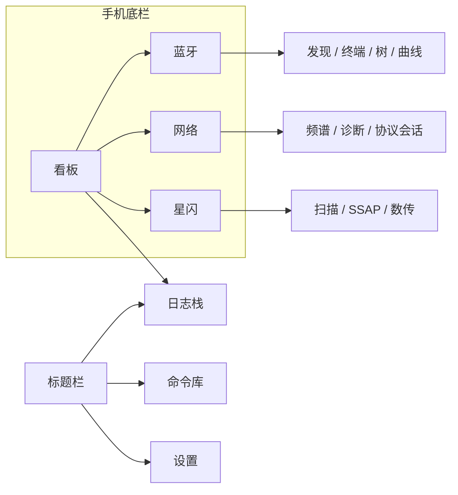

# 导航与页面职责

一个应用，一个 `Navigation` 栈。官方说明：`Navigation` 是根容器，包含导航页与子页；`mode` 为 `Stack`、`Split` 或 `Auto`（窗口宽度 API 10 起以 600vp 为分栏阈值）（[组件导航](https://raw.githubusercontent.com/openharmony/docs/OpenHarmony-5.0.2-Release/zh-cn/application-dev/ui/arkts-navigation-navigation.md)）。跨 HAR 的页面注册沿 `navigation-router` 的 `RouterModule`：每个 HAR 登记 builder，入口只持有 `NavPathStack`（`/tmp/YoAgentResearch/harmonyos_samples--navigation-router`，HEAD `6f81cde`，`RouterModule.ets`）。

## 一级目的地

手机底栏四项，都是并列目的地：

| 目的地 | 根页 | 职责 |
| --- | --- | --- |
| 看板 | `DB-BOARD` | 只观测。指标、状态、趋势、告警、下钻 |
| 蓝牙 | `BT-BOARD` | 经典链路与 BLE 链路的现状。发现、终端、GATT 是子页 |
| 网络 | `NW-BOARD` | 当前关联与环境摘要。频谱、诊断、套接字、HTTP、WebSocket、MQTT 是子页 |
| 星闪 | `NL-BOARD` | 能力与链路。不支持时停在本页。扫描、SSAP、数传是子页 |

日志、命令库、设置从标题栏进入同一条栈，不占底栏。

- 日志 `LOG-STREAM`：跨模块证据。从告警下钻时带过滤参数。
- 命令库 `CMD-LIBRARY`：编辑可复用命令。执行发生在会话上的命令托盘，不发生在库的首页。
- 设置 `SET-ROOT`：偏好与风险开关。按组下钻，组内不是功能入口。

宽屏用 `SideBarContainer`：第一个子组件是侧栏，第二个是内容，且只能有两个子组件（[SideBarContainer](https://raw.githubusercontent.com/openharmony/docs/OpenHarmony-5.0.2-Release/zh-cn/application-dev/reference/apis-arkui/arkui-ts/ts-container-sidebarcontainer.md)）。`multi-nav-bar` 在 `xl` 用嵌入侧栏、宽度 240vp，更窄的宽度用 `Tabs`，`lg` 时页签在起始侧（`Home.ets`，HEAD `a9a49a9`）。YoWire 采用同一断点策略，侧栏项与手机底栏相同的四项。内容区在宽度达到分栏阈值时用 `NavigationMode.Split`，这是 `NavigationSettings` 在非 `sm` 时的做法（`Index.ets`，HEAD `4349e44`）。

`Tabs` 的每个页签对应一个内容视图，子页签不会因为切走就销毁（[Tabs](https://raw.githubusercontent.com/openharmony/docs/OpenHarmony-5.0.2-Release/zh-cn/application-dev/reference/apis-arkui/arkui-ts/ts-container-tabs.md)）。所以底栏只用 `Tabs` 承载四个一级目的地。模块内部的「经典 / 低功耗」「文本 / HEX」用 `SegmentButton`（页签、单选、多选三类，API 11，[SegmentButton](https://raw.githubusercontent.com/openharmony/docs/OpenHarmony-5.0.2-Release/zh-cn/application-dev/reference/apis-arkui/arkui-ts/ohos-arkui-advanced-SegmentButton.md)），放在标题栏自定义区。UI Design Kit 允许在标题栏 `stackBuilder` 放分段按钮、在 `bottomBuilder` 放搜索（[设置自定义区域](https://developer.huawei.com/consumer/cn/doc/HarmonyOS-Guides/ui-design-navigation-customized-area)，更新于 2026-09-09）。

半模态只做短任务：连接参数、过滤、导出、单次写入。官方约束：复杂或冗长流程改用 `Navigation` 转场（[bindSheet](https://raw.githubusercontent.com/openharmony/docs/OpenHarmony-5.0.2-Release/zh-cn/application-dev/ui/arkts-sheet-page.md)）。终端、GATT 树、信道图、诊断步骤都是子页。

## 三类页面，三套语法

| 种类 | 用户问题 | 根页长什么样 | 不长什么样 |
| --- | --- | --- | --- |
| 看板 | 现在怎样 | 状态带、一个焦点数字、告警、趋势 | 入口列表、最近会话、宫格 |
| 模块深度调试 | 这条链路上发生什么、我要操作什么 | 模块自己的板；子页按发现、树、终端、诊断、报文拆开 | 每个模块打开都是「白卡片 + 胶囊连接 + 底部一颗按钮」 |
| 日志 / 命令 / 设置 | 证据、可复用动作、偏好 | 日志是流；命令执行贴在会话上；设置是分组偏好 | 第四个「工具箱」底栏，或「更多」抽屉里再放一组入口 |

专家 / 轻量是同一页的字段密度：专家展开 UUID、错误码、原始 HEX；轻量把这些收进「详细」。它不产生第二套导航。PRD 对两种模式的字段要求仍然有效。

## 相对旧稿改了什么

旧稿指 PR #24、#26、#29，以及 PRD 01 第 3.1–3.4 节，还有 `main` 上 `AppRoutes` 的五个底栏（工作台、蓝牙、网络、星闪、更多）。

**布局逻辑**

| 旧 | 新 |
| --- | --- |
| 工作台是最近会话，或分组入口列表，或模块宫格 | `DB-BOARD` 只有指标、状态、趋势、告警、下钻 |
| 五个底栏，第五个是「更多」 | 四个底栏。设置、日志、命令库在标题栏栈里 |
| 宽屏把同样的五项竖成侧栏；打开日志时侧栏仍高亮工作台 | 侧栏只有四项。日志在栈里；宽屏下钻告警时，右栏是过滤后的日志，侧栏高亮保持来源目的地 |
| 蓝牙、网络、星闪的第一屏都是扫描列表壳 | 第一屏分别是 `BT-BOARD`、`NW-BOARD`、`NL-BOARD`。发现列表只属于发现页 |
| 命令面板是全局一屏按钮 | 命令库是编辑页。执行用会话上的半模态托盘；宽屏时托盘落在分栏右栏 |
| 连接、过滤、整段 GATT 都有人画成同一种底部弹层 | 半模态只留短任务。树、终端、诊断是 `Navigation` 子页 |

**功能设计**

| 旧 | 新 |
| --- | --- |
| 打开应用是为了选择要进的工具 | 打开应用是为了读当前链路。进入模块是底栏或下钻，不是看板上的菜单 |
| 最近会话是首页主体 | 活跃会话是看板上的一个计数和告警行的对象。完整证据在 `LOG-STREAM` 与各终端 |
| 模块首页列出「经典 / BLE / 扫描 / 诊断 / 协议」入口 | 这些能力是子页，从模块板的焦点动作或告警进入，模块板本身展示读数 |
| 空态共用「中间一句说明 + 底部一颗按钮」 | 空、加载、失败、关射频、无权限、能力不支持各有文案和唯一主按钮。星闪不支持时没有「去扫描」 |
| 网络把环境分析、诊断、协议调试排成三行入口 | 三件事用三种页面：频谱分栏、诊断运行、协议会话 |
| 换一套宇宙蓝和雪域灰，列表结构不动 | 色彩仍用系统 token，但先改信息架构。见 [VISUAL-LANG.md](VISUAL-LANG.md) |

`network-query` 的首页是四颗全宽按钮，分别推入连接、感知、定位、排障（`Index.ets`，HEAD `42c7516`）。那是示例的启动器。YoWire 吸收它的四个目的地类型，不把按钮列表做成看板或网络根页。

星闪官方示例 `MainPage.ets` 把广播开关、开始/停止扫描和扫描结果放在同一页，再加一颗「Ssap Service」按钮（HEAD `d211493`）。那是接口演示。YoWire 把能力、扫描、SSAP、数传拆成不同页。

## 返回

子页返回模块板。终端返回时若链路仍在，标题栏保留「后台保持 / 断开」选择，规则沿用 PRD：设置里关闭后台长连接时，返回默认提示断开。从告警进入的子页，返回看板并保持滚动位置。从日志详情返回日志流。
