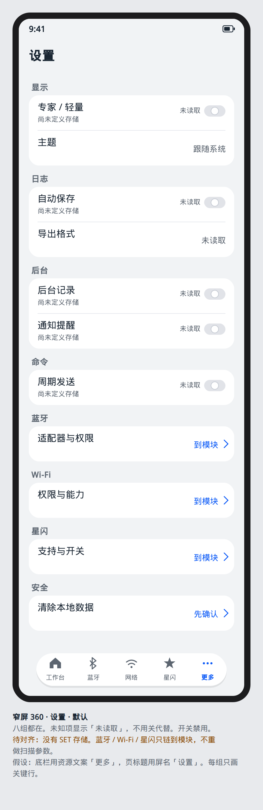
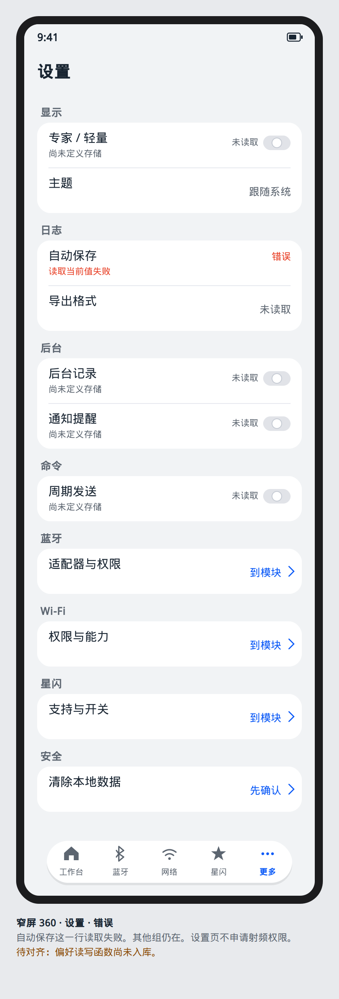

# 设置

设计屏号 `screen.settings.hub`。路由 `/more/hub`，槽位下标 4。`main` 上的 `MoreFeaturePage` 是空壳。

PRD 01 把设置分成显示、日志、后台、命令、蓝牙、Wi-Fi、星闪、安全。功能 Goal 没有 SET 架构编号，也没有入库的偏好读写函数。本屏把这些组画成列表分组，开关只改变页面状态里的展示意图。落盘接口等架构入库后再接，本文件不新命名。

## 布局

`ROOT_TAB`。一条 `List`，组用 `ListItemGroup`。组标题是 PRD 的八组。每行左标签、右 `Toggle` 或一行当前值。不把八组合成没有标题的长列表。

窄屏单列。不小于 600vp 时仍是一列，宽度不超过 `YoResponsive.CONTENT_MAX_WIDTH`，不把设置做成双栏仪表盘。

专家 / 轻量是「显示」组的第一行。它影响之后新打开页面的默认密度。已经打开的页面保持打开时的密度，直到用户离开再进入。这与 PRD 01 的模式规则一致，不在每个模块再做一套全局开关。

深浅色不在这里做三套主题。跟随系统。颜色规则见 [深浅色](../app-shell/color-scheme.md)。

## ArkUI 组件树

```text
YoPageShell
└── List
    └── ListItemGroup
        └── ListItem
            └── Row
                ├── Text
                └── Toggle                 // 仅二态项
AlertDialog                                 // 清除本地数据之前
```

`Toggle` 专页：`开发/API参考/…/ArkTS组件/按钮与选择/Toggle.md`。样例开关在 HarmonyOSComponentUXExamples 的 `components/select/toggle/`。不恢复已删除的 `YoSwitchRow`。

清除本地数据的确认用 `AlertDialog`。确认前不调用删除。

## 状态矩阵

| 态 | 本屏 |
| --- | --- |
| 默认 | 八组都在。开关显示页面状态里的当前值。未知项显示「未读取」，不用关代替未知 |
| 按下 | 行按下只展开说明。`Toggle` 松手后才提交意图 |
| 禁用 | 没有架构编号的项保持可见但 `Toggle` 禁用，原因「尚未定义存储」。这样不会假装已经能保存 |
| 空 | 不用空页。八组是固定结构。没有一项是「没有数据」 |
| 错误 | 读取当前值失败：该行 `YoError` 的一句原因，其他组仍在 |
| 加载 | 首次进入 `YoLoading`「正在读取设置」。读取结束前不把开关画成关 |
| 无权限 | 设置页不申请蓝牙、星闪或 WLAN 权限。后台与日志组若涉及系统权限，行上写「到对应模块查看」，点击只导航，不弹框 |

## 编号追溯

| 组 | 影响哪类屏幕 | 架构编号 |
| --- | --- | --- |
| 显示 | 全部模块的密度 | 无 |
| 日志 | 日志中心与各模块会话日志的导出格式 | 呈现仍是 BT-090、NL-109、WN-128。存储无 SET 编号 |
| 后台 | 蓝牙回连页的长时任务说明 | 文案对齐 BT-094、BT-095。不在设置页申请任务 |
| 命令 | 命令面板的周期按钮是否可点 | 无 |
| 蓝牙 / Wi-Fi / 星闪 | 只链到各模块已有屏幕，不在这里重做扫描参数 | BT、WN、NL 的既有编号 |
| 安全 | 清空前的确认 | 无。高风险动作本身在各模块缺口墙里已经禁止的，这里不重新打开 |

工作台入口：底栏「更多」，不是工作台卡片。槽 0 不重复放一整页设置。

## 可视化原型

静态图，不是页面实现。底栏文案是「更多」，页标题用屏名「设置」。



默认：八组都在。未知项是「未读取」，开关禁用，原因「尚未定义存储」。



错误：自动保存这一行读取失败，其他组仍在。
# 更多

槽位 4。标题资源现为「更多」，底栏也是「更多」。不把底栏改成「设置」；页内 `SubHeader` 可以用「显示」「记录」这类分组名，分组是否与 PR #20 的设置清单一致，等 `docs/goal/checklist/settings.md` 进 `main` 再对名称。本页先固定能从界面上核对的四组，不把未进主干的八组写成已经存在。

`main` 上 `MoreFeaturePage` 是空壳。

## 布局

`List` 分组，行 56vp：名称 Body_L，次行当前值 Body_S 或「未读取」，行尾箭头。点行打开 `bindSheet` 编辑，不 push 大量子页。

组：

1. 显示。一行「主题」。sheet 里 `SegmentButton`「跟随系统」「浅色」「深色」。主按钮「完成」。值未读到时次行「未读取」，SegmentButton 无选中项，完成按钮禁用。
2. 记录。一行「日志」文字按钮行，点击 push 日志中心。没有第二套日志开关。
3. 关于。一行，次行版本号或「未读取」。sheet 只读，无主按钮。

没有「清除数据」。没有专家/轻量开关。这两项在未合并清单里是缺口，本视觉不先画一个不能接线的开关。

本页不申请蓝牙、星闪、WLAN 权限。

宽屏：列表最大宽 600vp，sheet 居中。

## 组件树

```text
NavDestination 「更多」
  List
    ListItemGroup
      SubHeader 「显示」
      ListItem 56 「主题」 次行 当前值|「未读取」
    ListItemGroup
      SubHeader 「记录」
      ListItem 56 「日志」
    ListItemGroup
      SubHeader 「关于」
      ListItem 56 「版本」
bindSheet 主题
  SegmentButton 三项
  Button EMPHASIZED 「完成」  未读到值时禁用
```

## 状态

| 态 | 界面 |
| --- | --- |
| 默认 | 主题次行是三选一的当前词。版本有字 |
| 按下 | 行按压后开 sheet。完成按下 |
| 禁用 | 值未知：完成禁用，SegmentButton 不显示假选中 |
| 空 | 不把整页收成空插画。三组始终在，值用「未读取」 |
| 错 | 出错的那一行次行改为 status.error 的短消息，其他行保持 |
| 加载 | 次行位置 LoadingProgress，行不可开 sheet |
| 无权限 | 无权限墙 |

## 对照

采用家居模板「我的」的分组列表（登录、权限、关于那一列的行结构），不用它的插画和头像。主题 sheet 用一颗主按钮。不采用扫描、WLAN 双机、四格诊断、控制台、FastBle、体温卡。
