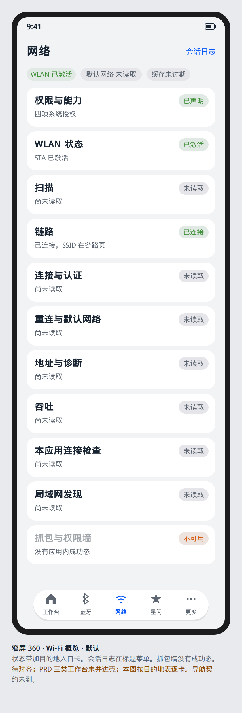
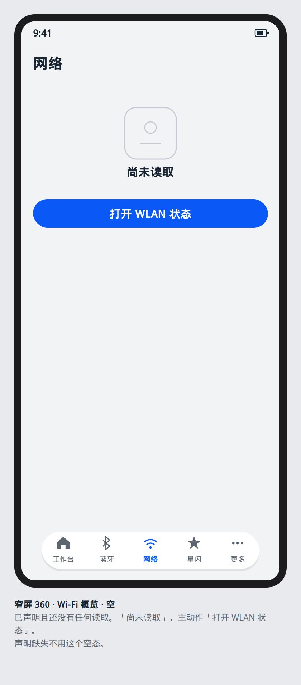
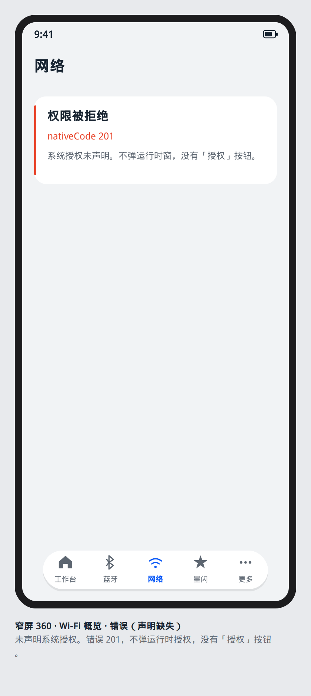

# 壳与导航

网络调试从现有应用壳进入。产品入口保持 `product/phone` 的 `MainTabContainer`：工作台、蓝牙、网络、星闪、更多。网络槽渲染 `features/wifi_network` 的 `WifiFeaturePage`。本设计只增加该 Tab 内部的 `NavDestination`，不新增底栏项，不把目的地注册到蓝牙或星闪。

## 信息架构

概览是导航栏内容，`YoNavDestinationKind.ROOT_TAB`，底栏保持可见。其余屏幕入栈后为 `MODULE`；单对象详情为 `OBJECT`；本应用连接检查为 `TERMINAL`；确认连接为 `MODAL`。

| 目的地 | 层级 | 标题 | 从概览进入 |
| --- | --- | --- | --- |
| 网络概览 | `ROOT_TAB` | 网络 | 当前 Tab |
| 权限与能力 | `MODULE` | 权限与能力 | 入口卡 |
| WLAN 状态 | `MODULE` | WLAN 状态 | 入口卡 |
| 扫描 | `MODULE` | 扫描 | 入口卡 |
| 接入点详情 | `OBJECT` | SSID 或「隐藏网络」 | 扫描行 |
| 信道 | `OBJECT` | 信道 | 扫描页菜单 |
| 链路 | `MODULE` | 链路 | 入口卡 |
| 连接与认证 | `MODULE` | 连接 | 入口卡，不从扫描行直达 |
| 重连与默认网络 | `MODULE` | 默认网络 | 入口卡 |
| 地址与诊断 | `MODULE` | 地址与诊断 | 入口卡 |
| 吞吐 | `MODULE` | 吞吐 | 入口卡 |
| 本应用连接检查 | `TERMINAL` | 连接检查 | 入口卡 |
| 局域网发现 | `MODULE` | 局域网 | 入口卡 |
| 抓包与权限墙 | `MODULE` | 权限墙 | 入口卡 |
| 会话日志 | `MODULE` | 会话日志 | 标题菜单，各页可开 |

路由名注册在 `features/wifi_network` 自己的路由表。跳转用 `NavPathStack.pushPath`，返回用 `pop`。网络 Tab 的 `NavPathStack` 与蓝牙、星闪的栈分开，不复用。

`<600vp` 用 `NavigationMode.Stack`：进入子页后整页替换，`YoPageShell.showBack = true`。`≥600vp` 用 `Auto`：左栏保留概览入口，右栏替换子页，宽度比 4:6，与 `YoSplitScaffold`、`YoNavigationToken` 一致。`≥840vp` 时应用壳已经是侧栏，网络内部仍是这一套分栏，侧栏项数量不变。

标题栏由 `YoPageShell` 的 `HdsNavigation` 提供。会话日志放进 `YoTitleBarMenuItem`，键为 `sessionLog`。扫描页另有导出与排序菜单。对话框表面才用 `YoTitleBarActionRow`。

页面 `onHidden` 时页面状态取消本页订阅。再次 `onShown` 时重新登记一次。同一次系统回调只产生一行日志。这是 WN-131 在导航上的可见结果。

## 概览密度

概览是调试入口，不是仪表盘。

- 顶部一条状态带：WLAN 激活与否、默认网络 `netId`、缓存扫描是否过期。三项都用 `YoStatusPill`。
- 下面是 `YoModeEntryCard` 网格。`<600vp` 一列；`600–839vp` 两列；`≥840vp` 仍两列，单卡不超过 8 栅格。列间距 12vp，页边距走 `YoResponsive.pageHorizontal`。
- 每张卡：标题、一枚状态胶囊、一行当前事实。事实示例：「缓存 12 秒前」「STA 未打开」「本机不支持 801」。
- 拒绝类入口的胶囊色为 `warning` 或 `neutral`，文案是「需系统设置」或「未提供」。卡可以点进说明页。卡内不放会执行该能力的按钮。
- 概览不放密钥框、不放测速进度、不放 AP 全表。

安全区由 `YoPageShell` 扩展系统栏。内容留在安全区内。折叠屏折痕上不放主按钮；宽窗分栏时主按钮留在右栏底部动作区。

## 组件

`YoAppShell` 的 `items` 仍由 Entry 注入，文案继续用现有 `tab_network`。特性页只组合 `YoPageShell` 与 `YoModeEntryCard`。按下、禁用、空、错误、加载走 `YoContentState`。

## 状态

### 默认

网络 Tab 选中。概览 `YoPageState.CONTENT`。每张入口卡显示该组最后一次终态。尚未读取的组显示「未读取」，胶囊为 `neutral`。

### 按下

底栏或侧栏项、入口卡在按下时透明度为 `YoOpacity.PRESSED`。松手后导航完成，透明度回到 `YoOpacity.ENABLED`。标题菜单项按下后入栈会话日志。

### 禁用

底栏五项始终可切换。入口卡在对应能力正在加载时 `disabled = true`，`disabledReason` 为「读取中」。拒绝类卡片保持可点，以便打开说明。壳上不提供洪泛、阻断其他应用、密码破解的入口（WN-132）。这些词不出现在菜单里。

### 空

四项系统授权已声明，且还没有任何一次读取时，内容区用 `YoEmpty`：标题「尚未读取」，说明「从 WLAN 状态或扫描开始」，主动作「打开 WLAN 状态」。这是合法空态。声明缺失时不使用这个空态（WN-001 的失败落到错误）。

### 错误

打开网络 Tab 时若 `GET_WIFI_INFO`、`SET_WIFI_INFO`、`GET_NETWORK_INFO` 或 `INTERNET` 未声明，概览进入 `ERROR`。`YoError.userMessage` 为「权限被拒绝」，`nativeCode` 为 `201`，`nextStep` 指向对应的子页。不弹出运行时授权（WN-001）。错误页仍可返回，底栏仍在。

### 加载

首次进入用 `YoLoading`，文案「正在核对权限声明」。核对结束就离开加载。设备返回 801 时加载结束，入口卡胶囊为「本机不支持 801」（WN-006）。

## 离开与返回

子页系统返回调用 `NavPathStack.pop`。栈空时停在概览，不退出应用，也不切到蓝牙或星闪。分栏时左栏始终是概览，右栏弹出后显示「选择一项调试能力」的 `YoEmpty`，主动作留空。

## 依据

- `开发/指南/开发/应用框架/ArkUI（方舟UI框架）/UI开发 (ArkTS声明式开发范式)/设置组件导航和页面路由/组件导航和页面路由概述.md`
- `开发/指南/开发/应用框架/ArkUI（方舟UI框架）/UI开发 (ArkTS声明式开发范式)/设置组件导航和页面路由/组件导航(Navigation) (推荐)/Navigation基础架构介绍.md`
- `开发/指南/开发/应用框架/ArkUI（方舟UI框架）/UI开发 (ArkTS声明式开发范式)/设置组件导航和页面路由/组件导航(Navigation) (推荐)/Navigation页面路由.md`
- `设计/设计指南/通用设计基础/布局/响应式应用架构.md`
- `common/youi_kit/src/main/ets/components/shell/YoAppShell.ets`
- `common/youi_kit/src/main/ets/components/shell/YoNavDestinationKind.ets`
- `docs/goal/architecture/wifi-network/WN-001.md`
- `docs/goal/architecture/wifi-network/WN-131.md`
- `docs/goal/architecture/wifi-network/WN-132.md`
when: design
related:
  - docs/goal/ui/app-shell/navigation.md
  - docs/goal/ui/wifi-network/README.md
  - product/phone/src/main/ets/shell/MainTabContainer.ets
---

# 网络目的地

Phase-C 把网络写成独立 `NavPathStack`，并在不小于 600vp 时使用 `NavigationMode.Auto`。这与 `main` 上 `Index.ets` 的单栈、`NavigationMode.Stack` 冲突，也与蓝牙壳冲突。该两句作废。断点与分栏以 [导航](../app-shell/navigation.md) 为准：一条根栈，页内 `YoSplitScaffold`。

网络仍是下标 2，路由 `/wifi/overview`。不把目的地注册到蓝牙或星闪。

## 布局

概览是 `ROOT_TAB`。顶部一条状态带，下面是入口卡。小于 600vp 一列；600–839vp 两列；不小于 840vp 仍两列，单卡不超过内容区的一半。不放密钥框、测速进度或 AP 全表。

## ArkUI 组件树

```text
YoPageShell
└── Column
    ├── Row
    │   └── YoStatusPill              // WLAN、默认网络、缓存是否过期
    └── GridRow
        └── GridCol
            └── YoModeEntryCard
NavDestination
└── 子屏组件树见各文件
```

会话日志放在 `YoTitleBarMenuItem`，键沿用 Phase-C 的 `sessionLog`。确认连接用 `bindSheet` 或 `AlertDialog`，不用第二套对话框组件。

## 状态矩阵

| 态 | 本屏 |
| --- | --- |
| 默认 | 网络 Tab 选中。每张入口卡显示该组最后一次终态。尚未读取显示「未读取」，胶囊 `neutral` |
| 按下 | 入口卡按下透明度 `YoOpacity.PRESSED`。松手后 push。底栏切换先 pop |
| 禁用 | 五项都可切换。入口卡在该组加载时 disabled，原因「读取中」。拒绝类卡片保持可点，以便阅读说明。不提供洪泛、阻断或其他应用破解入口（WN-132） |
| 空 | 四项系统授权已声明且还没有任何读取：`YoEmpty`「尚未读取」，主动作「打开 WLAN 状态」。声明缺失不用这个空态 |
| 错误 | `GET_WIFI_INFO`、`SET_WIFI_INFO`、`GET_NETWORK_INFO` 或 `INTERNET` 未声明时概览 `ERROR`，`nativeCode` 201，不弹运行时授权（WN-001） |
| 加载 | 首次 `YoLoading`「正在核对权限声明」。801 到达后加载结束，胶囊「本机不支持 801」（WN-006） |
| 无权限 | 声明缺失是错误 201，不是运行时权限墙。对端 MAC、本机 MAC 的受限显示在权限与能力页（WN-008、WN-009） |

## 编号追溯

| 项 | 值 |
| --- | --- |
| 设计屏 | `wifi-network/shell-and-navigation` |
| 架构编号 | WN-001、WN-006、WN-131、WN-132，以及下表 |
| 架构 PR | https://github.com/yohurm/HarmonyOS-YoWireTools/pull/7 |
| 工作台入口 | 槽 0 的网络卡片。无 WB 编号 |

| 目的地 | 层级 | 文档 | 编号 |
| --- | --- | --- | --- |
| 权限与能力 | `MODULE` | [permissions-and-capability.md](permissions-and-capability.md) | WN-001–WN-010 |
| WLAN 状态 | `MODULE` | [wlan-state.md](wlan-state.md) | WN-011–WN-018 |
| 扫描 | `MODULE` | [scan-filter-channel.md](scan-filter-channel.md) | WN-019–WN-039 |
| 链路 | `MODULE` | [link.md](link.md) | WN-040–WN-050 |
| 连接与认证 | `MODULE` | [connect-and-auth.md](connect-and-auth.md) | WN-051–WN-064 |
| 重连与默认网络 | `MODULE` | [reconnect-and-default-network.md](reconnect-and-default-network.md) | WN-065–WN-073 |
| 地址与诊断 | `MODULE` | [address-dns-route-ports.md](address-dns-route-ports.md) | WN-074–WN-090 |
| 吞吐 | `MODULE` | [throughput.md](throughput.md) | WN-091–WN-096 |
| 本应用连接检查 | `TERMINAL` | [in-app-connection-inspect.md](in-app-connection-inspect.md) | WN-097–WN-111 |
| 局域网发现 | `MODULE` | [lan-discovery.md](lan-discovery.md) | WN-112–WN-117 |
| 抓包与权限墙 | `MODULE` | [capture-boost-permission-walls.md](capture-boost-permission-walls.md) | WN-118–WN-127 |
| 会话日志 | `MODULE` | [session-log.md](session-log.md) | WN-128–WN-132 |

离开子页时页面状态成对取消订阅。同一次系统回调只产生一行日志（WN-131）。页面不调用 `@kit.ConnectivityKit` 或 `@kit.NetworkKit`。

## 可视化原型

静态图，不是页面实现。网络是底栏第三槽。会话日志在标题菜单。



默认：状态带和目的地入口卡。抓包与权限墙没有成功态。



空：尚未读取，主动作「打开 WLAN 状态」。声明缺失不用这个空态。



错误：系统授权未声明，`nativeCode` 201，不弹运行时窗。
