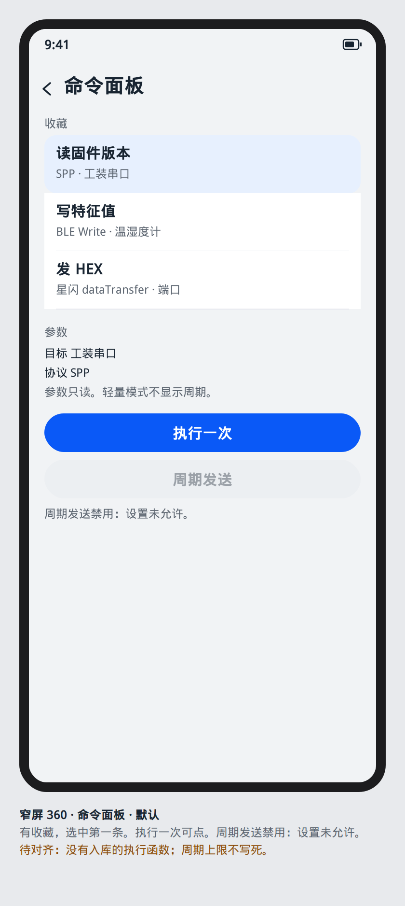
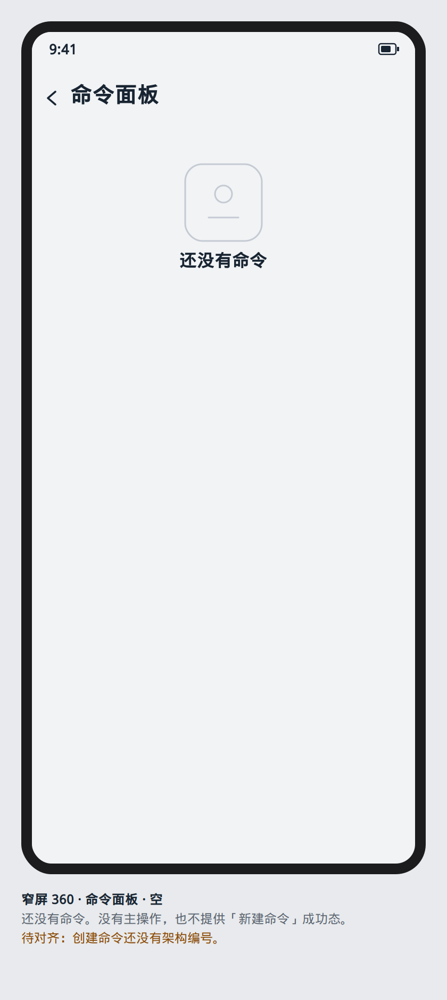
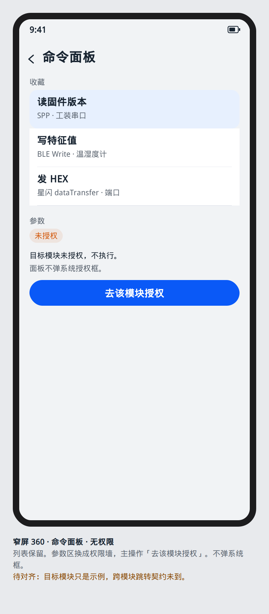

# 命令面板

设计屏号 `screen.workbench.command`。从工作台进入，层级 `MODULE`。

PRD 02 要求命令可复用到 SPP、BLE Write、Socket 和星闪 dataTransfer。功能 Goal 没有给命令面板架构切片，也没有入库的执行函数名。本屏只规定操作如何呈现。执行意图交给页面状态。页面不调用 Kit，也不新命名 Repository。

## 布局

上：收藏列表，主行是命令名，次行是协议和目标摘要。
下：选中命令的只读参数。专家模式显示周期与超时。轻量模式隐藏周期，只留发送。
底：主按钮「执行一次」。周期发送是次按钮，默认不可用，直到设置里打开允许，并且页面状态给出上限。本屏不写死上限数字，避免和未入库的架构冲突。

窄屏上下堆叠。不小于 600vp 时 `YoSplitScaffold` 左列表右参数，4:6。

## ArkUI 组件树

```text
NavDestination
└── YoPageShell
    └── YoSplitScaffold
        ├── List
        │   └── ListItem
        │       └── Column
        │           ├── Text
        │           └── Text
        └── Column
            ├── Text
            ├── Text                         // 目标、协议，MONO_S
            ├── YoActionButton               // 执行一次，Button
            └── YoActionButton               // 周期，默认禁用
AlertDialog                                  // 停止周期前确认
```

没有 `YoTextField`。若以后要改参数，输入用 `TextInput`，本阶段参数只读，因为没有已入库的编辑接口。

## 状态矩阵

| 态 | 本屏 |
| --- | --- |
| 默认 | 有收藏。选中第一条。主按钮可点。周期按钮禁用并说明原因 |
| 按下 | 行按下只选中。执行按钮松手后才把一次执行交给页面状态 |
| 禁用 | 没有选中、目标模块未连接、或上一次尚未终态时，执行禁用，原因可见。周期在设置未允许时保持禁用 |
| 空 | 没有收藏：`YoEmpty`「还没有命令」，没有主操作。不提供「新建命令」成功态，直到有架构编号描述创建 |
| 错误 | 执行终态失败：参数区 `YoError`，保留错误码。列表不删除该命令 |
| 加载 | 执行未终态：主按钮 `loading`，标签「执行中」。终态到达后离开加载 |
| 无权限 | 目标模块未授权时不执行。参数区换成该模块的权限墙文案，主操作「去该模块授权」。面板自己不弹系统授权框 |

## 编号追溯

| 项 | 值 |
| --- | --- |
| 设计屏 | `screen.workbench.command` |
| 架构编号 | 无。不把 PRD 02 的章节号写成 WB 或 LOG 切片 |
| 工作台 | 从 `screen.workbench.home` 进入。槽 0 |
| 相关能力 | 执行结果若写入会话，呈现规则同各模块日志：BT-090、NL-107、WN-128。写到哪一个日志对象，见 [日志中心](../log/center.md) 的缺口 |

## 可视化原型

静态图，不是页面实现。从工作台进入，窄屏不显示底栏。



默认：有收藏，选中第一条；「执行一次」可点，「周期发送」因设置未允许而禁用。



空：还没有命令，没有主操作。



无权限：列表保留，参数区换成「去该模块授权」，不弹系统框。
# 命令面板

从工作台 push。目标名对应架构 `/command/list`。`main` 上没有这页。模式：list + 一次执行。不是周期发送的控制台；周期若契约没有，界面不画间隔输入框。

## 布局

标题「命令」。`List` 56vp：命令名 Body_L，次行 Body_S 为参数摘要或「无参数」。点行选中，选中行 brand 浅底。

底部固定栏：主按钮「执行一次」。未选中时 enabled false。执行中按钮「正在执行」+ LoadingProgress，列表仍可滚动但不可改选中。

结果不占新页：按钮上方一行 Body_S，成功用 text.secondary，失败用 status.error。无结果时这行不占位。

空：Body_M「还没有命令」，底栏按钮禁用。

宽屏：左列表 320vp，右栏是选中项的只读参数，标签/值同链路详情。窄屏参数只在次行，不 push。

执行需要哪一路会话，界面不猜。ViewModel 没有焦点会话时，结果行写「没有可执行的会话」，按钮禁用。文案可以显示，不表示功能编号已经在 `main` 验收。

## 组件树

```text
NavDestination 「命令」
  Column
    List layoutWeight 1
      ListItem 56
        Text Body_L 名称
        Text Body_S 参数摘要
    Text Body_S 结果  可选
    Row padding 16
      Button EMPHASIZED 「执行一次」
```

## 状态

| 态 | 界面 |
| --- | --- |
| 默认 | 有行，选中一行，按钮可点 |
| 按下 | 行按压后成为选中。按钮按下 |
| 禁用 | 无选中或无会话：按钮禁用 |
| 空 | 「还没有命令」，无选中底 |
| 错 | 结果行 status.error，选中保留，按钮恢复「执行一次」 |
| 加载 | 「正在执行」，按钮禁用，行不可改选中 |
| 无权限 | 若执行被权限挡住：不换整页墙。结果行写 ViewModel 的权限句，并给文字按钮「去授权」 |

## 对照

采用 WLAN 的只读详情（宽屏）和一颗主按钮。不采用扫描雷达、wifi 密码、四场景、IKConsole 的多页签、家居海报、FastBle、数据卡。
