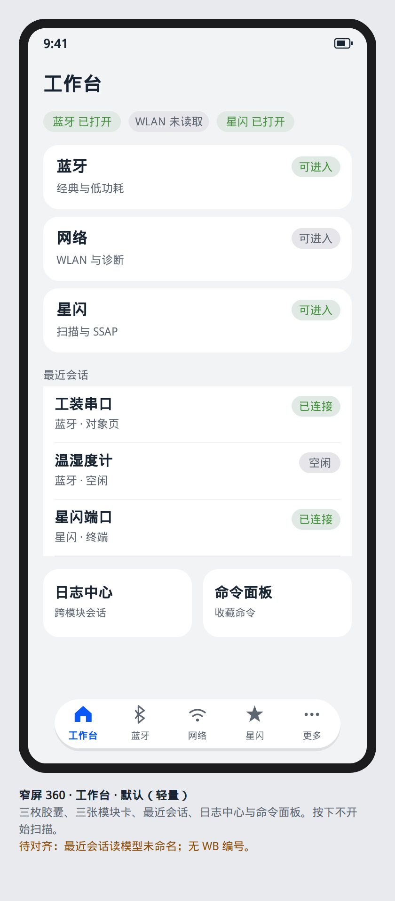
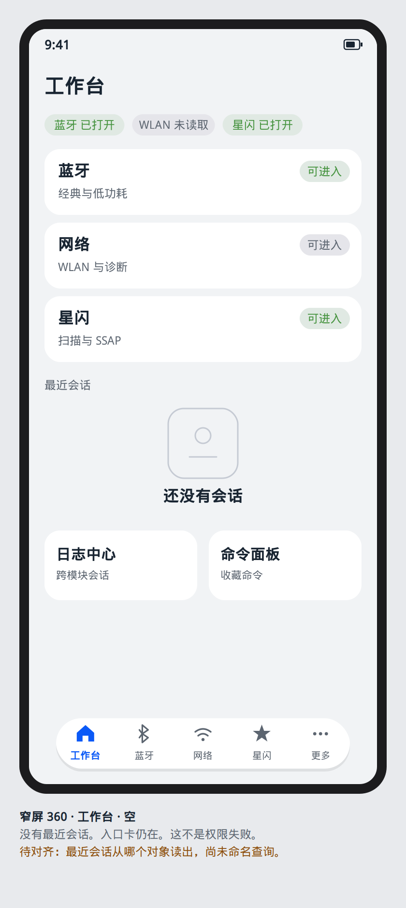

# 工作台

设计屏号 `screen.workbench.home`。路由 `/home/workbench`，槽位 `AppRoutes.TAB_INDEX_WORKBENCH` = 0。`main` 上的 `HomeFeaturePage` 是空壳。本屏只规定看见什么。

没有 WB 架构编号。功能 Goal 的已打开 PR 未给工作台切片。最近会话从哪个对象读出，本屏不新命名查询函数。页面只读页面状态。

## 布局

`ROOT_TAB`。自上而下四块，间距 `YoSpace.XL`：

1. 状态条：蓝牙、WLAN、星闪各一枚胶囊。事实来自各模块已经定义的状态句，工作台不重算。
2. 三张模块入口卡：蓝牙、网络、星闪。
3. 最近会话列表，最多五行。点一行进入该模块里已经存在的对象页或终端。
4. 两张次入口：日志中心、命令面板。

窄屏一列。不小于 600vp 时入口卡用 `GridRow` 三列，列表仍在下方，不把工作台做成 `NavigationMode.Split`。不小于 840vp 时应用壳已经是侧栏，本页结构不变。

轻量模式只留入口卡、最近会话和三枚状态胶囊。专家模式在状态条下多一行：后台记录是否开启、日志占用。模式开关在设置页，不在本页发明第二套模式存储。

## ArkUI 组件树

```text
YoPageShell                              // ROOT_TAB，HdsNavigation 标题「工作台」
└── Column
    ├── Row
    │   ├── YoStatusPill                  // 蓝牙
    │   ├── YoStatusPill                  // WLAN
    │   └── YoStatusPill                  // 星闪
    ├── GridRow
    │   └── GridCol
    │       └── YoModeEntryCard
    ├── List
    │   └── ListItem                      // accessibilityGroup，朗读名称与状态
    │       └── Row
    │           ├── Text
    │           └── YoStatusPill
    └── Row
        ├── YoModeEntryCard               // 日志中心
        └── YoModeEntryCard               // 命令面板
```

## 状态矩阵

| 态 | 本屏 |
| --- | --- |
| 默认 | 三枚胶囊显示各模块最后一次已知状态。未读取为「未读取」，`neutral`。入口卡可点 |
| 按下 | 卡片和会话行用 `YoColor.INTERACTIVE_PRESSED`。松手才切换 Tab 或 push。按下不开始扫描 |
| 禁用 | 模块在模拟器或能力不支持时，卡片仍可点，用来阅读该模块的不可用说明。不把卡片 disabled 成无法查看缺口 |
| 空 | 没有任何最近会话：列表区 `YoEmpty`「还没有会话」，主操作留空。模块入口仍在。这不是权限失败 |
| 错误 | 某一模块的最近一次终态是错误时，只在该胶囊上用 `error`，不把整页换成 `YoError` |
| 加载 | 三个状态都还没有快照时，状态条 `YoLoading`「正在读取状态」。入口卡仍可点进模块，由模块页自己加载 |
| 无权限 | 工作台不弹授权。胶囊写「未授权」时点卡片进入该模块，权限墙在模块里按 [权限墙](../app-shell/permission-gap-wall.md) 显示 |

## 编号追溯

| 区域 | 去向 | 架构编号 |
| --- | --- | --- |
| 蓝牙卡片 | `/bluetooth/overview` | BT-001 起，见适配器页 |
| 网络卡片 | `/wifi/overview` | WN-001 起 |
| 星闪卡片 | `/nearlink/overview` | NL-001 起 |
| 最近会话行 | 该会话所属模块的对象页或终端 | 行上的模块编号。没有统一会话架构号 |
| 日志 | [日志中心](../log/center.md) | 无 LOG 编号。行内容对应 BT-086–BT-090、NL-107–NL-109、WN-128–WN-132 |
| 命令面板 | [命令面板](command-panel.md) | 无架构编号。PRD 02 |

PR #1（`cursor/workbench-feature-hub-434e`）有未合并的工作台草稿。本设计不把它的用例签名当成已入库接口。

## 可视化原型

静态图，不是页面实现。窄屏逻辑宽 360vp。



默认（轻量）：三枚状态胶囊、三张模块卡、最近会话、日志中心与命令面板。



空：没有最近会话，入口卡仍在。

宽屏同一壳见 [侧栏展开的工作台](../prototypes/wide-shell-workbench.png)。清单见 [原型索引](../prototypes/README.md)。
# 工作台

槽位 0，标题「工作台」。`main` 上 `HomeFeaturePage` 是空 `Column`。目标布局是最近会话的扫描列表头，而不是三张模块海报。底栏已经能进蓝牙、网络、星闪，工作台不再放三张入口卡。

读哪些会话等 PR #21 的读模型对齐。对齐前这一屏的绑定标成未接线：界面规格仍按下面画，实现时若 ViewModel 没有行，只能出空态，不能填示例 SSID 或示例 MAC。

## 布局

标题下不放 Title_M 大字（标题栏已经是「工作台」）。第一行是文字按钮「日志」和「命令」，右对齐，高度 40。它们 push 日志中心和命令面板，不是底栏项。

其下 `SubHeader`「最近」。`List` 行 64vp：左 24vp 图标按模块（蓝牙、网络、星闪，资源名核对后再用），主行会话标题 Body_L，次行时间 Body_S。行点击 push 到该会话已有的终端；没有目标路由时行仍显示，点击不跳，次行追加「不能打开」。

无行：不显示 SubHeader。Body_M「还没有会话」，没有雷达，没有「搜索成功」。

不显示三枚射频总开关。开关在各模块概览。

宽屏：列表最大宽 600vp。两个文字按钮留在右上。

## 组件树

```text
NavDestination 「工作台」  根槽，无返回
  Column
    Row padding 16
      Blank
      Button TEXTUAL 「日志」
      Button TEXTUAL 「命令」
    SubHeader 「最近」  仅有行
    List
      ListItem 64
        SymbolGlyph 24
        Column Text 标题 / Text 时间
    空时 Column
      Text Body_M 「还没有会话」
```

## 状态

| 态 | 界面 |
| --- | --- |
| 默认 | 有会话行。日志、命令可点 |
| 按下 | 行按压。文字按钮按下 |
| 禁用 | 某一行 ViewModel 标成不能打开：文字 text.disabled，无按压，次行「不能打开」 |
| 空 | 「还没有会话」。日志和命令仍在 |
| 错 | 列表区换成 Body_M status.error 消息。两个按钮仍在 |
| 加载 | SubHeader 位置 LoadingProgress「正在读取」。不展示假行 |
| 无权限 | 工作台不申请射频权限，无权限墙 |

## 对照

采用扫描列表的「没有行就不要成功态」，采用 WLAN 的双行列表，采用家居模板仅限于底栏不在本页重复。不采用连接 sheet、四场景、控制台（命令和日志是下一屏）、FastBle、体温卡、wifi 密码框。
